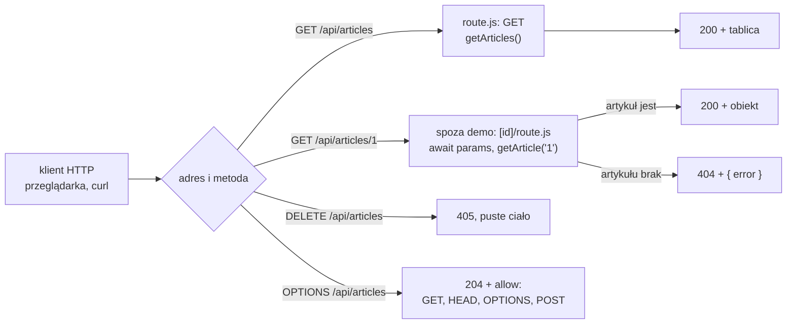

# Własne API w katalogu `app/api`

## Adres HTTP dla danych z magazynu

Kod w przeglądarce, skrypt w terminalu albo aplikacja mobilna nie zaimportują `lib/store.js`, więc potrzebują zwykłego adresu HTTP. W App Routerze taki adres daje **Route Handler**, czyli plik `route.js` z funkcjami nazwanymi jak metody HTTP.

> **„Route Handlery pozwalają tworzyć własne procedury obsługi żądań dla danej trasy, używając webowych API Request i Response.”**
>
> *„Route Handlers allow you to create custom request handlers for a given route using the Web Request and Response APIs.”*
>
> — dokumentacja Next.js, *Route Handlers*

Schwarzmüller w *React Key Concepts* opisuje taki plik krótko. To trasa, która „nie renderuje komponentów, tylko zwraca dane (na przykład w formacie JSON)” (*„do not render components but instead return data (e.g., in the JSON format)”*). Komponenty serwerowe API nie potrzebują, bo mogą wywołać funkcje magazynu bezpośrednio. Daniel Bugl w *Modern Full-Stack React Projects* zauważa jednak, że „czasem nadal ma sens wystawienie zewnętrznego API” (*„sometimes, it still makes sense to expose an external API”*). Jako przykład podaje aplikacje firm trzecich. W przeglądarce artykułów takim odbiorcą jest strona pobierająca dane po stronie klienta.

## Żądanie i odpowiedź HTTP

Protokół HTTP przesyła tekst w ustalonym układzie. **Żądanie** zaczyna się od linii z metodą, ścieżką i wersją protokołu. Pod nią stoją nagłówki, czyli pary „nazwa: wartość”, a po pustej linii opcjonalne ciało. **Odpowiedź** ma ten sam układ, tylko pierwsza linia niesie kod statusu:

```http
POST /api/articles HTTP/1.1
Host: localhost:3000
Content-Type: application/json

{"title":"New","body":"Article body"}
```

```http
HTTP/1.1 201 Created
Content-Type: application/json

{"id":3,"title":"New","body":"Article body"}
```

Adres wskazuje **zasób** (*resource*), na przykład kolekcję artykułów. **Metoda** mówi, co z nim zrobić: `GET` odczytuje, `POST` tworzy nowy element kolekcji, `PUT` i `PATCH` zmieniają istniejący element, a `DELETE` go usuwa. Banks i Porcello w *Learning React* streszczają to tak:

> **„Zwykle żądania POST używa się przy tworzeniu danych, a żądania PUT przy ich modyfikowaniu.”**
>
> *„Typically, we use a POST request when we’re creating data and a PUT request when we’re modifying it.”*
>
> — Alex Banks, Eve Porcello, *Learning React*

**Kod statusu** podaje wynik: 2xx oznacza sukces, 4xx błąd po stronie klienta, a 5xx błąd serwera. Nagłówek `Content-Type` mówi, w jakim formacie jest ciało. Dla danych jest to zwykle **JSON**, tekstowy zapis obiektów i tablic, który zna tylko napisy, liczby, wartości logiczne, `null`, tablice i zwykłe obiekty.

Każde żądanie HTTP jest samodzielne. Serwer nie pamięta poprzedniego żądania tego samego klienta, więc wszystko, czego potrzebuje do odpowiedzi, musi przyjść w adresie, nagłówkach albo ciele. Taki protokół nazywa się **bezstanowym** (*stateless*). Stan aplikacji żyje gdzie indziej: artykuły w magazynie serwera, a tożsamość użytkownika w ciasteczku, które przeglądarka dołącza do każdego żądania.

## `Request` i `Response` jako obiekty JavaScriptu

Route Handler nie czyta surowego tekstu. Next.js podaje mu żądanie jako obiekt `Request` i oczekuje w zamian obiektu `Response`. To te same klasy, których przeglądarka używa przy `fetch`, a Node.js ma je wbudowane.

```js
// odpowiedź z ciałem JSON, kodem 201 i ustawionym nagłówkiem
const res = Response.json({ ok: 1 }, { status: 201 });
res.status;                      // → 201
res.headers.get("content-type"); // → "application/json"

// żądanie z ciałem; json() czyta ciało i parsuje je, zwraca Promise
const req = new Request("http://x/", { method: "POST", body: '{"title":"A"}' });
await req.json(); // → { title: "A" }
```

Metoda `json()` odrzuca Promise wyjątkiem `SyntaxError`, gdy ciało nie jest poprawnym JSON-em, na przykład z komunikatem „Unexpected end of JSON input” dla uciętego `{"title":` i dla pustego ciała. Nagłówka `Content-Type` metoda nie sprawdza, więc ciało formularza `title=A&body=B` też kończy się wyjątkiem, a nie innym sposobem odczytu.

## Który kod statusu dla którego wyniku

Kod statusu to pierwsza informacja, którą klient odczytuje, zanim zajrzy do ciała. Program, który nie zna struktury odpowiedzi, decyduje tylko na jego podstawie: czy pokazać dane, czy komunikat, czy ponowić próbę. Dlatego kod musi opisywać wynik zgodnie z umową, a nie z wygodą autora API.

W przeglądarce artykułów kody układają się według źródła problemu:

- **200** (*OK*): odczyt listy albo artykułu się udał.
- **201** (*Created*): powstał nowy zasób, czyli artykuł.
- **400** (*Bad Request*): ciała nie da się odczytać, winny jest klient i powtórzenie tego samego żądania nic nie zmieni.
- **404** (*Not Found*): artykułu o podanym numerze nie ma, choć samo żądanie jest poprawne.
- **500** (*Internal Server Error*): awaria, której serwer się nie spodziewał.

Po kodzie z grupy 5xx klient może spróbować ponownie, po kodzie z grupy 4xx powinien najpierw poprawić żądanie. Grupa 3xx oznacza przekierowanie: nagłówek `Location` odpowiedzi wskazuje inny adres, pod który klient ma przejść. <u>Kod statusu mówi, kto ma naprawić problem: klient przy 4xx, serwer przy 5xx.</u>

## Lista i nowy artykuł: `app/api/articles/route.js`

Plik leży w katalogu `app/api/articles/`, więc jego funkcje odpowiadają pod `/api/articles`:

```js
// app/api/articles/route.js
import { getArticles, addArticle } from "@/lib/store";

// nazwa funkcji = nazwa metody HTTP
export async function GET() {
  await new Promise((r) => setTimeout(r, 1000)); // udajemy wolną bazę: odpowiedź po 1 s
  return Response.json(getArticles()); // JSON i domyślny status 200
}

export async function POST(request) {
  const article = addArticle(await request.json()); // ciało żądania jako obiekt
  return Response.json(article, { status: 201 }); // 201 Created
}
```

`GET` czeka sekundę, żeby źródło danych było wolne jak prawdziwa baza. Dzięki temu w kolejnych tematach widać ekran ładowania i zysk z pamięci `fetch`. `Response.json()` zamienia tablicę na tekst przez `JSON.stringify`, ustawia nagłówek `Content-Type: application/json` i wkłada ten tekst do ciała odpowiedzi. Klient odtwarza z niego tablicę przez `JSON.parse`, a przy `fetch` przez metodę `res.json()`. Między serwerem a klientem wędruje więc zapis tekstowy obiektów JavaScriptu.

Next.js ma też klasę **`NextResponse`**, która rozszerza standardową `Response`. Bugl pisze, że Next.js „rozszerza je o API NextRequest i NextResponse, które ułatwiają obsługę ciasteczek i nagłówków” (*„extends them into NextRequest and NextResponse APIs, which make handling cookies and headers easier”*). Do zwrócenia JSON-u rozszerzenie nie jest potrzebne, bo `Response.json()` przyjmuje te same argumenty.

`POST` nie łapie wyjątku z `request.json()`. Zły format ciała kończy się więc odpowiedzią 500 bez treści, a opis błędu trafia tylko do terminala serwera. Kod 500 oznacza tu błąd serwera, choć zły format wysłał klient. `POST` nie sprawdza też pól: obiekt `{"title":5}` zostanie zapisany jako artykuł z liczbą w tytule i odpowie `201 Created`.

## Przykład spoza demo: jeden artykuł

Katalog w nawiasach kwadratowych tworzy segment dynamiczny, więc `/api/articles/2` trafiłby do osobnego pliku z parametrem `id` równym `"2"`. Demo takiego pliku nie ma, bo stronę artykułu obsługuje komponent serwerowy. Wariant spoza demo wygląda tak:

```js
// Przykład spoza demo: app/api/articles/[id]/route.js
import { getArticle } from "@/lib/store";

// drugi argument to kontekst; params jest w nim obiektem Promise
export async function GET(request, { params }) {
  const { id } = await params; // Next.js 16: params trzeba odczytać przez await
  const article = getArticle(id);
  if (!article) {
    // brak zasobu to zwykła odpowiedź z innym kodem
    return Response.json({ error: "Not found" }, { status: 404 });
  }
  return Response.json(article);
}
```

W projekcie z tym plikiem adres `/api/articles/99` odpowiada `HTTP/1.1 404 Not Found` i ciałem `{"error":"Not found"}`, a `/api/articles/1` zwraca pierwszy artykuł. `params` jest obiektem Promise, tak jak w komponencie strony. W Route Handlerze pominięcie `await` daje jednak mylący objaw. Zapis `const { id } = params;` zostawia `id` z wartością `undefined`, więc klient dostaje 404 także dla `/api/articles/1`. Dla klienta API taka odpowiedź wygląda jak brak artykułu. Prawdziwą przyczynę podaje tylko terminal serwera: „`params` is a Promise and must be unwrapped with `await` or `React.use()` before accessing its properties”.

## Rysunek 5.2 — droga żądania przez Route Handler



Na Rysunku 5.2 klient wybiera adres i metodę, a Next.js na tej podstawie wskazuje plik i funkcję. Gałąź z `[id]` pochodzi z przykładu spoza demo. Gałęzie `DELETE` i `OPTIONS` obsługuje sam framework, bez kodu w `route.js`. Metoda, której plik nie eksportuje, dostaje `405 Method Not Allowed` z pustym ciałem. MDN wymaga, żeby taka odpowiedź miała nagłówek `Allow` z listą metod, ale Next.js 16.4.0 go przy 405 nie wysyła. Listę podaje dopiero odpowiedź na `OPTIONS`, w nagłówku `allow`. Brak artykułu jest dla API zwykłą odpowiedzią z kodem 404. Co z nią zrobić, decyduje klient.

## Żądanie wysłane z terminala

API sprawdza się najprościej programem **`curl`**, który wysyła żądanie HTTP z terminala i wypisuje surową odpowiedź. Opcja `-i` dokłada nagłówki, a `-X` wybiera metodę. `-H` dodaje nagłówek, a `-d` przekazuje ciało:

```bash
curl -i http://localhost:3000/api/articles
curl -X POST -H "Content-Type: application/json" \
  -d '{"title":"From terminal","body":"Article body sent from the terminal"}' \
  http://localhost:3000/api/articles
```

Na pierwsze polecenie serwer odpowiada po sekundzie linią `HTTP/1.1 200 OK`, nagłówkiem `content-type: application/json` i ciałem z dwoma artykułami startowymi. Drugie daje `HTTP/1.1 201 Created` i `{"id":3,"title":"From terminal","body":"Article body sent from the terminal"}`, więc od tej chwili `GET /api/articles` zwraca trzy pozycje. Ciało `{"title":` kończy się odpowiedzią `HTTP/1.1 500 Internal Server Error`, a w terminalu serwera pojawia się `SyntaxError: Unexpected end of JSON input`. Taki test oddziela błędy API od błędów interfejsu. Gdy `curl` dostaje złe dane, przyczyna leży w Route Handlerze. Gdy `curl` dostaje dobre dane, a strona pokazuje złe, przyczyna leży w kodzie Reacta.

## Zalety i koszty Route Handlera

Route Handler daje danym adres, który rozumie każdy klient HTTP, ale odpowiedzialność za format, status i walidację spada na autora pliku.

| Zyskujemy | Płacimy | Kiedy nie warto / co zamiast |
|---|---|---|
| Adres HTTP dla klientów, którzy nie zaimportują `lib/store.js`: przeglądarka, `curl`, aplikacja mobilna | Dane dwa razy zmieniają format: tablica staje się tekstem JSON i wraca | Komponent serwerowy tej aplikacji: wywołanie funkcji z `lib/store.js`, jak na stronie artykułu |
| Standardowe `Request` i `Response`; test `curl` oddziela błędy API od błędów interfejsu | Każdy `route.js` to publiczny punkt końcowy bez własnej walidacji (`{"title":5}` daje 201); kod statusu dobiera autor (zły JSON bez `try` daje 500) | Zapis z formularza własnej aplikacji: Server Action zamiast ręcznego `POST` |

> 💡 **Zapamiętaj:** Route Handler to plik `route.js`, którego funkcje nazywają się jak metody HTTP, dostają `Request` i zwracają `Response`. <u>Błąd klienta, taki jak zły JSON, odsyła się kodem 4xx</u>, bo nieprzechwycony wyjątek w Route Handlerze kończy się kodem 500.


Materiał rozszerzony do tego slajdu: [`rozszerzenia/r02_route-handler.md`](rozszerzenia/r02_route-handler.md)
