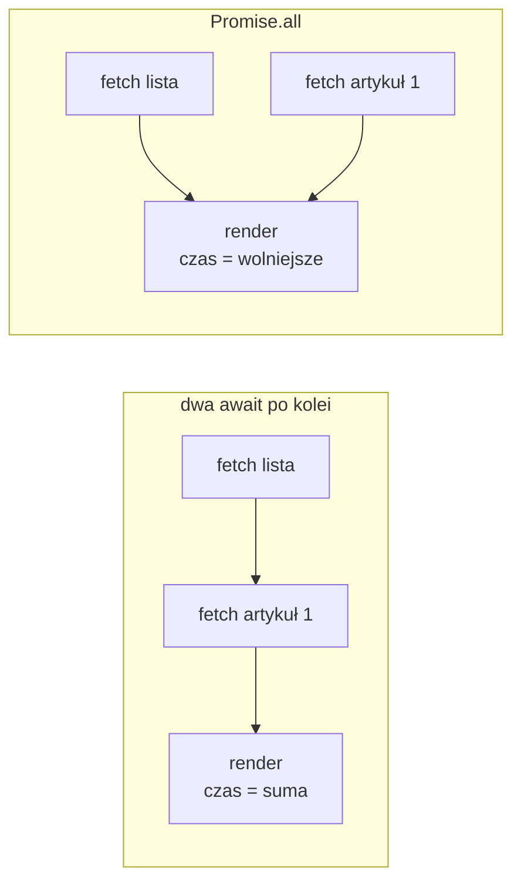

# Komponent, który czeka na dane

## Nawigacja we wspólnym layoucie

Layout główny dostaje pasek nawigacji z linkami do czterech tras aplikacji. Layout obejmuje każdą stronę i zostaje na ekranie przy przejściach, więc menu jest zawsze widoczne. W pliku `app/layout.jsx` dochodzą import `Link`, obiekt `metadata` z tytułem karty i blok `<nav>` przed `children`.

```jsx
// app/layout.jsx (nowe linie i dwie linie kontekstu nad nimi)
import Link from "next/link";

export const metadata = { title: "Articles Viewer" }; // tytuł karty przeglądarki

export default function RootLayout({ children }) {
  return (
    <html lang="pl">
      <body>
        <nav>
          <Link href="/">Artykuły</Link>
          {" | "}
          <Link href="/new">Dodaj</Link>
          {" | "}
          <Link href="/suspend">use() demo</Link>
          {" | "}
          <Link href="/swr-demo">SWR demo</Link>
        </nav>
        <hr />
        {children}
      </body>
    </html>
  );
}
```

`<Link>` przełącza strony bez przeładowania dokumentu, a link do trasy bez pliku `page.jsx` prowadzi do strony 404, dopóki ten plik nie powstanie. Trzy z tych tras czytają te same artykuły, każda w inny sposób, a czwarta, `/new`, je dopisuje. Menu pozwala porównać je jednym kliknięciem.

## Strona główna jako funkcja `async`

Plik `app/page.jsx` pobiera listę artykułów z własnego API aplikacji i wyświetla ją:

```jsx
// app/page.jsx
// Komponent serwerowy: bez dyrektywy "use client" wykonuje się tylko na serwerze
import Link from "next/link";

// adres serwera ze zmiennej środowiskowej; ?? podstawia wartość, gdy zmiennej brak
const BASE_URL = process.env.BASE_URL ?? "http://localhost:3000";

async function fetchArticles() {
  const res = await fetch(`${BASE_URL}/api/articles`, {
    cache: "no-store", // za każdym razem nowe żądanie, bez zapamiętanej odpowiedzi
  });
  if (!res.ok) throw new Error(`Failed to fetch articles: ${res.status}`); // status spoza 200–299
  return res.json();
}

export default async function HomePage() {
  console.log("HomePage render — server side"); // wpis w terminalu serwera, nie w przeglądarce
  const articles = await fetchArticles(); // funkcja czeka tu na dane

  return (
    <div>
      <h1>Artykuły ({articles.length})</h1>
      <ul>
        {articles.map((article) => (
          <li key={article.id}>
            <Link href={`/articles/${article.id}`}>{article.title}</Link>
            {" — "}
            {article.author} ({article.createdAt})
          </li>
        ))}
      </ul>
    </div>
  );
}
```

Demo celowo pobiera listę przez własne API, żeby pokazać `fetch` w komponencie serwerowym. Komponent serwerowy mógłby też wywołać `getArticles()` bezpośrednio, bez żądania HTTP. W kodzie brakuje `useState`, `useEffect` i flagi `isLoading`. `HomePage` jest zadeklarowana jako `async function`, a linia `await fetchArticles()` wstrzymuje ją do nadejścia danych. JSX powstaje dopiero z gotową tablicą, tak jak wynik zwykłej funkcji asynchronicznej w Node.js. Dokumentacja Next.js opisuje ten sposób tak:

> **„Aby pobrać dane przez API `fetch`, zamienia się komponent w funkcję asynchroniczną i czeka na wywołanie `fetch`.”**
>
> *„To fetch data with the `fetch` API, turn your component into an asynchronous function, and await the `fetch` call.”*
>
> — dokumentacja Next.js, *Fetching Data*

Opcja `cache: "no-store"` każe pobierać dane przy każdym wejściu na stronę. Jej rola i pozostałe ustawienia pamięci `fetch` to osobny temat, a tutaj wystarcza, że lista zawsze odpowiada bieżącemu stanowi magazynu.

## Dlaczego `async` działa tylko na serwerze

Komponent kliencki nie może być funkcją `async`, bo każdy jego render musi zakończyć się od razu i zwrócić JSX. React wywołuje go wielokrotnie: przy pierwszym wyświetleniu, po każdej zmianie stanu i w trybie ścisłym dodatkowo. Komponent serwerowy wykonuje się raz na żądanie, więc serwer może poczekać na wynik, zanim wyśle HTML. Tejas Kumar w *Fluent React* ujmuje to tak:

> **„Komponenty serwerowe mogą być asynchroniczne, bo możemy poczekać, aż zakończą wykonywanie na naszych serwerach, zanim udostępnimy je klientom przez sieć.”**
>
> *„Server components can be asynchronous since we can wait for them to complete executing on our servers before we share them with clients over the network.”*
>
> — Tejas Kumar, *Fluent React*

Dyrektywa `"use client"` na górze tego pliku zamieniłaby `HomePage` w komponent kliencki. Next.js 16.4.0 zgłasza wtedy w konsoli przeglądarki: „`<HomePage>` is an async Client Component. Only Server Components can be async at the moment.”

Pobieranie w efekcie zaczyna się dopiero po pierwszym renderze i nie działa na serwerze, więc HTML zawiera wtedy tylko stan ładowania. W `HomePage` dane są gotowe, zanim HTML opuści serwer. Trzy stany żądania obsługują tu trzy osobne mechanizmy. Oczekiwanie to samo `await`, sukces to dalszy ciąg funkcji, a porażka to wyjątek rzucony z `fetchArticles`. Przeglądarka dostaje gotową listę w HTML, więc do jej wyświetlenia nie potrzebuje żadnego skryptu.

## Adres względny i adres bezwzględny

W przeglądarce `fetch("/api/articles")` działa, bo adres względny rozwija się względem bieżącej strony. Na serwerze bieżącej strony nie ma. MDN pisze o konstruktorze `URL`, że adres względny wymaga adresu bazowego, a bez niego zgłasza `TypeError`. Node.js zachowuje się tak samo:

```js
// w Node.js nie ma "bieżącej strony", względem której można rozwinąć adres
try {
  await fetch("/api/articles");
} catch (e) {
  e.name;          // "TypeError"
  e.message;       // "Failed to parse URL from /api/articles"
  e.cause.message; // "Invalid URL"
}
await fetch("http://localhost:3000/api/articles"); // adres bezwzględny działa
```

Stąd **adres bezwzględny** z protokołem i hostem w `BASE_URL`. Wartość zastępcza z kodu działa tylko lokalnie na porcie 3000. Po wdrożeniu zmienna musi wskazywać domenę aplikacji, a przy uruchomieniu na innym porcie ten sam port.

`process.env` to obiekt ze **zmiennymi środowiskowymi** procesu, czyli wartościami ustawionymi poza kodem: w terminalu, w pliku `.env` albo w panelu platformy, na której działa aplikacja. Dzięki nim ten sam kod działa lokalnie i po wdrożeniu, a adres serwera czy klucz do usługi nie trafia do repozytorium.

## Status 404 nie jest dla `fetch` błędem

Odpowiedź z kodem błędu nie odrzuca obiektu Promise zwróconego przez `fetch`. Funkcja traktuje każdą odpowiedź serwera jako udane połączenie.

> **„Obiekt Promise zwrócony przez `fetch()` nie zostaje odrzucony, jeśli serwer odpowie kodem oznaczającym błąd (404, 504 itd.).”**
>
> *„A `fetch()` promise does not reject if the server responds with HTTP status codes that indicate errors (404, 504, etc.).”*
>
> — MDN Web Docs, *Window: fetch() method*

Różnicę widać na samej aplikacji, która na nieznany adres odpowiada stroną HTML z kodem 404.

```js
const res = await fetch("http://localhost:3000/brak"); // trasa nie istnieje, wyjątku brak
res.status; // 404
res.ok;     // false: ok jest true tylko dla statusów 200–299

await res.json(); // SyntaxError: Unexpected token '<', "<!DOCTYPE "... is not valid JSON

await fetch("http://localhost:3999/"); // na tym porcie nic nie działa: TypeError "fetch failed"
```

Obiekt Promise zostaje odrzucony tylko wtedy, gdy odpowiedzi nie ma wcale, na przykład gdy serwer nie działa. Banks i Porcello ujmują to krótko: „czasem żądanie HTTP może zakończyć się sukcesem z błędem” (*„Sometimes an HTTP request can succeed with an error”*). Dlatego linia `if (!res.ok) throw ...` w `fetchArticles` decyduje o czytelności błędu. Z literówką w adresie, `/api/article` bez „s”, wyjątek niesie „Failed to fetch articles: 404”. Bez tej linii strona 404 trafia do `res.json()`, a komunikat „Unexpected token '<'” nie mówi nic o przyczynie. <u>Po każdym `fetch` sprawdza się `res.ok`, zanim odczyta się ciało.</u>

## Kaskada żądań: jedno po drugim

Dwie linie z `await` jedna pod drugą czyta się jak kod synchroniczny i łatwo przeoczyć, że czekają po kolei. Dokumentacja Next.js ostrzega przed tym wprost: „wiele żądań z `async`/`await` nadal może wykonywać się po kolei, jeśli stoją jedno po drugim” (*„multiple `async`/`await` requests can still be sequential if placed after the other”*). Taki układ to **kaskada żądań** (*waterfall*). Banks i Porcello opisują ją jako żądania, które „następują jedno po drugim i zależą od siebie” (*„they happen one right after the other—they’re dependent on each other”*).

Żądanie zaczyna się w chwili wywołania `fetch`, a nie w chwili `await`. Naprawa polega więc na tym, żeby najpierw uruchomić oba żądania, a dopiero potem na nie czekać.

```js
const slowUrl = "http://localhost:3000/api/slow"; // przykładowy adres spoza demo, odpowiada po 300 ms

// po kolei: drugie żądanie startuje dopiero po pierwszym, razem ok. 600 ms
await fetch(slowUrl);
await fetch(slowUrl);

// równolegle: oba startują od razu, czas to wolniejsze z nich, ok. 300 ms
await Promise.all([fetch(slowUrl), fetch(slowUrl)]);
```

`Promise.all` przyjmuje tablicę obiektów Promise i zwraca jeden, który spełnia się tablicą wyników w tej samej kolejności. Gdy jedno żądanie się nie powiedzie, całe wywołanie kończy się błędem. Kolejność jest natomiast konieczna, gdy drugie żądanie potrzebuje wyniku pierwszego, na przykład identyfikatora autora z odpowiedzi o artykule. Taki łańcuch skraca dopiero zmiana źródła, na przykład jedno zapytanie do bazy, które zwraca artykuł razem z autorem.

Dokumentacja opisuje też odmianę kaskady rozrzuconą po komponentach. Komponent z danymi, który renderuje się dopiero po innej blokującej pracy, wysyła żądanie późno, choć dane wejściowe są znane od początku. **Wstępne uruchomienie** (*preloading*) polega na wywołaniu funkcji pobierającej bez `await` przed blokującą pracą. Wynik odbiera się dopiero po niej.

```js
const slowWork = () => new Promise((r) => setTimeout(r, 300)); // inna praca, na którą strona czeka

const listPromise = fetch(`${BASE_URL}/api/articles`).then((r) => r.json()); // bez await: żądanie już trwa
await slowWork();                    // w tym czasie żądanie biegnie w tle
const articles = await listPromise;  // wynik odbiera się po pracy, razem ok. 300 ms zamiast 600 ms
```

## Rysunek 5.3 — żądania po kolei i równolegle



Na Rysunku 5.3 oba warianty dotyczą strony, która obok listy pokazuje wyróżniony artykuł z `/api/articles/1`. W lewej ramce drugie żądanie startuje dopiero po powrocie pierwszego, więc render czeka na sumę obu czasów. W prawej ramce oba żądania wychodzą jednocześnie, a render czeka tylko na wolniejsze. `HomePage` ma jedno żądanie, więc kaskady nie ma, ale pojawia się ona przy drugim `await` dopisanym pod pierwszym.

## Rozszerzenie: status 200 z dokumentem HTML

Nagłówek `Content-Type` pozwala wyłapać przypadek, którego `res.ok` nie widzi. Strona 404 z literówki ma nagłówek `Content-Type: text/html; charset=utf-8`, a odpowiedzi Route Handlera `application/json`. Żądanie pod adres strony `/new` zamiast pod adres API dostaje status 200 i `res.ok` równe `true`, bo strona istnieje. Dopiero `res.json()` zgłasza ten sam błąd „Unexpected token '<'” co przy literówce. Sprawdzenie `res.headers.get("content-type")` przed `res.json()` pozwala rzucić własny wyjątek z nazwą otrzymanego typu, który wskazuje przyczynę zamiast skutku.

## Rozszerzenie: wynik każdego żądania osobno

Dla wyróżnionego artykułu zasada „wszystko albo nic” z `Promise.all` jest zbyt surowa, bo lista mogłaby się wyświetlić bez niego. Dokumentacja Next.js wskazuje na taki przypadek `Promise.allSettled`, którego działanie opisuje MDN:

> **„Zwrócony obiekt Promise zostaje spełniony, gdy rozstrzygną się wszystkie wejściowe obiekty Promise, a jego wartością jest tablica obiektów opisujących wynik każdego z nich.”**
>
> *„This returned promise fulfills when all of the input's promises settle […], with an array of objects that describe the outcome of each promise.”*
>
> — MDN Web Docs, *Promise.allSettled()*

Każdy obiekt ma pole `status` z wartością `"fulfilled"` albo `"rejected"`. Spełniony niesie wynik w `value`, odrzucony powód w `reason`. Wywołanie z jednym spełnionym i jednym odrzuconym obiektem Promise daje statusy `["fulfilled", "rejected"]`, więc strona wyświetla listę, a w miejscu wyróżnienia komunikat.

## Rozszerzenie: limit czasu dla `fetch`

`res.ok` pomaga, gdy odpowiedź przyszła. Wywołanie `fetch` bez limitu czeka natomiast tak długo jak serwer, a razem z nim czeka render strony. Według MDN metoda statyczna `AbortSignal.timeout()` zwraca sygnał, który sam przerywa operację po zadanym czasie wyjątkiem `TimeoutError`. Zapis `fetch(url, { signal: AbortSignal.timeout(100) })` do serwera odpowiadającego po 300 ms kończy się wyjątkiem „TimeoutError: The operation was aborted due to timeout”. W `fetchArticles` taki sygnał zamienia zawieszoną stronę na zwykły wyjątek.

## Rozszerzenie: zmienna, której zabrakło

Zapis `process.env.BASE_URL ?? "http://localhost:3000"` zakłada, że API leży pod tym samym adresem co strona. Serwer uruchomiony na innym porcie albo na innej maszynie bez ustawionej zmiennej wysyła więc żądanie pod `localhost:3000`, gdzie nic nie nasłuchuje. W Node.js 24 takie wywołanie kończy się wyjątkiem „TypeError: fetch failed”, a jego pole `cause` ma kod `ECONNREFUSED`, czyli odmowę połączenia. Komunikat nie wspomina o zmiennej środowiskowej, więc przyczyny szuka się w konfiguracji, a nie w kodzie strony. Zmienna jest przy tym czytelna tylko na serwerze: w komponencie klienckim `process.env.BASE_URL` ma wartość `undefined`, bo do przeglądarki trafiają wyłącznie zmienne z przedrostkiem `NEXT_PUBLIC_`, wpisywane w pliki przy budowaniu.

> 💡 **Zapamiętaj:** <u>komponent serwerowy może być funkcją `async` i czekać na dane przez `await`</u>, bez efektu i stanu ładowania. Na serwerze `fetch` potrzebuje pełnego adresu i sprawdzenia `res.ok`, bo status 404 nie odrzuca obiektu Promise.

