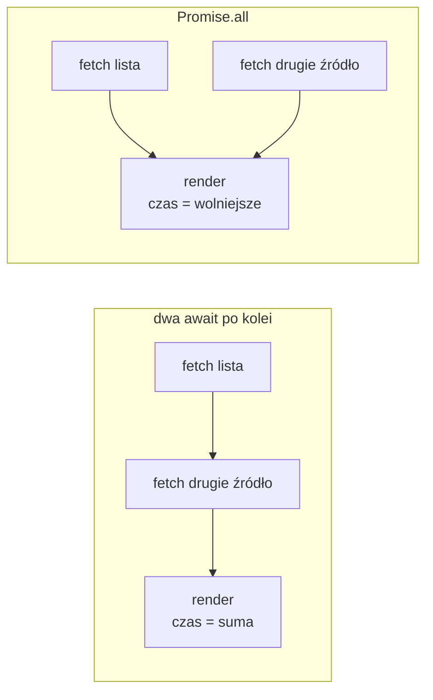

# Komponent, który czeka na dane

## Lista potrzebna, zanim strona powstanie

Lista artykułów ma być w HTML-u, który serwer wysyła przeglądarce. Komponent kliencki z `useEffect` wysyła HTML ze stanem ładowania, a listę dopiero po wczytaniu skryptu i drugim żądaniu do API. Trzeba do tego trzech flag stanu: dane, ładowanie i błąd. Każda z nich ma być w każdej chwili spójna z pozostałymi. Komponent serwerowy czeka na dane, zanim wyśle HTML, więc te flagi nie są potrzebne, a lista jest w pierwszej odpowiedzi.

## Nawigacja we wspólnym layoucie

Layout główny dostaje pasek nawigacji z dwoma linkami. Layout obejmuje każdą stronę i zostaje na ekranie przy przejściach, więc menu jest zawsze widoczne. W pliku `app/layout.jsx` dochodzą import `Link`, obiekt `metadata` z tytułem karty i blok `<nav>` przed `children`.

```jsx
// app/layout.jsx
import Link from "next/link";

export const metadata = { title: "Articles" };

export default function RootLayout({ children }) {
  return (
    <html lang="en">
      <body>
        <nav>
          <Link href="/">Articles</Link> | <Link href="/new">Add</Link>
        </nav>
        {children}
      </body>
    </html>
  );
}
```

`<Link>` przełącza strony bez przeładowania dokumentu, a link do trasy bez pliku `page.jsx` prowadzi do strony 404, dopóki ten plik nie powstanie. Tak jest z `Add`: strona `/new` pojawia się dopiero przy formularzu.

## Strona główna jako funkcja `async`

Plik `app/page.jsx` pobiera listę artykułów z własnego API aplikacji i wyświetla ją:

```jsx
// app/page.jsx
// Komponent serwerowy: bez "use client" wykonuje się tylko na serwerze
import Link from "next/link";

const BASE_URL = process.env.BASE_URL ?? "http://localhost:3000";

export default async function HomePage() {
  const res = await fetch(`${BASE_URL}/api/articles`, {
    cache: "no-store", // za każdym razem nowe żądanie
  });
  if (!res.ok) throw new Error(`Failed to fetch articles: ${res.status}`);
  const articles = await res.json();

  return (
    <main>
      <h1>Articles ({articles.length})</h1>
      <ul>
        {articles.map((a) => (
          <li key={a.id}>
            <Link href={`/articles/${a.id}`}>{a.title}</Link>
          </li>
        ))}
      </ul>
    </main>
  );
}
```

Demo celowo pobiera listę przez własne API, żeby pokazać `fetch` w komponencie serwerowym. Komponent serwerowy mógłby też wywołać `getArticles()` bezpośrednio, bez żądania HTTP. W kodzie brakuje `useState`, `useEffect` i flagi `isLoading`. `HomePage` jest zadeklarowana jako `async function`, a pierwsze `await` wstrzymuje ją do nadejścia odpowiedzi. JSX powstaje dopiero z gotową tablicą, tak jak wynik zwykłej funkcji asynchronicznej w Node.js. Dokumentacja Next.js opisuje ten sposób tak:

> **„Aby pobrać dane przez API `fetch`, zamienia się komponent w funkcję asynchroniczną i czeka na wywołanie `fetch`.”**
>
> *„To fetch data with the `fetch` API, turn your component into an asynchronous function, and await the `fetch` call.”*
>
> — dokumentacja Next.js, *Fetching Data*

Opcja `cache: "no-store"` każe pobierać dane przy każdym wejściu na stronę. Jej rola i pozostałe ustawienia pamięci `fetch` to osobny temat, a tutaj wystarcza, że lista zawsze odpowiada bieżącemu stanowi magazynu. Źródło strony (Ctrl+U) ma od razu listę dwóch artykułów, a `curl` na `/` zwraca ten sam HTML. Cenę widać w czasie: `GET /api/articles` czeka sekundę, więc przeglądarka nie pokazuje nic przez ok. 1,4 s (pomiar: 1,46; 1,42 i 1,40 s), a w terminalu przy każdym wejściu stoi `GET /api/articles 200 in 1006ms`.

## Dlaczego `async` działa tylko na serwerze

Komponent kliencki nie może być funkcją `async`, bo każdy jego render musi zakończyć się od razu i zwrócić JSX. React wywołuje go wielokrotnie: przy pierwszym wyświetleniu, po każdej zmianie stanu i w trybie ścisłym dodatkowo. Komponent serwerowy wykonuje się raz na żądanie, więc serwer może poczekać na wynik, zanim wyśle HTML. Tejas Kumar w *Fluent React* ujmuje to tak:

> **„Komponenty serwerowe mogą być asynchroniczne, bo możemy poczekać, aż zakończą wykonywanie na naszych serwerach, zanim udostępnimy je klientom przez sieć.”**
>
> *„Server components can be asynchronous since we can wait for them to complete executing on our servers before we share them with clients over the network.”*
>
> — Tejas Kumar, *Fluent React*

Dyrektywa `"use client"` na górze tego pliku zamieniłaby `HomePage` w komponent kliencki. Next.js 16.4.0 zgłasza wtedy w trybie deweloperskim w konsoli przeglądarki: „`<HomePage>` is an async Client Component. Only Server Components can be async at the moment.”

Trzy stany żądania obsługują w `HomePage` trzy osobne mechanizmy. Oczekiwanie to samo `await`, sukces to dalszy ciąg funkcji, a porażka to wyjątek rzucony z komponentu. Przeglądarka dostaje gotową listę w HTML, więc do jej wyświetlenia nie potrzebuje żadnego skryptu.

## Adres względny i adres bezwzględny

W przeglądarce `fetch("/api/articles")` działa, bo adres względny rozwija się względem bieżącej strony. Na serwerze bieżącej strony nie ma. MDN pisze o konstruktorze `URL`, że adres względny wymaga adresu bazowego, a bez niego zgłasza `TypeError`. Node.js zachowuje się tak samo:

```js
// w Node.js nie ma "bieżącej strony", względem której można rozwinąć adres
try {
  await fetch("/api/articles");
} catch (e) {
  e.name;          // → "TypeError"
  e.message;       // → "Failed to parse URL from /api/articles"
  e.cause.message; // → "Invalid URL"
}
await fetch("http://localhost:3000/api/articles"); // adres bezwzględny działa
```

Stąd **adres bezwzględny** z protokołem i hostem w `BASE_URL`. Wartość zastępcza z kodu działa tylko lokalnie na porcie 3000. Po wdrożeniu zmienna musi wskazywać domenę aplikacji, a przy uruchomieniu na innym porcie ten sam port.

`process.env` to obiekt ze **zmiennymi środowiskowymi** procesu, czyli wartościami ustawionymi poza kodem: w terminalu, w pliku `.env` albo w panelu platformy, na której działa aplikacja. Dzięki nim ten sam kod działa lokalnie i po wdrożeniu, a adres serwera czy klucz do usługi nie trafia do repozytorium.

## Status 404 nie jest dla `fetch` błędem

Odpowiedź z kodem błędu nie odrzuca obiektu Promise zwróconego przez `fetch`. Funkcja traktuje każdą odpowiedź serwera jako udane połączenie.

> **„Obiekt Promise zwrócony przez `fetch()` nie zostaje odrzucony, jeśli serwer odpowie kodem oznaczającym błąd (404, 504 itd.).”**
>
> *„A `fetch()` promise does not reject if the server responds with HTTP status codes that indicate errors (404, 504, etc.).”*
>
> — MDN Web Docs, *Window: fetch() method*

Różnicę widać na samej aplikacji, która na nieznany adres odpowiada stroną HTML z kodem 404.

```js
const res = await fetch("http://localhost:3000/missing"); // trasa nie istnieje, wyjątku brak
res.status; // → 404
res.ok;     // → false: ok jest true tylko dla statusów 200–299

await res.json(); // → SyntaxError: Unexpected token '<', "<!DOCTYPE "... is not valid JSON

await fetch("http://localhost:3999/"); // → TypeError "fetch failed": na tym porcie nic nie działa
```

Obiekt Promise zostaje odrzucony tylko wtedy, gdy odpowiedzi nie ma wcale, na przykład gdy serwer nie działa. Banks i Porcello ujmują to krótko: „czasem żądanie HTTP może zakończyć się sukcesem z błędem” (*„Sometimes an HTTP request can succeed with an error”*). Dlatego linia `if (!res.ok) throw ...` w `HomePage` decyduje o czytelności błędu. Z literówką w adresie, `/api/article` bez „s”, wyjątek niesie „Failed to fetch articles: 404”. Bez tej linii strona 404 trafia do `res.json()`, a komunikat „Unexpected token '<'” nie mówi nic o przyczynie. <u>Po każdym `fetch` sprawdza się `res.ok`, zanim odczyta się ciało.</u>

## Kaskada żądań: jedno po drugim

Dwie linie z `await` jedna pod drugą czyta się jak kod synchroniczny i łatwo przeoczyć, że czekają po kolei. Dokumentacja Next.js ostrzega przed tym wprost: „wiele żądań z `async`/`await` nadal może wykonywać się po kolei, jeśli stoją jedno po drugim” (*„multiple `async`/`await` requests can still be sequential if placed after the other”*). Taki układ to **kaskada żądań** (*waterfall*). Banks i Porcello opisują ją jako żądania, które „następują jedno po drugim i zależą od siebie” (*„they happen one right after the other—they’re dependent on each other”*).

Żądanie zaczyna się w chwili wywołania `fetch`, a nie w chwili `await`. Naprawa polega więc na tym, żeby najpierw uruchomić oba żądania, a dopiero potem na nie czekać.

```js
const slowUrl = "http://localhost:3000/api/slow"; // przykładowy adres spoza demo, odpowiada po 300 ms

// po kolei: drugie żądanie startuje dopiero po pierwszym, razem ok. 600 ms
await fetch(slowUrl);
await fetch(slowUrl);

// równolegle: oba startują od razu, czas to wolniejsze z nich, ok. 300 ms
await Promise.all([fetch(slowUrl), fetch(slowUrl)]);
```

`Promise.all` przyjmuje tablicę obiektów Promise i zwraca jeden, który spełnia się tablicą wyników w tej samej kolejności. Gdy jedno żądanie się nie powiedzie, całe wywołanie kończy się błędem. Kolejność jest natomiast konieczna, gdy drugie żądanie potrzebuje wyniku pierwszego, na przykład numeru z pierwszej odpowiedzi, który wchodzi do adresu drugiej. Taki łańcuch skraca dopiero zmiana źródła, na przykład jedno zapytanie do bazy, które zwraca oba zbiory razem.

Dokumentacja opisuje też odmianę kaskady rozrzuconą po komponentach. Komponent z danymi, który renderuje się dopiero po innej blokującej pracy, wysyła żądanie późno, choć dane wejściowe są znane od początku. **Wstępne uruchomienie** (*preloading*) polega na wywołaniu funkcji pobierającej bez `await` przed blokującą pracą. Wynik odbiera się dopiero po niej.

```js
const slowWork = () => new Promise((r) => setTimeout(r, 300)); // inna praca, na którą strona czeka

const listPromise = fetch(`${BASE_URL}/api/articles`).then((r) => r.json()); // bez await: żądanie już trwa
await slowWork();                    // w tym czasie żądanie biegnie w tle
const articles = await listPromise;  // wynik odbiera się po pracy, razem ok. 300 ms zamiast 600 ms
```

## Rysunek 5.3 — żądania po kolei i równolegle



Na Rysunku 5.3 oba warianty dotyczą strony, która obok listy pobiera drugie, niezależne źródło. W lewej ramce drugie żądanie startuje dopiero po powrocie pierwszego, więc render czeka na sumę obu czasów. W prawej ramce oba żądania wychodzą jednocześnie, a render czeka tylko na wolniejsze. `HomePage` ma jedno żądanie, więc kaskady nie ma, ale pojawia się ona przy drugim `await` dopisanym pod pierwszym.

## Zalety i koszty komponentu serwerowego z `await`

Komponent `async` zastępuje flagi stanu zwykłym `await`, ale cała strona czeka na najwolniejsze źródło.

| Zyskujemy | Płacimy | Kiedy nie warto / co zamiast |
|---|---|---|
| Lista w HTML-u (`curl` na `/` ją zwraca), bez `useState`, `useEffect` i flag | Cała strona czeka na najwolniejsze źródło: lista pojawia się po ok. 1,2–1,4 s przy każdym wejściu | Dane zmienne w trakcie oglądania albo zależne od wpisywania: pobieranie w przeglądarce (SWR i TanStack Query) |
| Kod pobierający dane nie trafia do przeglądarki | Pełny adres w `BASE_URL` i ręczne sprawdzanie `res.ok` | Dane z własnego modułu: wywołanie funkcji z `lib/store.js` bez HTTP, jak na stronie artykułu |
| Komponent czyta się jak zwykła funkcja asynchroniczna | Dwa `await` jeden pod drugim robią kaskadę, a bez komponentu klienckiego nie ma interakcji | Niezależne żądania: `Promise.all`; interakcja: osobny komponent kliencki obok |

> 💡 **Zapamiętaj:** <u>komponent serwerowy może być funkcją `async` i czekać na dane przez `await`</u>, bez efektu i stanu ładowania. Na serwerze `fetch` potrzebuje pełnego adresu i sprawdzenia `res.ok`, bo status 404 nie odrzuca obiektu Promise.


Materiał rozszerzony do tego slajdu: [`rozszerzenia/r03_async-server-component.md`](rozszerzenia/r03_async-server-component.md)
