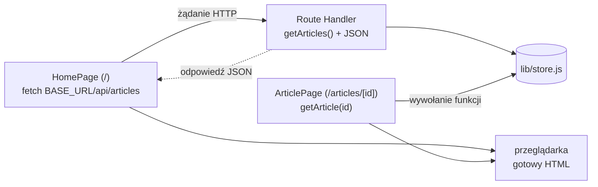

# Czekanie, awaria i strona jednego artykułu

## Dwa pliki obok strony głównej

Strona główna czeka na dane przez `await`, a `fetchArticles` rzuca wyjątek przy złym statusie. Ekran na czas czekania i ekran po wyjątku dają dwa pliki o zastrzeżonych nazwach. Oba leżą w korzeniu `app/`.

```jsx
// app/loading.jsx: treść zastępcza na czas, gdy strona czeka na dane
export default function Loading() {
  return <p>Ładowanie artykułów...</p>;
}
```

```jsx
// app/error.jsx: granica błędów działa w przeglądarce, stąd dyrektywa
"use client";

export default function Error({ error, retry }) {
  return (
    <div>
      <p>Błąd: {error.message}</p>
      {/* retry() pobiera segment od nowa (Next.js 16.3+) */}
      <button onClick={() => retry()}>Spróbuj ponownie</button>
    </div>
  );
}
```

Next.js owija stronę granicą Suspense z `Loading` i granicą błędów z `Error`, tak jak przy każdym segmencie. Pliki leżą w korzeniu `app/`, więc obejmują każdą stronę aplikacji, która nie ma własnych. Layout główny `articleviewer` danych nie pobiera, więc granica z `loading.jsx`, która stoi wewnątrz layoutu, obejmuje całą treść strony, a pasek nawigacji jest widoczny od razu. Nazwa `Error` przesłania w tym pliku wbudowaną klasę `Error`, co nie przeszkadza, bo plik nie tworzy nowych wyjątków.

## Dlaczego granice zamiast flag w stanie

W aplikacji bez frameworka ładowanie i błąd obsługuje się flagami w stanie komponentu. Wieruch w *The Road to React* pokazuje, jak łatwo wtedy o niespójność. Opisuje **stan niemożliwy** (*impossible state*): przy błędzie pobierania flaga błędu zostaje ustawiona, ale flaga ładowania nie zostaje cofnięta.

```js
let state = { isLoading: true, isError: false };

// procedura obsługi błędu zmienia jedną flagę i zapomina o drugiej
state = { ...state, isError: true };
state; // { isLoading: true, isError: true }: komunikat i wskaźnik ładowania naraz
```

Ekran pokazuje wtedy jednocześnie komunikat o błędzie i niekończący się wskaźnik ładowania. Wieruch naprawia to reducerem, który zmienia obie flagi w jednym kroku. Reducer zamyka możliwe stany w kilku gałęziach `switch`, ale nadal trzeba je zapisać i pilnować w każdym komponencie, który pobiera dane. Granice usuwają problem u źródła, bo flag nie ma wcale. `HomePage` opisuje tylko widok gotowych danych. O czekaniu React wie, bo funkcja `async` komponentu jeszcze nie zwróciła JSX. O błędzie wie, bo render rzucił wyjątek. Schwarzmüller ujmuje tę zaletę tak:

> **„Użycie `Suspense` może zaoszczędzić sporo kodu, bo nie trzeba ręcznie zarządzać tymi różnymi fragmentami stanu.”**
>
> *„Using `Suspense` can save you quite a bit of code since you don’t need to manage these different state slices manually.”*
>
> — Maximilian Schwarzmüller, *React Key Concepts*

## Błędy oczekiwane i wyjątki

Nie każdy problem z danymi jest awarią. Dokumentacja Next.js *Error Handling* dzieli błędy na dwie grupy. **Błędy oczekiwane** (*expected errors*) zdarzają się przy normalnej pracy aplikacji: niepoprawne dane w formularzu, brak zasobu, chwilowo niedostępna usługa. **Wyjątki nieprzechwycone** (*uncaught exceptions*) wskazują na błąd w kodzie albo awarię, której aplikacja się nie spodziewa. Tylko te drugie rzuca się i zostawia granicy z `error.jsx`.

Błąd oczekiwany zwraca się jako zwykłą wartość, a komponent decyduje, co z nią pokazać. Wariant spoza demo:

```jsx
// Wariant spoza demo: zły status zwracany jako wynik
async function loadArticles() {
  const res = await fetch(`${BASE_URL}/api/articles`, { cache: "no-store" });
  if (!res.ok) return { articles: [], error: "Lista chwilowo niedostępna" };
  return { articles: await res.json(), error: null };
}

// w komponencie strony:
const { articles, error } = await loadArticles();
if (error) return <p>{error}</p>; // nawigacja i reszta layoutu działają dalej
```

Granica między grupami zależy od tego, co strona może zrobić z wynikiem. Status 404 dla jednego artykułu jest oczekiwany: użytkownik wpisał zły numer albo artykuł usunięto, a strona ma na to gotowy widok. Status 400 z API to też błąd oczekiwany, bo klient wie, co poprawić. Status 500 albo zerwane połączenie oznaczają, że strona nie dostała danych, bez których nie ma czego pokazać. Strona główna bez listy nie ma czego pokazać, więc `fetchArticles` zostawia niedostępną listę jako wyjątek. Sekcja poboczna, na przykład lista polecanych, powinna je obsłużyć sama, żeby awaria dodatku nie zabierała całej strony.

Różnica dotyczy miejsca, w którym kończy się problem. Wyjątek z `fetchArticles` zastępuje całą treść strony ekranem z `error.jsx`. Wartość z `loadArticles` zostaje w komponencie, który może pokazać komunikat obok działającej części strony albo w miejscu jednej sekcji. Granica błędów o takiej wartości w ogóle się nie dowiaduje. Komponent sam wybiera więc treść komunikatu i sam decyduje, czy dać użytkownikowi przycisk ponowienia, a reszta drzewa renderuje się bez zmian. <u>Wyjątek zostawia się na sytuacje, w których strona nie ma czego pokazać.</u>

## Komunikat błędu w trybie produkcyjnym

Druga różnica dotyczy trybu produkcyjnego, czyli aplikacji zbudowanej przez `next build`. W trybie deweloperskim granica dostaje pełną treść wyjątku, więc ekran pokazuje „Błąd: Failed to fetch articles: 500” i łatwo uznać ten napis za tekst dla użytkownika. W trybie produkcyjnym wyjątek z komponentu serwerowego nie przekazuje swojej treści do przeglądarki. Pole `error.message` ma wtedy ogólny tekst „Minified React error #441; visit https://react.dev/errors/441 for the full message…”, a oryginalny komunikat trafia do logu serwera razem z identyfikatorem `digest`. Ten sam `digest` dostaje granica w przeglądarce, więc pozwala znaleźć wpis w logu, ale użytkownikowi nic nie mówi. Tekst, który użytkownik ma przeczytać, niesie więc wartość zwracana, a wyjątek służy diagnozie.

## Strona artykułu z magazynu

Każdy tytuł na liście prowadzi pod adres `/articles/1`, `/articles/2` i kolejne. Stronę artykułu tworzy plik `app/articles/[id]/page.jsx`.

```jsx
// app/articles/[id]/page.jsx
// Komponent serwerowy: dane prosto z magazynu, bez żądania HTTP
import { getArticle } from "@/lib/store";
import { notFound } from "next/navigation";
import Link from "next/link";

export default async function ArticlePage({ params }) {
  const { id } = await params; // params jest obiektem Promise
  const article = getArticle(id);
  if (!article) notFound(); // przerywa render i pokazuje widok „nie znaleziono”

  return (
    <article>
      <Link href="/">← Lista</Link>
      <h1>{article.title}</h1>
      <p>
        Autor: {article.author} | Data: {article.createdAt}
      </p>
      <p>{article.body}</p>
    </article>
  );
}
```

Obok leży osobny plik ładowania dla tego segmentu.

```jsx
// app/articles/[id]/loading.jsx: bliższy stronie niż app/loading.jsx, więc wygrywa
export default function Loading() {
  return <p>Ładowanie artykułu...</p>;
}
```

Brak artykułu to przypadek oczekiwany, więc strona woła `notFound()`, wyjątek sterujący, który Next.js zamienia na widok „nie znaleziono”. Nowe jest to, czego w pliku nie ma: wywołania `fetch`, adresu i formatu JSON. Strona mogłaby zamiast `notFound()` zwrócić własny akapit „Brak artykułu”. Odpowiedź wyglądałaby wtedy dla przeglądarki i robotów jak zwykła udana strona, bez znacznika `noindex` i bez wspólnego widoku „nie znaleziono”.

Przy przejściu z listy obowiązuje plik ładowania leżący najbliżej strony. Router pokazuje go od razu po kliknięciu, jeśli strona jeszcze nie przyszła z serwera. `getArticle` odpowiada jednak bez czekania, więc gotowa strona zwykle wyprzedza napis „Ładowanie artykułu...”, który mignie tylko przy wolniejszej odpowiedzi serwera.

## Dwie drogi do tych samych danych

Aplikacja ma teraz dwa komponenty serwerowe, które czytają artykuły na dwa sposoby. `HomePage` wysyła żądanie HTTP do `/api/articles`. Route Handler wywołuje `getArticles()`, zamienia tablicę na JSON i odsyła odpowiedź, a `HomePage` zamienia JSON z powrotem na tablicę. `ArticlePage` wywołuje `getArticle(id)` i od razu ma obiekt.

Na serwerze pierwsza droga jest okrężna. Żądanie wychodzi z procesu Next.js i wraca do tego samego procesu, kod musi znać pełny adres serwera, a dane dwa razy zmieniają format. JSON zna tylko proste typy, więc część wartości po drodze się zmienia:

```js
const article = { title: "A", createdAt: new Date("2025-01-01T00:00:00Z") };
const back = JSON.parse(JSON.stringify(article)); // droga przez HTTP w skrócie

typeof back.createdAt; // "string": obiekt Date stał się napisem
back.createdAt;        // "2025-01-01T00:00:00.000Z"
```

W tej aplikacji różnicy nie widać, bo `createdAt` od początku jest napisem `"2025-01-01"`. Druga droga omija te koszty. Kod z dostępem do danych i tak zostaje poza plikami przeglądarki, bo importuje go tylko komponent serwerowy.

Bugl w *Modern Full-Stack React Projects* wymienia trzy podejścia do danych w komponentach serwerowych: API HTTP, osobny moduł z funkcjami dostępu do danych i zapytania wprost w komponencie. `ArticlePage` korzysta z drugiego. Bugl zaleca trzymać się jednego: „lepiej wybrać jedno i się go trzymać” (*„it’s better to pick one and stick to it”*). Ta aplikacja celowo łamie tę radę, żeby obie drogi dało się porównać obok siebie. <u>Komponent serwerowy, którego API nie ma innych odbiorców, czyta dane bezpośrednio z modułu.</u>

Route Handler nie jest przez to zbędny: służy odbiorcom spoza procesu serwera, którzy nie mogą zaimportować magazynu. Komponent serwerowy sięga do danych krótszą drogą.

## Rysunek 5.4 — dwie drogi do magazynu



Na Rysunku 5.4 cała lewa część działa w jednym procesie serwera. Górna droga ma trzy strzałki i jedno żądanie sieciowe, które wychodzi z serwera i do niego wraca. Dolna droga ma jedną strzałkę. Przeglądarka po prawej w obu przypadkach dostaje gotowy HTML i nie widzi ani adresu `/api/articles`, ani pliku `store.js`. Żądanie z `HomePage` do API zostawia więc ślad wyłącznie w logu serwera.

## Strona renderowana przy każdym żądaniu

W wyniku budowania strona artykułu ma symbol `ƒ` (render przy każdym żądaniu), a wbudowana strona `/_not-found` symbol `○` (treść przygotowana przy budowaniu). Build nie zna listy identyfikatorów, bo artykuły przybywają w trakcie działania aplikacji. Każde wejście na `/articles/2` wywołuje więc `ArticlePage` od nowa, a `getArticle` czyta bieżący stan magazynu. Artykuł dodany przed chwilą jest od razu dostępny pod swoim adresem.

Inaczej wygląda strona `/new` z formularzem: ma symbol `○`, bo jej treść nie zależy od żądania i daje się przygotować raz. O wyborze decyduje to, czego strona używa. `await params` w trasie dynamicznej albo `fetch` z `cache: "no-store"` przenosi render na chwilę żądania. Lista identyfikatorów podana z góry przez `generateStaticParams` pozwoliłaby przygotować strony artykułów przy budowaniu, ale artykuł dodany później nie miałby wtedy gotowej strony.

Serwer produkcyjny mówi to także nagłówkiem. Odpowiedź dla `/articles/1` ma `Cache-Control: private, no-cache, no-store, max-age=0, must-revalidate`, który zabrania zapisu strony w pamięci przeglądarki i serwerów pośrednich, bo przy następnym żądaniu wynik może być inny.

## Kod 200 przy widoku „nie znaleziono”

Adres `/articles/99` pokazuje widok „nie znaleziono”, ale odpowiedź HTTP ma kod 200 i znacznik `noindex`. Strumień, który otwiera każdy plik `loading.jsx` nad stroną, także `app/loading.jsx`, wysyła nagłówki z kodem 200, zanim `notFound()` się wykona. Adres bez żadnej trasy, na przykład `/artykuly`, dostaje 404, bo Next.js wie o braku trasy jeszcze przed renderem. Różnica dzieli więc przypadki „nie ma takiej trasy” i „trasa jest, ale zasobu brak”.

## Rozszerzenie: prawdziwy status i roboty

Gdy prawdziwy status jest potrzebny, na przykład dla statystyk albo robotów wyszukiwarek, istnienie zasobu sprawdza się, zanim treść odpowiedzi zacznie płynąć, czyli przed granicą Suspense. Część robotów oznacza strony z widokiem błędu i kodem sukcesu jako **miękkie 404** (*soft 404s*), a znacznik `noindex` ogranicza tylko ich indeksowanie. Strumień zmienia też to, co widzą roboty. Według dokumentacji `loading.js` dla robotów, które czytają wyłącznie statyczny HTML, takich jak Twitterbot, Next.js najpierw kończy `generateMetadata`, a dopiero potem strumieniuje interfejs. Metadane trafiają dzięki temu do `<head>`, zanim robot przestanie czytać odpowiedź. Listę takich robotów ustawia opcja `htmlLimitedBots`. Kumar w *Fluent React* opisuje ten sam podział w Remiksie: dla robota odpowiedź musi zawierać wyrenderowaną treść strony, a przeglądarka dostaje jeszcze JavaScript do hydratacji. W `articleviewer` nie ma `generateMetadata`, więc tytuł karty pochodzi ze stałego obiektu `metadata` w layoucie.

> 💡 **Zapamiętaj:** komponent serwerowy czyta dane przez zwykłe wywołanie funkcji z `lib/store.js`, bez żądania HTTP do własnego API. <u>Błąd oczekiwany zwraca się jako wartość, a wyjątek zostawia granicy z `error.jsx`</u>, bo po zbudowaniu jego treść i tak nie dociera do użytkownika.

