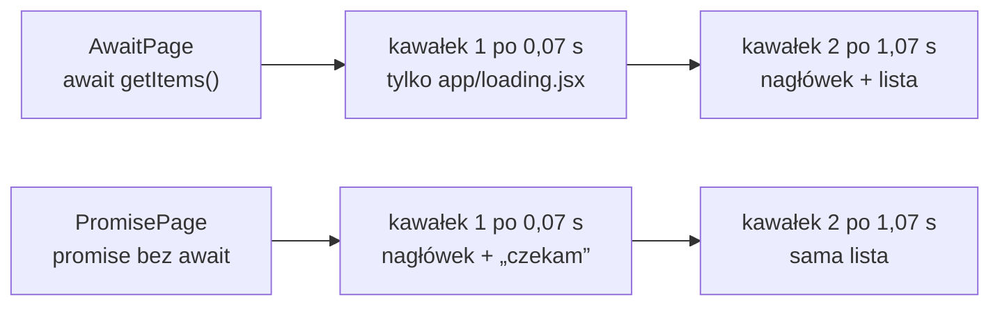

# Promise z serwera, odczyt w przeglądarce

## Strona, która nie czeka na własne dane

Strona główna czeka na dane, zanim cokolwiek pokaże w miejscu listy. Przy wolnym źródle użytkownik patrzy na ekran ładowania, choć nagłówek strony mógłby pojawić się od razu. Trasa `/suspend` pokazuje inny układ. Serwer zaczyna pobierać dane bez czekania na wynik i przekazuje komponentowi klienckiemu obiekt Promise, czyli wynik, który jeszcze nie nadszedł. Odczyt takiego obiektu działa tak samo jak w każdym komponencie klienckim: `use` zawiesza komponent do chwili rozstrzygnięcia Promise, a najbliższa granica Suspense pokazuje w tym czasie treść zastępczą. Nowe jest miejsce, w którym Promise powstaje: komponent serwerowy, jeden raz na żądanie.

## Promise zaczyna się od razu, wynik przychodzi później

Wywołanie `fetch` nie czeka na odpowiedź. Zwraca od razu Promise, a żądanie trwa w tle. To samo dotyczy metody `then`, która dokleja kolejny krok i też zwraca od razu nowy Promise:

```js
// fetch z adresem data: nie potrzebuje sieci ani serwera
const p = fetch("data:application/json,[1,2,3]").then((r) => r.json());
console.log(p);        // Promise { <pending> }: wyniku jeszcze nie ma
console.log(await p);  // [ 1, 2, 3 ]: wynik po odczytaniu treści odpowiedzi
```

Pierwsza linia kończy się natychmiast. Zmienna `p` trzyma Promise tablicy, więc `console.log(p)` wypisuje stan oczekiwania. Dopiero `await` zatrzymuje funkcję do chwili, gdy oba kroki się zakończą. Komponent serwerowy, który pominie `await`, kończy więc pracę od razu i może przekazać `p` dalej jak każdą inną wartość.

## Komponent kliencki czyta Promise z propsa

Trasa składa się z dwóch plików. Najpierw powstaje komponent kliencki, bo strona go importuje. Plik `app/suspend/ArticleListClient.jsx`:

```jsx
// app/suspend/ArticleListClient.jsx
"use client";
import { use } from "react";

export default function ArticleListClient({ promise }) {
  // use() zawiesza komponent, dopóki Promise z propsa się nie rozstrzygnie
  const articles = use(promise);

  return (
    <ul>
      {articles.map((a) => (
        <li key={a.id}>
          {a.title} — {a.author}
        </li>
      ))}
    </ul>
  );
}
```

Komponent nie wie, skąd pochodzi Promise ani jak długo będzie czekał. Pisze się go tak, jakby tablica `articles` była zawsze gotowa. Za stan oczekiwania odpowiada granica nad nim, a za błąd najbliższa granica błędów.

## Strona tworzy Promise i nie czeka

Promise dostarcza strona. Plik `app/suspend/page.jsx`:

```jsx
// app/suspend/page.jsx
// komponent serwerowy: tworzy Promise, ale NIE czeka na niego
import { Suspense } from "react";
import ArticleListClient from "./ArticleListClient";

const BASE_URL = process.env.BASE_URL ?? "http://localhost:3000";

export default function SuspendPage() {
  // Promise powstaje tutaj, bez await, i idzie w propsie do komponentu klienckiego
  const articlesPromise = fetch(`${BASE_URL}/api/articles`, {
    cache: "no-store",
  }).then((r) => r.json());

  return (
    <div>
      <h1>Artykuły — use() + Suspense</h1>
      <Suspense fallback={<p>Suspense czeka na dane...</p>}>
        <ArticleListClient promise={articlesPromise} />
      </Suspense>
    </div>
  );
}
```

Plik ma trzy ważne cechy:

1. **`SuspendPage` nie jest funkcją `async`.** Komponent kończy pracę od razu i zwraca JSX z nagłówkiem.
2. **`articlesPromise`** to Promise zwrócony przez `fetch(...).then(...)`. Żądanie już trwa, a wynik jeszcze nie istnieje.
3. **`<Suspense fallback={...}>`** obejmuje tylko listę. Nagłówek leży poza granicą i nie musi na nic czekać.

## Co wolno przekazać jako wynik Promise

Propsy z komponentu serwerowego do klienckiego przechodzą przez sieć, więc muszą dać się zserializować. Dokumentacja Reacta stosuje tę regułę także do obiektów Promise: „jego rozwiązana wartość musi dać się serializować” (*„its resolved value must be serializable”*). Liczy się więc nie sam Promise, ale to, czym się rozstrzygnie. Wariant bez `.then` łamie ten warunek.

```jsx
// przykład spoza demo (importy i BASE_URL jak w app/suspend/page.jsx):
// Promise rozstrzyga się obiektem Response
export default function BrokenPage() {
  const promise = fetch(`${BASE_URL}/api/articles`, { cache: "no-store" });
  return <ArticleListClient promise={promise} />;
}
// terminal: Error: Only plain objects, and a few built-ins, can be passed
// to Client Components from Server Components. Classes or null prototypes are not supported.
```

Obiekt `Response` jest instancją klasy z metodami i strumieniem treści, więc nie przechodzi przez granicę. Strona i tak odpowiada kodem 200, bo błąd pojawia się już po wysłaniu początku odpowiedzi. Tablica zwykłych obiektów z napisami i liczbami przechodzi bez problemu. Dlatego `.then((r) => r.json())` stoi jeszcze po stronie serwera: do przeglądarki trafia Promise gotowych danych, a nie Promise odpowiedzi HTTP. Ten sam warunek wyklucza Promise, który rozstrzyga się funkcją albo instancją własnej klasy.

## Wynik idzie do przeglądarki dwa razy

Przeglądarka nie wysyła własnego żądania do `/api/articles`. Pobiera je tylko serwer, a gotowy wynik dosyła w odpowiedzi na `/suspend` w dwóch postaciach. Pierwsza to HTML listy, który przeglądarka pokazuje od razu. Druga to wiersz danych w skrypcie `self.__next_f.push`, zapisany jako JSON pod numerem wiersza.

```text
10:[{"id":1,"title":"Intro to Server Components","author":"Alice","body":"Server Components run …"}, …]
```

Z tego wiersza `use` w przeglądarce odczytuje tę samą tablicę, która posłużyła do wyrenderowania HTML-a, więc lista po hydratacji wygląda identycznie. Wiersz zawiera każde pole obiektu, także `body`, którego lista nie wyświetla. <u>Do przeglądarki trafia cała wartość, którą rozstrzyga się Promise</u>, więc dane wrażliwe albo duże obcina się jeszcze na serwerze, w tym samym `.then`.

## `await` na miejscu czy Promise w dół

Promise trzeba w końcu rozpakować. Dokumentacja Reacta opisuje obie drogi. Promise „rozpakowuje się przez `await` w komponencie serwerowym i przez `use` w komponencie klienckim” (*„You unwrap it with `await` in a Server Component, and with `use` in a Client Component”*). Ta sama strona wskazuje wariant domyślny.

> **„Zwykle najprostszą opcją jest `await` na Promise tam, gdzie się go tworzy.”**
>
> *„Usually, the simplest option is to `await` the Promise where you create it.”*
>
> — dokumentacja React, *use*

Różnicę widać na dwóch stronach spoza demo, które czytają to samo źródło odpowiadające po sekundzie. Źródło i funkcja pobierająca wyglądają tak.

```js
// app/api/slow/route.js (spoza demo): odpowiedź po 1 s
export async function GET() {
  await new Promise((r) => setTimeout(r, 1000));
  return Response.json([{ id: 1, title: "Wolny artykuł" }]);
}
```

```js
// lib/items.js (spoza demo): wspólna funkcja obu stron
const BASE_URL = process.env.BASE_URL ?? "http://localhost:3000";
export const getItems = () =>
  fetch(`${BASE_URL}/api/slow`, { cache: "no-store" }).then((r) => r.json());
```

Pierwsza strona czeka na dane w całości.

```jsx
// app/await/page.jsx (wariant 1): await na miejscu
import { getItems } from "@/lib/items";

export default async function AwaitPage() {
  const items = await getItems(); // strona czeka tu w całości
  return (
    <>
      <h1>Nagłówek</h1>
      <ul>{items.map((i) => <li key={i.id}>{i.title}</li>)}</ul>
    </>
  );
}
```

Druga przekazuje Promise w dół, do komponentu klienckiego zbudowanego jak `ArticleListClient`.

```jsx
// app/promise/List.jsx (spoza demo): komponent kliencki z use(promise)
"use client";
import { use } from "react";

export default function List({ promise }) {
  const items = use(promise);
  return <ul>{items.map((i) => <li key={i.id}>{i.title}</li>)}</ul>;
}
```

```jsx
// app/promise/page.jsx (wariant 2): Promise w dół, czeka tylko granica
import { Suspense } from "react";
import { getItems } from "@/lib/items";
import List from "./List";

export default function PromisePage() {
  const promise = getItems(); // bez await
  return (
    <>
      <h1>Nagłówek</h1>
      <Suspense fallback={<p>czekam</p>}>
        <List promise={promise} />
      </Suspense>
    </>
  );
}
```

Bez żadnej granicy nad stroną pierwszy bajt odpowiedzi wariantu 1 przychodzi po 1,07 s, a wariantu 2 po 0,07 s, już z nagłówkiem i napisem „czekam”. W `articleviewer` nad każdą stroną stoi granica z `app/loading.jsx`, więc wariant 1 też zaczyna odpowiadać po 0,07 s. Pierwszy kawałek zawiera wtedy jednak tylko „Ładowanie artykułów...”, a nagłówek przychodzi razem z listą po 1,07 s. <u>Przekazanie Promise w dół nie przyspiesza danych, tylko zmienia, która część strony na nie czeka.</u>

Odbiorcą nie musi być komponent kliencki. Dokumentacja pokazuje głębszy komponent serwerowy, który robi `await` na otrzymanym Promise. Komponent kliencki nie może czekać przez `await` w trakcie renderu, więc używa `use`. Dokumentacja podaje typowy powód, żeby dane trafiły do klienta: treść interaktywna, na przykład dymki i okienka. W `/suspend` lista nie ma takiej interakcji, więc ten sam efekt dałby asynchroniczny komponent serwerowy pod tą samą granicą. Trasa pokazuje mimo to wariant z komponentem klienckim, bo tylko w nim widać `use` i przejście obiektu Promise z serwera do przeglądarki, potrzebne, gdy lista dostanie interakcję w przeglądarce.

## Statyczna powłoka i czas do pierwszego bajtu

Część odpowiedzi wysłaną, zanim rozstrzygnie się jakakolwiek praca asynchroniczna, przewodnik Next.js *Streaming* nazywa **statyczną powłoką** (*static shell*): to layouty, nawigacja i treść zastępcza granic. Resztę serwer dosyła kolejnymi kawałkami w tym samym połączeniu, czyli strumieniuje odpowiedź. Kumar w *Fluent React* definiuje powłokę od strony Reacta:

> **„Powłoka to HTML wyrenderowany, zanim aplikacja React przejdzie hydratację i zanim rozwiążą się zależności od danych objęte granicami Suspense.”**
>
> *„The shell is the HTML that is rendered before the React application is hydrated, and before data dependencies wrapped in Suspense boundaries are resolved.”*
>
> — Tejas Kumar, *Fluent React*

Od powłoki zależy **czas do pierwszego bajtu** (**TTFB**, *Time to First Byte*). Przewodnik *Streaming* opisuje oba przypadki. Bez strumieniowania serwer czeka na wszystkie dane, więc TTFB równa się czasowi najwolniejszego zapytania. Ze strumieniowaniem TTFB spada do czasu wyrenderowania layoutów i treści zastępczych. W przykładzie z dwiema stronami to 1,07 s i 0,07 s. W `/suspend` powłoką jest layout z nawigacją, nagłówek strony i akapit „Suspense czeka na dane...”. Element, który ma się pojawić najszybciej, na przykład główny nagłówek, stawia się więc poza granicą.

## Rysunek 5.5 — co trafia do pierwszego kawałka odpowiedzi



Na Rysunku 5.5 obie strony stoją pod granicą z `app/loading.jsx` i obie zaczynają odpowiadać w tym samym czasie. Górny wiersz zużywa pierwszy kawałek na ekran ładowania całej strony, bo cała strona czeka na `await`. Dolny wiersz mieści w pierwszym kawałku nagłówek, a po sekundzie dosyła tylko HTML listy. Dane przychodzą w obu wierszach w tej samej chwili.

## Własna granica a `app/loading.jsx`

Bez `<Suspense>` w `SuspendPage` zawieszenie przejmuje najbliższa granica wyżej, czyli `app/loading.jsx`, i cała strona czeka razem z nagłówkiem. Własna granica opłaca się więc tylko wtedy, gdy obok niej jest coś do pokazania od razu.

Przewodnik *Streaming* zestawia oba narzędzia w tabeli. `loading.js` obejmuje całą stronę, a `<Suspense>` dowolny komponent. Treść z `loading.js` router pobiera z wyprzedzeniem jako natychmiastowy ekran zastępczy, a treść `<Suspense>` domyślnie nie. Przewodnik poleca `loading.js` dla stron, na których bez danych nic się nie wyrenderuje. Dla pozostałych zaleca jawne granice blisko miejsca, które czeka na dane.

## Promise tworzony w przeglądarce

Promise tworzony w renderze komponentu klienckiego, czyli `use(fetch(...).then(...))`, powstaje przy każdej próbie renderu od nowa, więc ładowanie nigdy się nie kończy. <u>Promise dla `use` tworzy się poza renderem komponentu, który go odczytuje</u>, a komponent serwerowy spełnia ten warunek, bo tworzy go raz na żądanie.

Kod `SuspendPage` nie sprawdza `r.ok`. Przy odpowiedzi 500 Promise się spełni treścią błędu, a wyjątek wyjdzie dopiero przy `articles.map` i trafi do najbliższej granicy błędów, w tej aplikacji do `app/error.jsx`. W kodzie przeznaczonym do wdrożenia łańcuch rzuca wyjątek przy złym statusie, tak jak `fetchArticles` na stronie głównej.

## Rozszerzenie: jeden Promise, kilku odbiorców

Ten sam Promise może trafić do kilku komponentów, na przykład do listy tytułów i do licznika artykułów obok nagłówka. Oba propsy wskazują jeden obiekt, więc żądanie do `/api/articles` wychodzi raz, a oba komponenty czekają na ten sam wynik. Przewodnik *Streaming* zaznacza, że Promise można przekazywać przez dowolnie wiele poziomów. Granicy `<Suspense>` potrzebuje tylko komponent, który wywołuje `use`. Gdy odbiorców jest wielu i leżą głęboko, przewodnik podaje wzorzec z kontekstem:

> **„Gdy kilka komponentów potrzebuje tych samych danych, pobieranie zaczyna się raz, a Promise przekazuje się przez dostawcę kontekstu, tak żeby każdy komponent w poddrzewie mógł go rozpakować przez `use()`.”**
>
> *„When multiple components need the same data, start the fetch once and pass the promise through a context provider so any component in the subtree can resolve it with `use()`”*
>
> — dokumentacja Next.js, *Streaming*

W kontekście leży wtedy sam Promise. Dostawca nie czeka na nic, więc nie wstrzymuje renderu poddrzewa. Zawiesza się dopiero komponent, który wywoła `use`. Odbiorcy pod osobnymi granicami pokazują treść niezależnie, a każda granica jest według przewodnika osobną jednostką hydratacji.

## Rozszerzenie: strumień po drodze do przeglądarki

Strumień może zniknąć między serwerem a przeglądarką. Przewodnik *Streaming* ostrzega, że każda warstwa, która zbiera odpowiedź w całości przed wysłaniem, odbiera mu sens. Serwer pośredniczący (*reverse proxy*), czyli program przyjmujący żądania przed aplikacją, na przykład Nginx, domyślnie tak robi, a przewodnik wyłącza to nagłówkiem `X-Accel-Buffering: no`. Kompresja odpowiedzi w drodze do przeglądarki też potrafi zbierać kawałki. TTFB mierzony za takim pośrednikiem wraca wtedy do czasu najwolniejszego zapytania, choć sama aplikacja strumieniuje poprawnie.

> 💡 **Zapamiętaj:** komponent serwerowy może zacząć pobieranie bez `await` i przekazać Promise w dół drzewa. Promise musi się rozstrzygnąć wartością, którą da się zserializować, a nagłówek poza granicą trafia do statycznej powłoki, zanim dane nadejdą.

