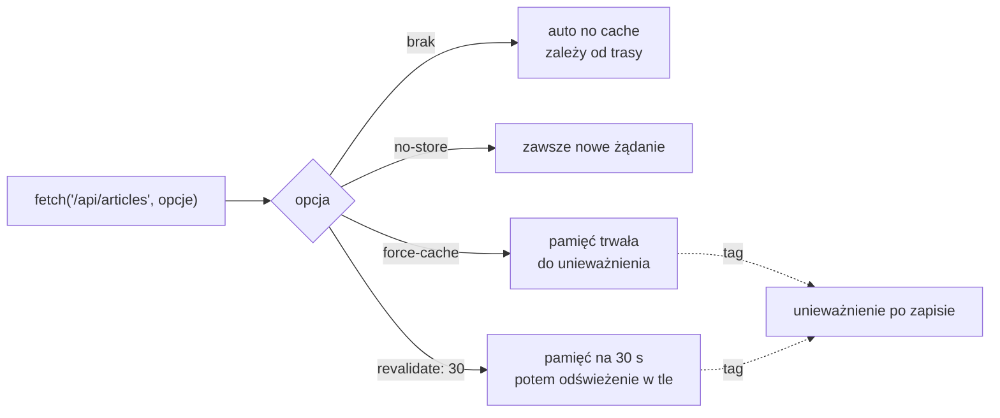

# Jak długo serwer pamięta odpowiedź

## Lista, która pyta źródło przy każdym wejściu

Strona główna pobiera artykuły z opcją `cache: "no-store"`, więc każde wejście na `/` wysyła nowe żądanie do `/api/articles`. Przy prawdziwej bazie danych to koszt: każde odświeżenie strony oznacza zapytanie. Next.js pozwala zapamiętać odpowiedź po stronie serwera. Wywołanie `fetch` w komponencie serwerowym przyjmuje trzy jawne ustawienia, a czwartym sposobem jest wywołanie bez opcji.

## Trzy jawne ustawienia

Pierwsze ustawienie wyłącza pamięć.

```js
// zawsze nowe żądanie; strona renderuje się przy każdym wejściu
const res = await fetch(`${BASE_URL}/api/articles`, {
  cache: "no-store",
});
```

Drugie zapisuje odpowiedź na stałe, aż ktoś ją unieważni, czyli oznaczy jako nieaktualną.

```js
// pamięć trwała: kolejne wejścia dostają zapisaną odpowiedź
const res = await fetch(`${BASE_URL}/api/articles`, {
  cache: "force-cache",
});
```

Przy `force-cache` żądanie pasuje do zapisu po adresie, metodzie, nagłówkach i treści, a zapisywane są tylko odpowiedzi ze statusem 200. Trzecie ustawienie daje pamięć z terminem ważności.

```js
// pamięć czasowa: wpis żyje najwyżej 30 sekund
const res = await fetch(`${BASE_URL}/api/articles`, {
  next: { revalidate: 30 },
});
```

Wartość `0` blokuje zapis, a `false` oznacza pamięć bez limitu. Tryb z liczbą sekund nazywa się **ISR** (*Incremental Static Regeneration*), czyli przyrostową regenerację statyczną: strona jest statyczna, ale odnawia się pojedynczo w trakcie działania aplikacji, bez ponownego budowania całości. Do projektu trafia zawsze jedno z tych wywołań.

## Lista, która nie chce się odświeżyć

Z pamięcią trwałą w `fetchArticles` lista na stronie głównej przestaje nadążać za magazynem:

```js
// app/page.jsx: fetchArticles z pamięcią trwałą (wariant spoza demo; BASE_URL jak w pliku)
const res = await fetch(`${BASE_URL}/api/articles`, {
  cache: "force-cache",
});
```

Odpowiedź `/api/articles` trafia do pamięci serwera przy pierwszym wejściu na stronę główną. Nowy artykuł wysłany żądaniem `POST /api/articles` prosto do Route Handlera ląduje w magazynie, a API od razu zwraca go razem z pozostałymi. Licznik w nagłówku „Artykuły (3)” na `/` się nie zmienia. Nic nie jest zepsute. Serwer Next.js podaje odpowiedź z własnej pamięci podręcznej, bo tak go poproszono.

## `fetch` z dodatkową pamięcią

W przeglądarce opcja `cache` w `fetch` dotyczy pamięci podręcznej przeglądarki. Na serwerze Next.js nadaje jej nowe znaczenie. Dokumentacja funkcji `fetch` opisuje to tak:

> **„Next.js rozszerza webowe API `fetch()`, aby każde żądanie po stronie serwera mogło ustawić własne zasady trwałej pamięci podręcznej i odświeżania.”**
>
> *„Next.js extends the Web `fetch()` API to allow each request on the server to set its own persistent caching and revalidation semantics.”*
>
> — dokumentacja Next.js, *fetch*

**Pamięć podręczna** (*cache*) to miejsce, w którym serwer przechowuje odpowiedź, żeby przy następnym żądaniu nie pytać źródła ponownie. Dane w niej z czasem się starzeją. Banks i Porcello w *Learning React* nazywają to wprost: gdy lokalne dane rozjadą się ze źródłem, tracą świeżość i nazywa się je **nieświeżymi** (*stale*). Każdy tryb pamięci podręcznej to więc decyzja, jak długo aplikacja może pokazywać dane nieświeże. **Rewalidacja** (*revalidation*) to sprawdzenie, czy zapamiętane dane są jeszcze aktualne, i pobranie nowych. Bugl w *Modern Full-Stack React Projects* definiuje ją tak: przy następnym żądaniu danych funkcja, która je pobiera, wykona się ponownie, a nowe dane zostaną zwrócone i zapamiętane zamiast poprzednich. **Unieważnienie** (*invalidation*) to oznaczenie wpisu w pamięci jako nieaktualnego, na żądanie, przed upływem jego terminu. Następne żądanie pobiera wtedy dane od nowa.

## Domyślnie bez pamięci, ale nie zawsze świeżo

Dokumentacja Next.js 16 zaczyna opis od zdania: „pamięć podręczną trzeba włączyć samodzielnie” (*„Caching is opt-in.”*). Tryb domyślny nazywa *auto no cache*. W trybie deweloperskim zasób pobiera się przy każdym żądaniu. Przy `next build` trasa zostaje wyrenderowana z góry, a `fetch` wykonuje się raz, w czasie budowania. Wyjątkiem są trasy, które czytają dane konkretnego żądania, na przykład przez `cookies()`, `headers()` albo `searchParams`. Takie trasy pobierają dane przy każdym żądaniu. Różnicę widać na dwóch stronach spoza demo.

```jsx
// app/auto/page.jsx (spoza demo): bez opcji i bez danych żądania, build oznacza trasę jako ○
const BASE_URL = process.env.BASE_URL ?? "http://localhost:3000";

export default async function Auto() {
  const items = await fetch(`${BASE_URL}/api/articles`).then((r) => r.json());
  return <p>auto: {items.length}</p>;
}
```

```jsx
// app/autoheaders/page.jsx (spoza demo): to samo z odczytem nagłówków, build oznacza trasę jako ƒ
import { headers } from "next/headers";

const BASE_URL = process.env.BASE_URL ?? "http://localhost:3000";

export default async function AutoHeaders() {
  await headers(); // odczyt danych żądania przenosi render na chwilę żądania
  const items = await fetch(`${BASE_URL}/api/articles`).then((r) => r.json());
  return <p>autoheaders: {items.length}</p>;
}
```

Po dopisaniu czwartego artykułu zbudowana pierwsza strona pokazuje nadal „auto: 3”, czyli liczbę z chwili budowania, a druga „autoheaders: 4”. <u>Brak opcji nie oznacza świeżych danych: o tym, kiedy wykona się `fetch`, decyduje wtedy reszta trasy</u>.

Książka Bugla, pisana dla Next.js 14, opisuje stan odwrotny: „żądania przez fetch domyślnie trafiają do pamięci podręcznej” (*„requests with fetch are cached by default”*). To zachowanie zmieniło się w Next.js 15. Przykład skopiowany z takiego poradnika da w Next.js 16 dane świeże w `next dev`, a zamrożone w buildzie, jeśli trasa jest statyczna.

## Pamięć czasowa i odświeżanie w tle

Upływ 30 sekund przy `revalidate: 30` nie oznacza, że następne wejście dostanie świeże dane. Przewodnik *How Revalidation Works* opisuje to tak:

> **„Rewalidacja czasowa używa wzorca stale-while-revalidate. Zapamiętana treść jest podawana od razu, a regeneracja w tle rusza, gdy wiek treści przekroczy czas `cacheLife` albo `revalidate`. Nieświeża treść jest podawana dalej, dopóki świeża nie będzie gotowa.”**
>
> *„Time-based revalidation uses a stale-while-revalidate pattern. The cached content is served immediately, and a background regeneration is triggered when the content's age exceeds the `cacheLife` or `revalidate` duration. The stale content continues to be served until the fresh content is ready.”*
>
> — dokumentacja Next.js, *How Revalidation Works*

Nazwa wzorca znaczy „nieświeże w trakcie rewalidacji” i pochodzi z dyrektywy nagłówka HTTP `Cache-Control`. Pierwsze wejście na `/` po upływie 30 sekund pokazuje jeszcze starą liczbę artykułów, a dopiero drugie nową. Serwer produkcyjny oznacza te dwie odpowiedzi nagłówkami `x-nextjs-cache: STALE` i `x-nextjs-cache: HIT`. Bugl opisuje swój przykład inaczej: odświeżenie po co najmniej 10 sekundach ma według niego od razu pokazać nowy czas. W Next.js 16 jedno odświeżenie to za mało. <u>Pierwsze żądanie po upływie czasu dostaje dane stare i dopiero uruchamia ich wymianę.</u> Przy rzadkim ruchu dane mogą więc być starsze niż ustawiony czas.

## Tagi: nazwa dla zapamiętanych danych

Opcja `next: { tags: ["articles"] }` w wywołaniu `fetch` przypina do wpisu w pamięci nazwę `"articles"`, po której można go później unieważnić. Sam tag niczego nie odświeża: dopóki nikt go nie unieważni, wpis żyje według opcji `cache` albo `revalidate`.

## Rysunek 5.6 — cztery sposoby wywołania `fetch`



Na Rysunku 5.6 każda gałąź to jedno ustawienie. Gałąź „brak” jest jedyną, której zachowanie zależy od reszty trasy. Pozostałe trzy wybiera się jawnie. Linie przerywane prowadzą do unieważniania: dane w pamięci trwałej i czasowej można wyrzucić wcześniej, na żądanie. Gałąź `no-store` takiej linii nie ma, bo nie ma czego unieważniać.

## Pamięć trwała tylko dla danych wspólnych

Dokumentacja `fetch` dodaje szczegół o metodach. Opcja `force-cache` zapamięta każde żądanie, także `POST` oraz żądania z nagłówkami `authorization` albo `cookie`. Odpowiedź z danymi jednego zalogowanego użytkownika zapisana we wspólnej pamięci mogłaby trafić do innego. Kumar w *Fluent React* opisuje to ryzyko ogólnie: serwer obsługuje żądania wielu klientów, więc wrażliwe dane jednego nie mogą przypadkiem wyciec do drugiego. Pamięć trwałą stosuje się więc do danych wspólnych dla wszystkich, takich jak lista artykułów.

## Która pamięć jest która

Odpowiedź z danymi może zostać zapamiętana w czterech miejscach o różnym zasięgu. Każde ma tu jedną nazwę:

- **Pamięć `fetch`** leży na serwerze i trwa między żądaniami, w `.next/cache/fetch-cache`. Sterują nią opcje `cache`, `revalidate` i `tags`.
- **Deduplikacja żądań** leży na serwerze i trwa jeden przebieg renderu: ten sam `fetch` wywołany w kilku komponentach wykonuje się wtedy raz.
- **Pamięć klienta** leży w przeglądarce i trzyma wynik komponentów serwerowych (RSC Payload) odwiedzonych tras na czas przejść linkami.
- **Pamięć HTTP** leży w przeglądarce i na serwerach pośrednich. Steruje nią nagłówek `Cache-Control` odpowiedzi.

Opcje opisane wyżej dotyczą tylko pierwszej pozycji. Biblioteki, które pobierają dane w przeglądarce, mają jeszcze własne pamięci, niezależne od wszystkich czterech.

## Pamięć a budowanie aplikacji

Przy `force-cache` albo `revalidate: 30` strona `/` staje się statyczna, więc `next build` pobiera dane w czasie budowania. Serwer aplikacji wtedy jeszcze nie działa, więc build przerywa się komunikatem „Error occurred prerendering page "/"” z przyczyną `TypeError: fetch failed` i `connect ECONNREFUSED` dla adresu `127.0.0.1` z portem aplikacji. <u>Strony, która pyta własne API, nie da się prerenderować bez działającego serwera.</u> Pamięć `fetch` nie wymaga jednak strony statycznej. Wpis z `revalidate` działa tak samo na stronie renderowanej przy każdym żądaniu, bo dotyczy odpowiedzi, a nie całej strony. Demo łączy więc pamięć czasową z wywołaniem `await connection()` z `next/server`, które przenosi render na chwilę żądania:

```jsx
// app/page.jsx: nowe linie wersji końcowej
import { connection } from "next/server";

async function fetchArticles() {
  const res = await fetch(`${BASE_URL}/api/articles`, {
    next: { revalidate: 60 }, // odpowiedź API zapamiętana na 60 sekund
  });
  if (!res.ok) throw new Error(`Failed to fetch articles: ${res.status}`);
  return res.json();
}

export default async function HomePage() {
  // ...log jak wcześniej
  await connection(); // render przy żądaniu, nigdy w next build
  const articles = await fetchArticles();
  // ...JSX jak wcześniej
}
```

Build oznacza teraz `/` symbolem `ƒ` i nie potrzebuje działającego API. Każde wejście renderuje stronę od nowa, ale lista przez minutę pochodzi z pamięci `fetch`. O tym, kiedy renderuje się strona, decyduje `connection()`, a o tym, jak długo żyje odpowiedź API, opcja `revalidate`.

> 💡 **Zapamiętaj:** w Next.js 16 `fetch` na serwerze domyślnie nie zapamiętuje odpowiedzi, ale na trasie statycznej i tak wykonuje się raz, w czasie budowania. Pamięć włącza się jawnie przez `force-cache` albo `next: { revalidate: N }`, a po upływie czasu pierwsze żądanie dostaje jeszcze dane stare.


Materiał rozszerzony do tego slajdu: [`rozszerzenia/r06_cache-fetch.md`](rozszerzenia/r06_cache-fetch.md)
