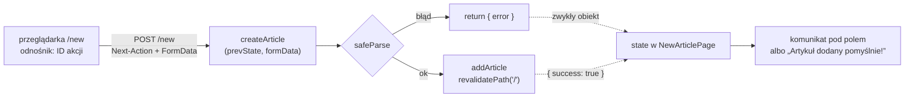

# Zapis, który wykonuje się na serwerze

## Opis poprawnego artykułu

Kolejny krok to zapis nowego artykułu do magazynu `lib/store.js`. Zanim powstanie formularz, powstaje opis poprawnych danych. Schemat w bibliotece Zod działa tak samo jak przy formularzach z akcjami w przeglądarce, w tej samej przypiętej wersji 3.25.76. Tak wygląda plik `lib/validate.js`.

```js
// lib/validate.js
import { z } from "zod";

// trzy wymagane napisy z minimalną długością; komunikaty trafią pod pola formularza
export const articleSchema = z.object({
  title: z.string().min(3, "Tytuł: minimum 3 znaki"),
  author: z.string().min(2, "Autor: minimum 2 znaki"),
  body: z.string().min(10, "Treść: minimum 10 znaków"),
});
```

Schemat leży w osobnym pliku, bo z tego samego opisu może korzystać każde miejsce, które przyjmuje artykuł. Plik nie importuje niczego z serwera, więc da się go użyć także w przeglądarce.

## Najmniejsza funkcja serwerowa

Zapis ma się wykonać na serwerze, bo tam leży magazyn. Komponent kliencki nie ma do niego dostępu, ale może wywołać funkcję, która wykona się po drugiej stronie sieci. Taką funkcję oznacza dyrektywa `"use server"`. Najmniejszy przykład spoza demo wygląda tak.

```js
// lib/ping.js
"use server"; // każdy eksport tego pliku wykonuje się na serwerze
export async function ping(name) {
  return `pong: ${name}`;
}
```

```jsx
// komponent kliencki: importuje funkcję serwerową jak zwykłą funkcję
"use client";
import { ping } from "@/lib/ping";

export default function PingButton() {
  return <button onClick={async () => alert(await ping("Ala"))}>ping</button>;
}
```

Kliknięcie wysyła żądanie, które da się zapisać w kilku liniach. Przycisk stoi w tym przykładzie na stronie głównej, więc żądanie idzie pod jej adres, a nagłówek `Next-Action` niesie identyfikator funkcji.

```text
POST /
Next-Action: 4051dec969faafcb8afae660872b527071fde1ed27
Content-Type: text/plain;charset=UTF-8

["Ala"]                      ← argumenty wywołania, zserializowane

odpowiedź:  1:"pong: Ala"    ← wartość zwrócona przez funkcję
```

Argumenty jadą w treści żądania jako tablica, a wynik wraca w formacie, z którego React odtwarza wartość.

## Server Function i Server Action

Dokumentacja Next.js używa dwóch nazw. Pierwszą definiuje w przewodniku *Mutating Data*.

> **„Server Function to funkcja asynchroniczna, która wykonuje się na serwerze. Można ją wywołać z klienta przez żądanie sieciowe, dlatego musi być asynchroniczna.”**
>
> *„A Server Function is an asynchronous function that runs on the server. You can call them from the client through a network request, which is why they must be asynchronous.”*
>
> — dokumentacja Next.js, *Mutating Data*

**Server Action** to według tego samego przewodnika funkcja serwerowa użyta w określony sposób: do obsługi formularzy i zmian danych, czyli przekazana do `<form action>` albo `<button formAction>`. Przewodnik nazywa Server Function pojęciem szerszym. `ping` wywołany w procedurze `onClick` jest więc funkcją serwerową, a `createArticle` w formularzu będzie Server Action. Wywołanie spoza formularza działa, ale React nie śledzi wtedy jego trwania. Dokumentacja Reacta zaleca zamknąć je w przejściu, czyli w `startTransition`, które oznacza aktualizację jako niepilną i daje stan oczekiwania. Schwarzmüller w *React Key Concepts* podkreśla wymóg asynchroniczności: „nie ma synchronicznych Server Actions” (*„There are no synchronous Server Actions”*).

Dyrektywę `"use server"` stawia się na dwa sposoby. Na początku pliku zamienia każdy eksport w funkcję serwerową. W pierwszej linii ciała funkcji `async` zdefiniowanej w komponencie serwerowym oznacza tylko tę funkcję. Komponent kliencki nie może definiować funkcji serwerowych. Importuje je z pliku z dyrektywą na górze albo dostaje w propsach od komponentu serwerowego.

## Co robi build

Przewodnik Next.js *Server Actions and Mutations* opisuje mechanizm, który zostawia kod funkcji na serwerze.

> **„W czasie budowania dyrektywa `'use server'` każe kompilatorowi zastąpić w paczkach klienta implementację funkcji odnośnikiem (identyfikatorem akcji i dyspozytorem), który wysyła żądanie POST z powrotem na serwer.”**
>
> *„At build time, the `'use server'` directive tells the compiler to swap the function's implementation in client bundles for a reference (an action ID plus a dispatcher) that POSTs back to the server.”*
>
> — dokumentacja Next.js, *Server Actions and Mutations*

Kumar w *Fluent React* opisuje to od strony paczki. Funkcja akcji według niego „nie jest dołączana do paczki klienta” (*„is not included in the client bundle”*) i wykonuje się na serwerze. W paczce JavaScriptu przykładu z `ping` nie ma ani ciała funkcji, ani napisu `pong:`. Pod nazwą `ping` stoi wywołanie `createServerReference("4051dec9…", callServer, …, "ping")`, czyli odnośnik z identyfikatorem. <u>Przeglądarka nie zna kodu funkcji, zna tylko jej identyfikator.</u> Razem z ciałem funkcji na serwerze zostają jej importy: magazyn, schemat i sekrety.

## Argumenty przychodzą z sieci

Tablica `["Ala"]` z żądania jest jedynym źródłem argumentów funkcji. Kto wyśle to samo żądanie z inną tablicą, ten wywoła funkcję z innymi argumentami, więc argumenty są danymi od nieznanego nadawcy. Lista typów dozwolonych w kierunku **klient → serwer** jest węższa od listy propsów. Przechodzą wartości proste, tablice, `Map`, `Set`, `Date`, `FormData`, zwykłe obiekty, obiekty Promise i inne funkcje serwerowe. Dokumentacja Reacta wymienia wyjątki.

> **„Nie są obsługiwane w szczególności: elementy Reacta, czyli JSX.”**
>
> *„Notably, these are not supported: React elements, or JSX”*
>
> — dokumentacja React, *'use server'*

Na liście nieobsługiwanych stoją też zwykłe funkcje, klasy, instancje klas i obiekty zdarzeń. Element `<b>hi</b>` przekazany do akcji nie daje błędu w przeglądarce. Serwer nie potrafi odtworzyć elementu Reacta z treści żądania, więc akcja dostaje w jego miejscu obiekt zastępczy. Taki obiekt nie ma żadnych danych elementu i przy pierwszej próbie odczytu rzuca wyjątek „Cannot access constructor on the server…”. Odwrotny kierunek, **serwer → klient**, rządzi się listą propsów, więc wartość zwrócona przez akcję może zawierać JSX.

## Akcja `createArticle`

Zapis artykułu wykonuje funkcja w pliku `lib/actions.js`.

```js
// lib/actions.js
"use server"; // ten plik eksportuje wyłącznie funkcje serwerowe

import { addArticle } from "./store";
import { articleSchema } from "./validate";
import { revalidatePath } from "next/cache";

export async function createArticle(prevState, formData) {
  // surowe wartości z FormData
  const raw = {
    title: formData.get("title"),
    author: formData.get("author"),
    body: formData.get("body"),
  };

  // walidacja na serwerze: danym z przeglądarki się nie ufa
  const result = articleSchema.safeParse(raw);
  if (!result.success) {
    return { error: result.error.flatten().fieldErrors };
  }

  // zapis do magazynu w pamięci serwera
  addArticle(result.data);

  // unieważnienie zapamiętanej strony głównej, żeby lista pokazała nowy artykuł
  revalidatePath("/");

  return { success: true };
}
```

Ciało funkcji ma układ znany z akcji formularza w przeglądarce: odczyt pól z `FormData`, `safeParse`, zwrot błędów pól jako wartości i zapis `result.data`. Nowa jest dyrektywa na górze pliku. Dzięki niej `addArticle` i schemat wykonują się po stronie, na której leży magazyn. Linia z `revalidatePath("/")` unieważnia zapamiętaną odpowiedź listy, którą strona główna trzyma w pamięci `fetch` przez minutę, więc nowy artykuł widać od razu po powrocie na listę.

## Komponent serwerowy czyta, akcja zapisuje

Dokumentacja Reacta wyjaśnia, do czego akcje służą.

> **„Funkcje serwerowe są zaprojektowane do zmian stanu po stronie serwera; nie zaleca się ich do pobierania danych. Dlatego frameworki, które je implementują, zwykle przetwarzają jedną akcję naraz i nie mają sposobu na zapamiętanie zwróconej wartości.”**
>
> *„Server Functions are designed for mutations that update server-side state; they are not recommended for data fetching. Accordingly, frameworks implementing Server Functions typically process one action at a time and do not have a way to cache the return value.”*
>
> — dokumentacja React, *'use server'*

Przewodnik Next.js potwierdza to dla swojego frameworka: „Next.js wysyła Server Actions po jednej na klienta” (*„Next.js dispatches Server Actions one at a time per client.”*). Druga akcja z tej samej karty czeka na koniec pierwszej, więc odświeżony widok zgadza się z wynikiem akcji, która go wywołała. Dwie akcje zebrane w `Promise.all` i tak trafiają do tej kolejki, więc wykonają się jedna po drugiej, a nie równolegle. <u>Komponent serwerowy czyta, a Server Action zapisuje.</u>

## Rysunek 5.7 — od pola formularza do komunikatu



Rysunek 5.7 dodaje do kodu format przesyłki: dane jadą na serwer jako `FormData` w treści typu `multipart/form-data`, a wracają jako zwykły obiekt. Akcja sama odczytuje pola po nazwach i sama wybiera kształt odpowiedzi, a komponent musi znać ten kształt, żeby wyświetlić `state.error.title[0]`. Wyjątek rzucony w akcji omija `state` i trafia do najbliższej granicy błędów, w tej aplikacji `app/error.jsx`. Wszystko, co da się opisać użytkownikowi, akcja zwraca więc jako wartość.

## Formularz `/new`

Akcję wywołuje strona z `useActionState` i przyciskiem opartym na `useFormStatus`. Oba hooki działają tak samo jak przy akcji wykonywanej w przeglądarce. Nowe linie w `app/new/page.jsx` to import akcji i podłączenie jej do formularza.

```jsx
// app/new/page.jsx (fragment)
"use client";

import { useActionState } from "react";
import { useFormStatus } from "react-dom";
import { createArticle } from "@/lib/actions";

// ... SubmitButton: useFormStatus, napis „Zapisywanie...” w trakcie wysyłki

export default function NewArticlePage() {
  const [state, action] = useActionState(createArticle, null);

  return (
    <div>
      <h1>Nowy artykuł</h1>

      {state?.success && <p>Artykuł dodany pomyślnie!</p>}

      <form action={action}>
        <div>
          <label>
            Tytuł: <input name="title" />
          </label>
          {state?.error?.title && <p>{state.error.title[0]}</p>}
        </div>
        {/* ... pola author i body w tym samym układzie, potem <SubmitButton /> */}
      </form>
    </div>
  );
}
```

**`import { createArticle } from "@/lib/actions"`** wygląda jak zwykły import, ale daje odnośnik do funkcji serwerowej. Tytuł „ab” wraca z komunikatem „Tytuł: minimum 3 znaki” pod polem, a poprawny artykuł daje napis „Artykuł dodany pomyślnie!” i nową pozycję na końcu listy pod `/`. `SubmitButton` jest zadeklarowany poza `NewArticlePage`. Deklaracja wewnątrz strony tworzyłaby przy każdym renderze nowy typ komponentu, więc React montowałby przycisk od nowa.

## Plik akcji bez dyrektywy

Usunięcie `"use server"` z `lib/actions.js` robi z pliku zwykły moduł, który bundler dokleja do kodu przeglądarki razem z importami. Next.js 16.4.0 przerywa wtedy budowanie strony `/new` komunikatem „You're importing a module that depends on "revalidatePath". This API is only available in Server Components in the App Router, but you are using it in the Pages Router”. Wzmianka o Pages Routerze myli, bo projekt go nie używa. Przyczyną jest brakująca dyrektywa.

> 💡 **Zapamiętaj:** Server Action to funkcja `async` z `"use server"`, którą build zamienia w przeglądarce na odnośnik wysyłający `POST` pod adres strony. Argumenty przychodzą z treści tego żądania, więc kontroluje je klient.


Materiał rozszerzony do tego slajdu: [`rozszerzenia/r07_server-action-i-formularz.md`](rozszerzenia/r07_server-action-i-formularz.md)
