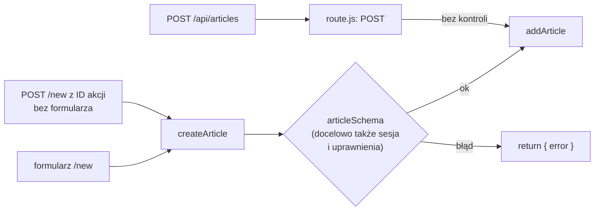

# Każde wejście do zapisu pilnuje się samo

## Trzy drogi do jednej funkcji

Akcja `createArticle` przepuszcza do magazynu tylko dane zgodne ze schematem `articleSchema`. Nie wynika z tego jeszcze, że magazyn dostaje wyłącznie takie dane. Rozstrzyga to liczba dróg, które prowadzą do funkcji zapisu. Przeglądarka artykułów zapisuje dane jedną funkcją: `addArticle` w `lib/store.js`. Prowadzą do niej jednak trzy drogi.

1. **Formularz na `/new`**, który wywołuje akcję `createArticle`.
2. **To samo żądanie `POST /new` wysłane bez formularza**, na przykład z terminala, razem z polami ukrytymi formularza.
3. **Route Handler `POST /api/articles`**, który woła `addArticle` bezpośrednio.

Pierwsza droga sprawdza dane schematem. Druga przechodzi przez tę samą akcję, więc też je sprawdza: tytuł „ab” wraca z komunikatem „Tytuł: minimum 3 znaki”. Trzecia nie sprawdza niczego. Route Handler z pliku `app/api/articles/route.js` przekazuje ciało żądania do `addArticle` bez zmian. Treść `{"title":"","author":"","body":""}` daje odpowiedź 201 i artykuł z trzema pustymi polami. Treść `{"title":5}` daje 201 i rekord z tytułem będącym liczbą 5, bez autora i bez treści. Oba trafiają na listę pod `/`. <u>Walidacja w jednym wejściu nie chroni pozostałych.</u>

## Dane od klienta są niezaufane

Każda wartość, która przychodzi z przeglądarki, mogła zostać zmieniona, na przykład w narzędziach deweloperskich albo w żądaniu napisanym ręcznie. Dokumentacja Reacta, w opisie dyrektywy `'use server'`, mówi o tym jednoznacznie.

> **„Argumenty funkcji serwerowych są w pełni kontrolowane przez klienta. Ze względów bezpieczeństwa zawsze traktuje się je jako dane niezaufane i odpowiednio je waliduje oraz zabezpiecza.”**
>
> *„Arguments to Server Functions are fully client-controlled. For security, always treat them as untrusted input, and make sure to validate and escape arguments as appropriate.”*
>
> — dokumentacja React, *'use server'*

Server Action wygląda w kodzie jak zwykła funkcja importowana przez komponent, a po zbudowaniu jest **publicznym punktem końcowym HTTP**: każdy, kto zna identyfikator, może ją wywołać własnym żądaniem. Dokumentacja mutacji danych umieszcza tę regułę w ostrzeżeniu.

> **„Funkcje serwerowe są osiągalne przez bezpośrednie żądania POST, nie tylko przez interfejs aplikacji. Zawsze sprawdzaj uwierzytelnienie i autoryzację w każdej funkcji serwerowej.”**
>
> *„Server Functions are reachable via direct POST requests, not just through your application's UI. Always verify authentication and authorization inside every Server Function.”*
>
> — dokumentacja Next.js, *Mutating Data*

Identyfikator akcji nie wiąże jej też z jedną stroną. Akcję używaną na jednej stronie da się wykonać żądaniem `POST` pod dowolną inną ścieżkę aplikacji, na przykład `/swr-demo`, jeśli nagłówek `Next-Action` niesie jej identyfikator. Przewodnik *Data Security* zapewnia, że funkcje serwerowe niewykorzystane w aplikacji znikają z paczki klienta i nie mają publicznego punktu końcowego. W Next.js 16.4.0 funkcja eksportowana z pliku `"use server"`, ale nigdzie nieimportowana, rzeczywiście nie dostaje identyfikatora w manifeście budowania. Akcja używana przez aplikację pozostaje jednak osiągalna spod każdej ścieżki i dlatego sama kontroluje dane.

## Walidacja i zabezpieczenie

Ten sam schemat może działać w przeglądarce i na serwerze, bo `lib/validate.js` nie importuje niczego z serwera. Ochronę daje tylko kopia po stronie serwera, bo tylko ten kod wykonuje się zawsze, niezależnie od tego, czym wysłano żądanie.

Dokumentacja Reacta używa dwóch czasowników: walidować i zabezpieczać (*validate and escape*). **Walidacja** odrzuca dane o złym kształcie. **Zabezpieczenie** dotyczy danych, które przechodzą walidację, ale trafiają później do innego języka, na przykład do zapytania SQL albo do HTML-a. Tytuł „Intro'; DROP TABLE articles; --” ma poprawną długość, więc schemat go przepuści. Przed wstawieniem do zapytania musi go zabezpieczyć biblioteka bazy danych, na przykład przez zapytania z parametrami.

Schemat w tej aplikacji ustala tylko minimalne długości, a **górnej granicy nie ustawia**. Górna granica też jest częścią walidacji. Bez niej pole `body` przyjmie tekst aż do limitu ciała żądania akcji. Limit wynosi domyślnie 1 MB i zmienia go opcja `serverActions.bodySizeLimit`. Dłuższa treść kończy się błędem „Body exceeded 1 MB limit.” i odpowiedzią 500, zanim akcja w ogóle się wykona. Limit chroni serwer, ale nie wyraża żadnej reguły aplikacji. Metoda `.max(...)` w Zod zamknęłaby tę lukę jedną linijką na pole.

## Naprawa w miejscu wejścia

Najprostsza naprawa używa tego samego schematu w Route Handlerze. Schemat leży w `lib/validate.js`, więc `app/api/articles/route.js` może go zaimportować. Poniższa wersja `POST` nie należy do projektu i pokazuje tylko kierunek zmiany.

```js
// app/api/articles/route.js, wariant spoza demo: POST sprawdzany tym samym schematem
import { NextResponse } from "next/server";
import { addArticle } from "@/lib/store";
import { articleSchema } from "@/lib/validate";

export async function POST(request) {
  let body;
  try {
    body = await request.json();
  } catch {
    return NextResponse.json({ error: "Invalid JSON" }, { status: 400 }); // ciało nie jest JSON-em
  }

  const result = articleSchema.safeParse(body);
  if (!result.success) {
    // 400: przyczyna leży w wysłanych danych; kształt błędów jak w formularzu
    return NextResponse.json({ error: result.error.flatten().fieldErrors }, { status: 400 });
  }
  const article = addArticle(result.data);
  return NextResponse.json(article, { status: 201 });
}
```

Ciało, którego nie da się odczytać jako JSON, dostaje teraz odpowiedź 400 zamiast 500, a treść `{"title":5}` odpowiedź 400 z trzema komunikatami zamiast miejsca na liście.

```text
{"error":{"title":["Expected string, received number"],"author":["Required"],"body":["Required"]}}
```

Kod 400 (*Bad Request*) mówi klientowi, że przyczyna leży w wysłanych danych. Treść odpowiedzi ma ten sam kształt co błędy w formularzu, więc klient API dostaje komunikaty tego samego rodzaju co użytkownik strony `/new`. Dwa ostatnie komunikaty są domyślnymi tekstami Zod 3, bo schemat definiuje własne komunikaty tylko dla zbyt krótkich napisów.

## Warstwa dostępu do danych

Jest też rozwiązanie mocniejsze. Wszystkie trzy drogi kończą się w `addArticle`. Gdyby sprawdzenie stało w tej funkcji, a nie przed nią, każde przyszłe wejście do zapisu dostałoby je automatycznie. `lib/store.js` jest już warstwą dostępu do danych (*Data Access Layer*), czyli jedynym miejscem, które wie, gdzie leżą dane. Dokumentacja Next.js dokłada do tej warstwy kontrolę: moduł wykonywany tylko na serwerze sprawdza uprawnienia i dane, zanim cokolwiek odczyta albo zapisze. Akcje i Route Handlery stają się wtedy cienkie i tylko przekazują dane dalej.

Bugl w *Modern Full-Stack React Projects* odradza drogę na skróty, czyli zapytania do bazy wpisane wprost w komponent.

> **„To wzorzec, w którym baza jest odpytywana bezpośrednio w komponentach serwerowych. Może przydać się do szybkiego prototypowania i nauki. Nie należy go jednak używać w aplikacji produkcyjnej z powodu problemów ze skalowalnością i ryzyka wprowadzenia luk bezpieczeństwa.”**
>
> *„This is a pattern where the database is queried directly in RSCs. This approach can be useful for rapid prototyping and learning. However, it should not be used in a production app due to scalability issues and the potential introduction of security problems.”*
>
> — Daniel Bugl, *Modern Full-Stack React Projects*

Warstwa dostępu do danych oddziela według Bugla obsługę danych, razem z wyzwaniami bezpieczeństwa, od interfejsu, który dane wyświetla. Moduł `lib/store.js` zamyka się przed przeglądarką jednym importem.

```js
// lib/store.js, pierwsze linie wariantu spoza demo
import "server-only"; // build przerwie się, gdy moduł trafi do komponentu klienckiego
```

Import nie zmienia działania magazynu po stronie serwera: komponenty serwerowe, Route Handler i `lib/actions.js` korzystają z niego jak wcześniej. Zmienia się los błędu. Przypadkowy import magazynu w komponencie klienckim przestaje być cichym wyciekiem kodu do paczki przeglądarki i staje się przerwanym buildem z komunikatem „You're importing a module that depends on "server-only"”. Ślad importu w tym komunikacie kończy się wpisem `[Client Component Browser]` przy pliku winnego komponentu.

## Rysunek 5.8 — wejścia do zapisu i ich kontrola



Rysunek 5.8 pokazuje, gdzie stoi kontrola: tylko na drodze przez akcję, a strzałka z Route Handlera omija ją i trafia prosto do zapisu. Romb przeniesiony do wnętrza `addArticle` leżałby na wszystkich trzech drogach naraz.

## Kolejność kontroli: kto, czy wolno, jakie dane

Ta aplikacja nie ma logowania i każdy może dodać artykuł. W aplikacji z kontami akcja sprawdza trzy rzeczy, w ustalonej kolejności:

1. **Uwierzytelnienie** (*authentication*): kto wysyła żądanie, czyli czy istnieje ważna sesja.
2. **Autoryzacja** (*authorization*): czy ta osoba może zmienić ten konkretny zasób, na przykład czy artykuł należy do zalogowanej osoby.
3. **Walidacja**: czy dane mają poprawny kształt. Ten krok wykonuje schemat.

Sesja idzie pierwsza, bo walidacja danych od nieznanej osoby jest zbędną pracą. Banks i Porcello w *Learning React* zauważają, że autoryzacja jest prawie zawsze wymagana, gdy użytkownik wykonuje operacje na serwerze żądaniami `POST`, `PUT` albo `DELETE`. Skąd akcja bierze sesję, mówi dokumentacja dyrektywy `use server`. Uwierzytelnienie odczytuje się z ciasteczek albo nagłówków, a tokenów nie przyjmuje się jako argumentów funkcji (*„rather than accepting tokens as function parameters”*). Argument przychodzi od klienta, więc token w argumencie niczego nie dowodzi.

Środkowy krok najłatwiej pominąć. Formularz edycji wysyła `id` artykułu, a akcja zapisuje zmianę pod tym `id`. Bez sprawdzenia właściciela każdy zmieni cudzy wpis, podmieniając liczbę w żądaniu. Taki błąd nazywa się **IDOR** (*Insecure Direct Object Reference*). Przewodnik Next.js zauważa, że schemat go nie wyłapie.

> **„Walidacja schematem (Zod lub podobnym) sprawdza tylko kształt danych. Poprawnie zbudowany obiekt `Item` może nadal wskazywać wiersz, który nie należy do wywołującego.”**
>
> *„Schema validation (zod or similar) only checks the shape of the input. A well-formed `Item` object can still refer to a row the caller does not own.”*
>
> — dokumentacja Next.js, *Server Actions and Mutations*

Sprawdzenie na poziomie strony nie wystarcza. Przewodnik *Data Security* pisze, że kontrola uwierzytelnienia na stronie nie obejmuje akcji zdefiniowanych w tej stronie (*„A page-level authentication check does not extend to the Server Actions defined within it.”*). Strona może przekierować niezalogowanego, a akcja i tak przyjmie jego żądanie `POST`, jeśli sama nie sprawdzi sesji.

> 💡 **Zapamiętaj:** każde wejście, które zapisuje dane, samo sprawdza ich kształt, bo Server Action i Route Handler to publiczne punkty końcowe. Ochrony frameworka, takie jak kontrola `Origin`, tego sprawdzenia nie zastępują.


Materiał rozszerzony do tego slajdu: [`rozszerzenia/r08_bezpieczenstwo-zapisu.md`](rozszerzenia/r08_bezpieczenstwo-zapisu.md)
