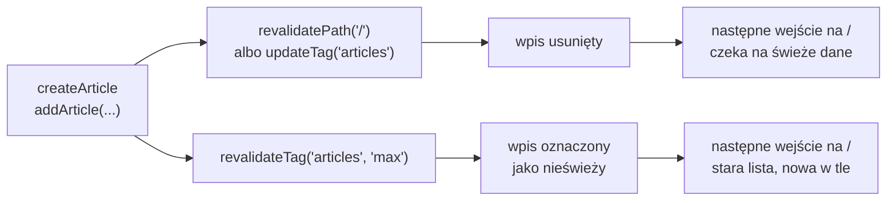

# Po zapisie lista musi się odświeżyć

## Artykuł dodany, lista stara

Formularz `/new` zapisuje już tylko poprawne dane. Zapis to jednak połowa drogi, bo lista na stronie głównej musi się o nim dowiedzieć. W akcji `createArticle` odpowiada za to jedna linia przed `return`:

```js
// lib/actions.js (fragment)
addArticle(result.data);
revalidatePath("/"); // unieważnia zapamiętane dane strony głównej
return { success: true };
```

Lista na stronie głównej trzyma odpowiedź `/api/articles` w pamięci `fetch` przez 60 sekund (`next: { revalidate: 60 }`). Wywołanie `await connection()` sprawia tylko, że sama strona renderuje się przy każdym żądaniu. Bez linii z `revalidatePath` akcja zapisuje artykuł, ale licznik „Artykuły (…)” stoi w miejscu, także po F5. Rośnie najwcześniej po minucie:

```js
// lib/actions.js: wariant z wyłączoną linią (do omówienia)
addArticle(result.data);
// revalidatePath("/"); // bez unieważnienia lista podaje zapamiętaną odpowiedź
```

Po upływie minuty pierwsze wejście dostaje jeszcze starą liczbę, a dopiero następne nową, bo pamięć czasowa działa według wzorca *stale-while-revalidate*.

Z punktu widzenia serwera wszystko działa. `addArticle` dopisała artykuł do magazynu, a strona główna uczciwie podaje odpowiedź zapamiętaną zgodnie z opcją `revalidate`. Z punktu widzenia osoby, która przed chwilą kliknęła „Dodaj artykuł”, aplikacja zgubiła jej dane. Z linią `revalidatePath("/")` ta sama lista pokazuje nowy artykuł od razu po powrocie na stronę główną.

## Odczyt własnego zapisu

Ten wymóg ma nazwę: **odczyt własnego zapisu** (*read-your-own-writes*). Kto zapisał dane, ten przy następnym odczycie widzi swój zapis. Dokumentacja Next.js używa tej nazwy przy funkcji `updateTag`. Chodzi o sytuację, gdy użytkownik tworzy wpis, „a interfejs od razu pokazuje zmianę zamiast nieaktualnych danych” (*„and the UI immediately shows the change, rather than stale data”*).

Wymóg nie dotyczy wszystkich czytelników jednakowo. Inna osoba, która ma otwartą listę, może zobaczyć nowy artykuł minutę później i nic złego się nie stanie. Autor oczekuje go jednak od razu, bo inaczej uzna, że zapis się nie udał, i wyśle formularz drugi raz. Rewalidacja po zapisie istnieje głównie dla autora.

Bugl w *Modern Full-Stack React Projects* formułuje ogólną regułę.

> **„Najlepszym sposobem radzenia sobie z nieaktualnymi danymi jest rewalidacja pamięci podręcznej, gdy pojawiają się nowe dane, na przykład przez Server Actions.”**
>
> *„The best way of dealing with stale data is to revalidate the cache when new data comes in, for example, via Server Actions.”*
>
> — Daniel Bugl, *Modern Full-Stack React Projects*

Barklund w *React in Depth* opisuje ten zabieg jako unieważnienie pamięci (*cache invalidation*): świeże dane pobiera się dopiero przy następnej potrzebie, bez przeliczania pamięci po każdej operacji. `revalidatePath` robi to po stronie serwera.

Dokumentacja mutacji danych opisuje ten wzorzec tak.

> **„Po wykonaniu mutacji można unieważnić pamięć Next.js i pokazać zaktualizowane dane, wywołując `revalidatePath` albo `revalidateTag` w funkcji serwerowej.”**
>
> *„After performing a mutation, you can revalidate the Next.js cache and show the updated data by calling `revalidatePath` or `revalidateTag` within the Server Function”*
>
> — dokumentacja Next.js, *Mutating Data*

## Jedna odpowiedź niesie wynik i nowy widok

Po wywołaniu `revalidatePath` akcja nie kończy się samym `{ success: true }`. Przewodnik *Server Actions and Mutations* opisuje, co wraca w odpowiedzi na żądanie `POST /new`. Next.js wykonuje akcję, a potem jeszcze w tym samym żądaniu renderuje na serwerze bieżącą trasę. Odpowiedź zawiera wartość zwróconą dla `useActionState` i nowy RSC Payload, czyli opis drzewa komponentów serwerowych. Zapis, unieważnienie pamięci i ponowny render kończą się więc w jednej wymianie z serwerem. Akcja, która nie unieważnia niczego, niesie w odpowiedzi tylko swoją wartość.

## Trzy zasięgi `revalidatePath`

Dokumentacja definiuje funkcję krótko: `revalidatePath` unieważnia na żądanie zapamiętane dane dla wskazanej ścieżki. Wywołać ją można w funkcjach serwerowych i w Route Handlerach (*„`revalidatePath` can be called in Server Functions and Route Handlers.”*). Nie wywołuje się jej w komponencie klienckim ani w trakcie renderowania komponentu serwerowego. O zasięgu decydują dwa argumenty:

```js
revalidatePath("/");                      // jedna strona o dosłownej ścieżce
revalidatePath("/articles/[id]", "page"); // każda strona pasująca do wzorca
revalidatePath("/", "layout");            // wszystko pod layoutem głównym
```

1. **Ścieżka dosłowna**, taka jak `"/"` czy `"/articles/4"`, unieważnia jedną stronę. Drugiego argumentu się wtedy nie podaje.
2. **Wzorzec z segmentem dynamicznym** wymaga drugiego argumentu, `'page'` albo `'layout'`. Wywołanie `revalidatePath("/articles/[id]", "page")` unieważnia wszystkie strony szczegółów naraz. Funkcja działa na strukturze plików tras, a nie na adresie widocznym dla użytkownika, więc wzorzec zapisuje się tak, jak nazywa się katalog `app/articles/[id]`.
3. **`revalidatePath("/", "layout")`** według dokumentacji czyści pamięć klienta i unieważnia wszystkie zapamiętane dane w aplikacji.

Skutek zależy też od miejsca wywołania. W funkcji serwerowej interfejs odświeża się od razu, jeśli użytkownik ogląda wskazaną ścieżkę. W Route Handlerze ścieżka zostaje tylko oznaczona, a odświeżenie następuje przy następnej wizycie.

## Pamięć `fetch` i pamięć klienta

Lista po zapisie może być nieaktualna w dwóch miejscach naraz: w pamięci `fetch` na serwerze i w pamięci klienta w przeglądarce, która zachowuje widoki odwiedzonych tras. Ścieżka dosłowna w akcji obejmuje obie. Na serwerze unieważnia wpis wskazanej strony, a w przeglądarce według dokumentacji odświeża przy kolejnej nawigacji wszystkie odwiedzone strony, co ma się w przyszłości zawęzić do podanej ścieżki.

Każda z tych pamięci ma własne wywołanie, które ją czyści. W zestawieniu są też funkcje działające na tagach i `refresh`. Ostatni wiersz to `mutate` z biblioteki SWR, której pamięć leży w przeglądarce.

| Wywołanie | Gdzie | Pamięć `fetch` na serwerze | Pamięć SWR |
|---|---|---|---|
| `revalidatePath("/")` | akcja, Route Handler | unieważnia wpisy strony `/` | bez zmian |
| `revalidatePath("/", "layout")` | akcja, Route Handler | unieważnia wszystkie wpisy | bez zmian |
| `updateTag("articles")` | tylko akcja | usuwa wpisy z tagiem, następny odczyt czeka na nowe dane | bez zmian |
| `revalidateTag("articles", "max")` | akcja, Route Handler | oznacza wpisy jako nieświeże, następny odczyt dostaje stare | bez zmian |
| `refresh()` | tylko akcja | bez zmian | bez zmian |
| `router.refresh()` | komponent kliencki | bez zmian | bez zmian |
| `mutate()` | komponent kliencki | bez zmian | pobiera wpis klucza od nowa |

Dwa wiersze z „bez zmian” w obu kolumnach nie są pomyłką: `refresh()` i `router.refresh()` dają tylko nowy render bieżącej trasy, który czyta tę samą pamięć `fetch`.

## Unieważnienie zamiast krótkiego czasu

Brak rewalidacji dałoby się też obejść inaczej: ustawić `revalidate: 1` zamiast 60. Lista byłaby nieaktualna najwyżej przez sekundę. To rozwiązanie ma dwie wady. Serwer odświeżałby listę co sekundę także wtedy, gdy nikt nic nie dodaje, a autor nadal mógłby trafić na starą wersję, jeśli wróci na listę szybciej.

Unieważnienie po zapisie odwraca ten rachunek. Pamięć może trwać długo, nawet bez limitu przy `force-cache`, bo każdy zapis ją czyści. Limit czasu zostaje jako zabezpieczenie dla zmian, o których aplikacja się nie dowie, na przykład wprowadzonych bezpośrednio w bazie.

## Druga droga zapisu bez rewalidacji

Aplikacja ma jeszcze jedno wejście do magazynu: `POST /api/articles`. Ten Route Handler dopisuje artykuł, ale nie wywołuje `revalidatePath`. Przy `revalidate: 60` na stronie głównej artykuł dodany przez to wejście pojawia się na liście dopiero po wygaśnięciu wpisu. Przy `force-cache` czekałby na unieważnienie, bo pamięć `fetch` przeżywa nawet restart serwera. Rewalidację wywołuje każde miejsce, które zmienia dane, a nie tylko formularz.

Pominięcie jednego wywołania nie daje żadnego błędu w konsoli. Objawia się dopiero starymi danymi na ekranie, czasem po wielu minutach, gdy nikt już nie łączy ich z ostatnią zmianą w kodzie. Wywołanie umieszczone w samej `addArticle` objęłoby wszystkie wejścia naraz.

## Rozszerzenie: `refresh()` odświeża widok, a nie dane

Next.js ma dwie funkcje o podobnej nazwie, które działają tylko na pamięć klienta. `router.refresh()` z hooka `useRouter` pobiera od serwera nowy widok bieżącej trasy, bez utraty stanu komponentów klienckich. Funkcja `refresh()` z `next/cache` robi to samo z wnętrza Server Action:

```js
// lib/actions.js, wariant spoza demo: akcja odświeża widok, ale nie unieważnia pamięci fetch
"use server";
import { refresh } from "next/cache";
import { addArticle } from "./store";

export async function addAndRefresh(article) {
  addArticle(article);
  refresh(); // nowy render trasy z tą samą zapamiętaną odpowiedzią
}
```

Dokumentacja `useRouter` stawia granicę wprost:

> **„Czyści pamięć klienta dla bieżącej trasy, ale nie unieważnia pamięci po stronie serwera.”**
>
> *„This clears the Client Cache for the current route, but does **not** invalidate the server-side cache.”*
>
> — dokumentacja Next.js, *useRouter*

Na stronie z `force-cache` ponowny render dostaje tę samą odpowiedź z pamięci `fetch`. Magazyn ma już nowy artykuł, a licznik na liście stoi w miejscu, tak samo jak po akcji bez żadnego wywołania z `next/cache`. `refresh` przydaje się, gdy widok zależy od stanu poza pamięcią, na przykład od ciasteczka. Po zmianie danych zapamiętanych potrzebne jest unieważnienie.

## Rozszerzenie: tag zamiast ścieżki

Ścieżka wskazuje stronę, a tag z opcji `next: { tags }` wskazuje dane na dowolnej liczbie stron. Tag dopisuje się w wywołaniu `fetch`.

```js
// app/page.jsx, wariant spoza demo: każde wywołanie fetch z tagiem "articles" należy do jednej grupy
const res = await fetch(`${BASE_URL}/api/articles`, {
  cache: "force-cache",
  next: { tags: ["articles"] },
});
```

Zapis unieważnia grupę funkcją z `next/cache`. Akcja i Route Handler używają różnych funkcji.

```js
// lib/actions.js, wariant spoza demo
"use server";
import { updateTag } from "next/cache";

export async function createArticle(prevState, formData) {
  // ... walidacja i addArticle(result.data) bez zmian
  updateTag("articles"); // wpis wygasa, następny odczyt czeka na świeże dane
  return { success: true };
}
```

```js
// app/api/articles/route.js, wariant spoza demo
import { NextResponse } from "next/server";
import { revalidateTag } from "next/cache";
import { addArticle } from "@/lib/store";

export async function POST(request) {
  const article = addArticle(await request.json()); // zapis jak w demo
  revalidateTag("articles", "max"); // wpis staje się nieświeży
  return NextResponse.json(article, { status: 201 });
}
```

Tag to dowolny napis do 256 znaków, najwyżej 128 tagów na jedno wywołanie `fetch`. <u>Wszystkie wywołania `fetch` z tym samym tagiem, na dowolnej stronie, tworzą jedną grupę</u>, którą unieważnia się jednym wywołaniem. Dwie funkcje różnią się tym, co zobaczy następny czytelnik:

- **`updateTag("articles")`** działa wyłącznie w Server Action i od razu usuwa wpis. Następne żądanie czeka na świeże dane, więc autor widzi swój zapis już przy pierwszym wejściu na listę. Przewodnik dodaje, że oczekiwanie obejmuje też render dołączany do odpowiedzi akcji. To narzędzie dokładnie na sytuację z formularzem `/new`.
- **`revalidateTag("articles", "max")`** działa także w Route Handlerze. Profil `'max'` daje zachowanie *stale-while-revalidate*: pierwsze wejście po wywołaniu dostaje jeszcze starą listę i uruchamia pobranie w tle, a dopiero kolejne widzi nowy artykuł.

Dokumentacja `revalidateTag` mówi wprost, że forma z jednym argumentem jest przestarzała (*„The single-argument form `revalidateTag(tag)` is deprecated.”*). Działa dziś jak natychmiastowe wygaśnięcie, ale może zniknąć w przyszłej wersji. Gdy dane muszą wygasnąć od razu poza Server Action, dokumentacja podaje wariant `revalidateTag(tag, { expire: 0 })`.

## Rysunek 5.9 — dwie ścieżki unieważnienia na osi czasu



Rysunek 5.9 dodaje oś czasu: różnica między ścieżkami leży w tym, które wejście na `/` pierwsze zobaczy nowy artykuł.

## Rozszerzenie: rewalidacja na żądanie z zewnątrz

Funkcja `revalidateTag` ma sens tam, gdzie zmiana nie przechodzi przez formularz. Bugl definiuje **webhook** jako API wywoływane zwrotnie: gdy dane się zmienią, zewnętrzne źródło, na przykład system zarządzania treścią, wywołuje punkt końcowy aplikacji, żeby dać znać, że trzeba pobrać dane ponownie. Taki punkt to zwykły Route Handler z `revalidateTag` albo `revalidatePath`. Bugl zaznacza, że webhooki definiuje się zwykle jako Route Handlery `POST`, bo wpływają na stan aplikacji. Adres webhooka jest publiczny jak każdy Route Handler, więc obowiązują go te same kontrole wejścia co akcję.

Dokumentacja zaznacza też, że rewalidację uruchamia żądanie, a nie samo wywołanie `revalidateTag`. Strony z tagiem odświeżają się w miarę odwiedzin, a nie wszystkie naraz. Przy kilku instancjach serwera za równoważeniem ruchu wywołanie działa domyślnie tylko na instancji, która je dostała. Pozostałe podają stare dane, dopóki wspólny magazyn pamięci nie przekaże im zdarzenia.

## Rozszerzenie: ścieżka czy tag

`revalidatePath("/")` unieważnia tylko stronę `/`. Gdyby lista artykułów stała też na drugiej stronie, tamta dalej pokazywałaby stare dane. Tag rozwiązuje to jednym wywołaniem, bo obejmuje każde oznaczone nim żądanie na każdej stronie. Bugl opisuje to tak: rewalidacja tagiem może objąć wiele ścieżek naraz.

Oba mechanizmy mają wspólny fundament. Przewodnik *How revalidation works* opisuje **tagi miękkie** (*soft tags*), które Next.js nadaje sam na podstawie ścieżki, z przedrostkiem `_N_T_`. Trasa `/blog/hello` dostaje między innymi `_N_T_/layout` i `_N_T_/blog/hello`, a `revalidatePath` unieważnia właśnie te tagi. Ścieżka to więc tag wyprowadzony z drzewa plików, a tag jawny to nazwa nadana danym.

W tej aplikacji wystarcza ścieżka. Lista artykułów występuje tylko na `/`, a strona szczegółów czyta magazyn bezpośrednio przez `getArticle`, bez pamięci `fetch`. <u>Unieważnia się dokładnie to, co pokazuje zmienione dane.</u>

> 💡 **Zapamiętaj:** po zapisie akcja unieważnia pamięć danych, które się zmieniły, w tej aplikacji przez `revalidatePath("/")`. Wywołanie należy do każdego wejścia, które zmienia dane, nawet gdy obecna wersja listy pamięci nie używa.

