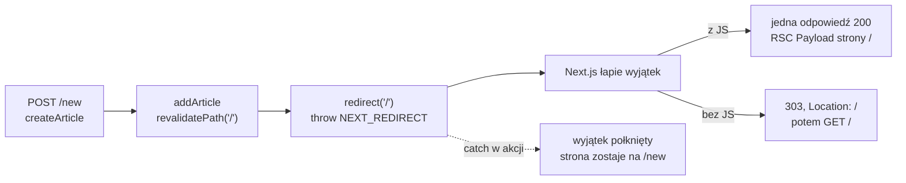

# Przekierowanie po zapisie

## Zamiast komunikatu: powrót na listę

Akcja `createArticle` po udanym zapisie zwraca `{ success: true }`, a formularz pokazuje komunikat. Częstszy wzorzec w aplikacjach to przeniesienie użytkownika na stronę, na której widać efekt zapisu. W `lib/actions.js` dochodzi import, a w miejsce `return { success: true }` trafia wywołanie `redirect`:

```js
// lib/actions.js (nowe linie i ich otoczenie)
import { redirect } from "next/navigation";

export async function createArticle(prevState, formData) {
  // ... obiekt raw z polami FormData bez zmian ...

  const result = articleSchema.safeParse(raw);
  if (!result.success) {
    return { error: result.error.flatten().fieldErrors };
  }

  // Zapis w magazynie w pamięci
  addArticle(result.data);

  // Unieważnienie pamięci strony z listą, żeby nowy artykuł był widoczny od razu
  revalidatePath("/");

  redirect("/"); // rzuca wyjątek wewnętrznie: kod po tej linii się nie wykona
}
```

`redirect` pochodzi z modułu `next/navigation`, tego samego co `notFound`. Po udanym zapisie użytkownik trafia na listę, a nowy artykuł jest na niej od razu dzięki wcześniejszemu `revalidatePath`. Gałąź z błędem walidacji nadal zwraca `{ error }`. Za krótki tytuł zostawia więc użytkownika na `/new` z komunikatem „Tytuł: minimum 3 znaki” pod polem, a przekierowanie dotyczy tylko sukcesu.

Schwarzmüller w *React Key Concepts* opisuje ten układ jako typowy.

> **„To bardzo częsty wzorzec w aplikacjach full-stack, bo zwykle chce się przenieść użytkowników na inną stronę po tym, jak wyślą dane.”**
>
> *„This is a very common pattern when building fullstack applications since you often want to navigate your website users to a different page once they have submitted data.”*
>
> — Maximilian Schwarzmüller, *React Key Concepts*

Bugl w *Modern Full-Stack React Projects* stosuje go przy tworzeniu wpisu na blogu: po zapisie akcja przekierowuje na stronę nowego posta. Tutaj celem jest lista, bo akcja nie używa obiektu zwracanego przez `addArticle`. Wariant z przekierowaniem na `/articles/4` wymagałby odczytania z tego obiektu pola `id`.

## Dlaczego przekierowanie: problem ponownego wysłania

Zwykły formularz HTML wysyła żądanie `POST`, a serwer odpowiada stroną z wynikiem. Taka strona pamięta, że powstała z żądania `POST`. Dokumentacja MDN o przekierowaniach opisuje skutek: wciśnięcie przycisku odświeżania wyśle żądanie ponownie, czasem po prośbie o potwierdzenie. Przy formularzu dodawania oznacza to drugi, identyczny artykuł. Rozwiązanie MDN opisuje w tym samym miejscu:

> **„W takim przypadku serwer może odesłać odpowiedź 303 (See Other) z adresem, pod którym znajduje się właściwa informacja. Po wciśnięciu przycisku odświeżania wyświetla się ponownie tylko ta strona, bez powtarzania niebezpiecznych żądań.”**
>
> *„In this case, the server can send back a 303 (See Other) response for a URL that will contain the right information. If the reload button is pressed, only that page is redisplayed, without replaying the unsafe requests.”*
>
> — MDN Web Docs, *Redirections in HTTP*

Wzorzec nosi nazwę **Post/Redirect/Get** (PRG): formularz wysyła `POST`, serwer odpowiada przekierowaniem, a przeglądarka pobiera stronę wyniku metodą `GET`. Żądanie „niebezpieczne” to w języku HTTP takie, które zmienia stan serwera. Po odświeżeniu powtarza się tylko ostatnie, bezpieczne żądanie. Kumar w *Fluent React* pokazuje ten sam schemat we frameworku Remix: akcja zwraca przekierowanie do tej samej trasy, tym razem metodą `GET`, co ponownie pobiera aktualne dane.

## Co wysyła serwer w obu trybach

Dokumentacja `redirect` opisuje dwa tryby pracy w Server Action. Gdy JavaScript jest dostępny, następuje nawigacja po stronie klienta. Formularz wysłany przed załadowaniem skryptów dostaje odpowiedź HTTP **303**. Ruch sieciowy w obu trybach wygląda inaczej:

- **z JavaScriptem:** jedno żądanie `POST /new` z kodem 200 i żadnego osobnego `GET /`;
- **bez JavaScriptu:** `POST /new` z kodem 303 i nagłówkiem `Location: /`, a po nim `GET /` z kodem 200.

Pierwszy wynik wynika z tego, że odpowiedź akcji niesie wynik razem z nowym widokiem. Przy `redirect` jest to widok strony docelowej, jak opisuje przewodnik:

> **„Odpowiedź przełącza router i przesyła strumieniem RSC Payload strony docelowej.”**
>
> *„The response navigates the router and streams the destination's RSC Payload.”*
>
> — dokumentacja Next.js, *Server Actions and Mutations*

Przekierowanie z JavaScriptem nie kosztuje więc drugiej wymiany z serwerem, bo widok strony docelowej przychodzi w tej samej odpowiedzi. Wzorzec PRG zostaje zachowany w obu trybach, bo w historii przeglądarki nie ma wpisu z wysłanym formularzem.

## `redirect` przerywa funkcję wyjątkiem

Komentarz w kodzie mówi, że `redirect` „rzuca wyjątek wewnętrznie”. Taki **wyjątek sterujący** (*control-flow exception*) służy do przeniesienia sterowania do kodu, który go oczekuje, i nie oznacza awarii. Mechanizm da się odtworzyć w kilku liniach zwykłego JavaScriptu:

```js
class Redirect extends Error {}
function go(path) { throw new Redirect(path); }
function save() { go("/"); console.log("po go()"); } // ta linia się nie wykona

try { save(); }
catch (e) { console.log(e instanceof Redirect ? `przekierowanie na ${e.message}` : "inny błąd"); }
// wypisuje: przekierowanie na /
```

Next.js robi to samo. Dokumentacja podaje, że wywołanie `redirect()` rzuca wyjątek `NEXT_REDIRECT`, który framework łapie na zewnątrz akcji, a `notFound()` działa na tej samej zasadzie. Dokumentacja mutacji danych opisuje skutek dla akcji:

> **„Wywołanie `redirect` rzuca wyjątek sterujący obsługiwany przez framework. Kod po nim się nie wykona. Jeśli potrzebne są świeże dane, `revalidatePath` albo `revalidateTag` wywołuje się wcześniej.”**
>
> *„Calling `redirect` throws a framework handled control-flow exception. Any code after it won't execute. If you need fresh data, call `revalidatePath` or `revalidateTag` beforehand.”*
>
> — dokumentacja Next.js, *Mutating Data*

Projektanci frameworka mieli do wyboru dwie drogi. Funkcja `redirect` mogłaby zwracać specjalną wartość, którą każda funkcja pośrednia musiałaby przekazać wyżej przez `return`. Przy trzech poziomach wywołań to trzy miejsca, w których łatwo o pomyłkę. Wyjątek przechodzi przez wszystkie poziomy sam, więc `redirect` może stać w funkcji pomocniczej, na przykład sprawdzającej sesję, i nadal zakończy całą akcję. Ceną jest to, że każdy blok `catch` po drodze może go zatrzymać.

Z tego wynika kolejność. <u>`revalidatePath` stoi przed `redirect`, bo kod po `redirect` się nie wykona.</u> Lista w demo trzyma odpowiedź API w pamięci `fetch` przez minutę, więc odwrotna kolejność dałaby przekierowanie na listę bez nowego artykułu. Wiersz z `revalidatePath` nigdy by się nie wykonał.

## Rysunek 5.10 — przekierowanie jako wyjątek



Rysunek 5.10 zestawia na jednym schemacie trzy losy tego samego wyjątku: dwa tryby odpowiedzi i przerywaną strzałkę do bloku `catch`, który zatrzymuje go wewnątrz akcji.

## Pułapka bloku `try`

Zapis i odświeżenie łatwo objąć blokiem `try`, żeby obsłużyć ewentualny błąd zapisu. Taki układ zamienia trzy ostatnie linie `createArticle` na:

```js
// wariant błędny: redirect wewnątrz try
try {
  addArticle(result.data);
  revalidatePath("/");
  redirect("/");
} catch (e) {
  console.log("caught:", e.message); // e.message to "NEXT_REDIRECT"
  return { success: false };
}
```

Blok `catch` łapie wyjątek sterujący jak zwykły błąd. Artykuł trafia do magazynu, ale strona zostaje na `/new` z pustymi polami i bez komunikatu. Stan `{ success: false }` nie ma pola `error` ani `success: true`, więc formularz nie pokazuje niczego. Użytkownik nie wie, czy zapis się udał, i może wysłać formularz jeszcze raz. Każde takie wysłanie dopisze kolejny artykuł, choć ekran nigdy tego nie potwierdzi.

Dokumentacja `redirect` zaleca wprost wywołanie go poza blokiem `try`. Poprawny układ pokazuje przewodnik Next.js o przekierowaniach. Blok `try` obejmuje tylko wywołanie bazy danych, a `revalidatePath` i `redirect` stoją za nim. Wyjątek, którego nikt nie zaplanował, na przykład awaria bazy, nadal wychodzi z akcji do `app/error.jsx`.

## Cena przekierowania

Komunikat „Artykuł dodany pomyślnie!” przestaje być widoczny, bo formularz na `/new` znika razem ze stanem `useActionState`. Kod tego komunikatu jednak zostaje. Gałąź `{state?.success && <p>Artykuł dodany pomyślnie!</p>}` w `app/new/page.jsx` jest teraz martwym kodem: akcja po sukcesie nie zwraca już żadnej wartości, więc `state.success` nigdy nie będzie prawdą. W kodzie przeznaczonym do wdrożenia usuwa się ją razem ze zmianą akcji.

Użytkownik widzi tylko efekt: nowy artykuł na końcu listy, pod trzema istniejącymi. Przy długiej liście łatwo go przeoczyć.

> 💡 **Zapamiętaj:** `redirect` w akcji rzuca wyjątek `NEXT_REDIRECT`, który framework zamienia na nawigację w tej samej odpowiedzi albo na kod 303. Dlatego stoi po `revalidatePath` i poza blokiem `try`. Poza akcją `redirect` daje 307, więc przekierowanie po `POST` w Route Handlerze wymaga jawnego 303.


Materiał rozszerzony do tego slajdu: [`rozszerzenia/r10_przekierowanie.md`](rozszerzenia/r10_przekierowanie.md)
