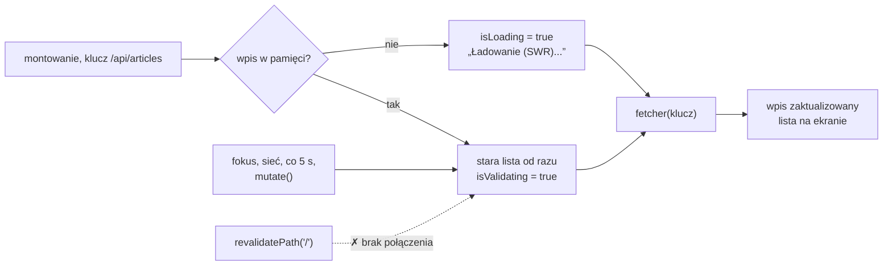

# Dane pobierane w przeglądarce: SWR

## Kiedy dane pobiera przeglądarka

Każda dotychczasowa trasa pobierała dane na serwerze, a po zapisie widok odświeżało unieważnienie pamięci albo przekierowanie. Strona `/` jest więc aktualna w chwili renderu. Gdy artykuł doda ktoś inny, otwarta strona tego nie pokaże do przeładowania. Do przeglądarki przenosi się pobieranie, gdy odpowiedź na jedno z trzech pytań tego wymaga:

1. **Czy dane mają się zmieniać w trakcie oglądania strony?** Lista odświeżana co pięć sekund wymaga kodu w przeglądarce.
2. **Czy dane zależą od interakcji po załadowaniu?** Wyniki wyszukiwania wpisywanego znak po znaku pobiera się w przeglądarce.
3. **Czy dane mogą przyjść dopiero po załadowaniu strony?** Pobranie w przeglądarce zostawia pierwszy HTML bez nich, więc treść dla wyszukiwarek pobiera się na serwerze.

Granicę wyznacza też bezpieczeństwo. Klucze API, czyli tajne identyfikatory, którymi aplikacja przedstawia się zewnętrznej usłudze, oraz hasła do bazy nie mogą trafić do przeglądarki. Pobieranie z ich użyciem zostaje więc na serwerze. Lista artykułów, która ma sama pokazywać cudze zapisy, spełnia pierwszy warunek.

## Najmniejszy przykład `useSWR`

Biblioteka SWR (projekt przypina ją w wersji 2.5.1) daje jeden główny hook, `useSWR`. Najmniejszy komponent, który pobiera dane w przeglądarce, ma kilka linii:

```jsx
"use client"; // hook działa tylko w komponencie klienckim
import useSWR from "swr";

const fetcher = (url) => fetch(url).then((r) => r.json()); // dostaje klucz, zwraca Promise z danymi

export default function Count() {
  const { data } = useSWR("/api/articles", fetcher); // klucz i funkcja pobierająca
  return <p>{data ? data.length : "…"}</p>;           // przed odpowiedzią data to undefined
}
```

Pierwszy render pokazuje „…”, bo odpowiedzi jeszcze nie ma. Po nadejściu danych komponent renderuje się ponownie i pokazuje liczbę artykułów, w projekcie 3. Hook łączy **klucz** (*key*), czyli identyfikator danych, z funkcją **`fetcher`**, która dostaje ten klucz i zwraca Promise. SWR wywołuje ją za każdym razem, gdy potrzebuje danych.

## Lista, która odświeża się sama

Strona `/swr-demo` pokazuje drugi model: dane pobiera kod w przeglądarce, który sam pilnuje ich świeżości. Plik `app/swr-demo/page.jsx` jest nowy. W pierwszej wersji wygląda tak:

```jsx
// app/swr-demo/page.jsx
"use client"; // komponent kliencki: korzysta z hooków SWR

import useSWR from "swr";

const fetcher = (url) => fetch(url).then((r) => r.json());

export default function SwrDemoPage() {
  const { data: articles, error, isLoading } = useSWR("/api/articles", fetcher);

  if (isLoading) return <p>Ładowanie (SWR)...</p>;
  if (error) return <p>Błąd: {error.message}</p>;

  return (
    <div>
      <h1>Artykuły — SWR</h1>
      <p>SWR odświeża dane przy fokusie okna i ponownym połączeniu.</p>
      <ul>
        {articles.map((a) => (
          <li key={a.id}>
            {a.title} — {a.author}
          </li>
        ))}
      </ul>
    </div>
  );
}
```

Funkcja `fetcher` stoi poza komponentem, więc nie powstaje na nowo przy każdym renderze. Nie sprawdza `r.ok`, więc odpowiedź 404 z treścią JSON trafiłaby do `data`, a nie do `error`. Dwa wczesne `return` obsługują ładowanie i błąd, a lista renderuje się dopiero przy gotowej tablicy. Strona najpierw pokazuje „Ładowanie (SWR)...”, a potem listę w formacie „Intro to Server Components — Alice”. Przeglądarka wysyła przy tym jedno żądanie `GET /api/articles`.

Kod działa w przeglądarce, więc wystarcza ścieżka `/api/articles` bez hosta. Źródłem danych jest Route Handler, jedyne miejsce, z którego przeglądarka odczytuje artykuły. Zapis z formularza idzie inną drogą, przez akcję `createArticle`. Druga wersja dodaje odświeżanie co pięć sekund. Zmienia się tylko wywołanie hooka:

```jsx
// app/swr-demo/page.jsx: wywołanie useSWR z odpytywaniem
const { data: articles, error, isLoading } = useSWR("/api/articles", fetcher, {
  refreshInterval: 5000, // ponowne pobranie co 5 sekund
});
```

Przeglądarka wysyła teraz żądanie `/api/articles` co pięć sekund. Artykuł dodany przez formularz `/new` w innym oknie pojawia się na `/swr-demo` najpóźniej po pięciu sekundach, bez odświeżania strony.

## SWR jako biblioteka danych

Nazwa SWR pochodzi od strategii *stale-while-revalidate*, tej samej, którą Next.js stosuje przy pamięci czasowej, tyle że tutaj pamięć leży w przeglądarce. Morten Barklund w *React in Depth* ujmuje rolę takich narzędzi tak:

> **„Wiele bibliotek ułatwia pracę z danymi zdalnymi, w tym TanStack Query. Te biblioteki nie są bibliotekami żądań sieciowych, tylko bibliotekami danych zbudowanymi do pracy z danymi zdalnymi.”**
>
> *„Several libraries make working with remote data easier, including TanStack Query. These libraries aren’t network request libraries—merely data libraries built for working with remote data.”*
>
> — Morten Barklund, *React in Depth*

Żądanie wysyła `fetch`, a SWR decyduje, kiedy go użyć i co zrobić z wynikiem. Dokumentacja Reacta, przy wadach pobierania w efekcie, wymienia `useSWR` i TanStack Query jako gotowe pamięci po stronie klienta. Pamięć jest wspólna dla komponentów z tym samym kluczem: trzy komponenty z kluczem `"/api/articles"` czytają jeden wpis.

## Co zwraca `useSWR`

- **`data`** to wynik `fetcher`, przed pierwszą odpowiedzią `undefined`.
- **`error`** pojawia się, gdy `fetcher` rzuci wyjątek.
- **`isLoading`** według dokumentacji API oznacza trwające żądanie przy braku załadowanych danych.
- **`isValidating`** oznacza każde trwające żądanie albo rewalidację.

Przy pierwszym wejściu obie flagi są prawdziwe, a `data` jest puste. Przy każdym kolejnym pobraniu `isLoading` zostaje fałszywe, `isValidating` staje się prawdziwe, a na ekranie zostaje stara lista. <u>Ekran ładowania zależy od `isLoading`</u>, a mały wskaźnik odświeżania od `isValidating`. Ekran oparty na `isValidating` zastępowałby listę co pięć sekund.

Dokumentacja dodaje szczegół: dane startowe i dane poprzedniego klucza nie liczą się jako załadowane. Opcja **`keepPreviousData`**, domyślnie wyłączona, zwraca dane poprzedniego klucza, dopóki nie przyjdą nowe. Wyniki wyszukiwania nie znikają wtedy przy każdej wpisanej literze.

## Czego nie ma w pierwszym HTML-u

Strona `/` wysyła listę w HTML-u. Strona `/swr-demo` wysyła napis „Ładowanie (SWR)...” i pobiera dane po załadowaniu JavaScriptu, więc robot, który skryptu nie wykona, listy nie zobaczy. Oba modele można łączyć: dane z komponentu serwerowego mogą być wartością startową dla SWR, a odpytywanie w przeglądarce dba o ich dalszą świeżość.

## Przycisk, który dodaje artykuł

Po własnym zapisie użytkownik nie powinien czekać na kolejny cykl. Ostatnia wersja pliku dostaje przycisk „Dodaj testowy artykuł”, a zdanie o fokusie okna znika. Nowe są `mutate` w wyniku hooka, funkcja obsługi i przycisk:

```jsx
// app/swr-demo/page.jsx (nowe linie)
const { data: articles, error, isLoading, mutate } = useSWR("/api/articles", fetcher, {
  refreshInterval: 5000,
});

async function handleAddTest() {
  await fetch("/api/articles", {
    method: "POST",
    headers: { "Content-Type": "application/json" },
    body: JSON.stringify({
      title: "Test SWR " + Date.now(),
      author: "SWR User",
      body: "Article added directly via fetch + SWR mutate revalidation.",
    }),
  });
  mutate(); // pobierz od razu, bez czekania na refreshInterval
}

// w JSX, pod nagłówkiem:
<button onClick={handleAddTest}>Dodaj testowy artykuł</button>
```

Funkcja **`mutate`** z wyniku hooka to według dokumentacji **związany `mutate`** (*bound mutate*), który zna klucz z wywołania `useSWR`. Wywołany bez danych oznacza wpis jako przeterminowany i pobiera go ponownie. Po kliknięciu przeglądarka wysyła `POST`, a zaraz po nim `GET` do `/api/articles`, a na końcu listy staje pozycja „Test SWR 17… — SWR User”.

`await fetch(...)` czeka na potwierdzenie zapisu. Bez `await` żądanie listy mogłoby dotrzeć przed zapisem i przynieść jeszcze trzy artykuły. Zapis idzie przez `POST /api/articles`, czyli przez Route Handler, który niczego nie waliduje. Przycisk wysyła mimo to treść zgodną ze schematem, dłuższą niż dziesięć znaków.

## Klucz jako nazwa wpisu i argument `fetcher`

Domyślnie klucz trafia do `fetcher` jako argument, więc tutaj musi być adresem. Klucz `"moje-artykuly"` daje `fetch("moje-artykuly")`, czyli `/moje-artykuly`. Next.js odpowiada stroną 404 w HTML-u, a `r.json()` rzuca `SyntaxError`. Ekran pokazuje wtedy „Błąd: Unexpected token '<', "<!DOCTYPE "... is not valid JSON”.

## Odpytywanie czy unieważnienie

Pamięć SWR jest osobna od pamięci Next.js na serwerze, więc `revalidatePath` w akcji jej nie dotyka. Artykuł z `/new` pojawia się na `/swr-demo` dzięki odpytywaniu. Unieważnienie po własnym zapisie kosztuje jedno żądanie i działa od razu, jak `mutate()`. Odpytywanie kosztuje żądanie co ustalony czas i ma sens tylko dla zmian z innego okna albo od innego użytkownika.

## Rysunek 5.11 — co uruchamia pobranie wpisu SWR



Rysunek 5.11 zbiera w jednym węźle wszystkie wyzwalacze pobrania i pokazuje przerywaną strzałką ze znakiem ✗ połączenie, którego nie ma: `revalidatePath` nie uruchamia pobrania w SWR.

> 💡 **Zapamiętaj:** klucz SWR jest nazwą wpisu w pamięci i argumentem `fetcher`. Ekran ładowania zależy od `isLoading`, a związany `mutate()` odświeża wpis po własnym zapisie. Pamięć SWR żyje w przeglądarce i nie widzi rewalidacji z serwera.


Materiał rozszerzony do tego slajdu: [`rozszerzenia/r11_swr.md`](rozszerzenia/r11_swr.md)
