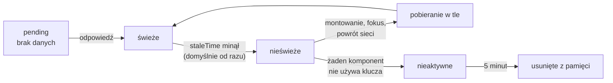

# TanStack Query: zapytanie z cyklem życia

## Ta sama lista w drugiej bibliotece

To slajd porównawczy: aplikacja `articleviewer` nie instaluje **TanStack Query**, dawniej React Query, najpopularniejszej alternatywy dla SWR, więc wszystkie fragmenty poniżej pochodzą spoza projektu. Pokazują pobranie tej samej listy z `/api/articles` w wersji 5 biblioteki, przypiętej tu w wydaniu 5.104.1. Biblioteka trzyma pamięć w jednym obiekcie, który udostępnia drzewu dostawca:

```jsx
// Rozszerzenie spoza demo: app/providers.jsx
"use client"; // dostawca korzysta z kontekstu, więc plik jest komponentem klienckim
import { useState } from "react";
import { QueryClient, QueryClientProvider } from "@tanstack/react-query";

export default function Providers({ children }) {
  const [queryClient] = useState(() => new QueryClient()); // jeden klient na sesję przeglądarki
  return <QueryClientProvider client={queryClient}>{children}</QueryClientProvider>;
}
```

Layout główny owija `{children}` tym komponentem, czyli `<body><Providers>{children}</Providers></body>`, więc każda strona może pobierać dane przez TanStack Query. Klient powstaje w `useState` z funkcją inicjalizującą. Na serwerze powstaje więc osobno dla każdego żądania, a w przeglądarce raz na sesję. Samo pobranie wygląda w komponencie klienckim tak:

```jsx
// Rozszerzenie spoza demo: komponent kliencki pod Providers
"use client";
import { useQuery } from "@tanstack/react-query";

export default function ArticleList() {
  const { data, isPending, isError, error } = useQuery({
    queryKey: ["articles"], // klucz wpisu w pamięci
    queryFn: async () => {
      const r = await fetch("/api/articles");
      if (!r.ok) throw new Error(`HTTP ${r.status}`); // 404 staje się błędem zapytania
      return r.json();
    },
  });

  if (isPending) return <p>Ładowanie...</p>;
  if (isError) return <p>Błąd: {error.message}</p>;
  return <ul>{data.map((a) => <li key={a.id}>{a.title}</li>)}</ul>;
}
```

`useQuery` przyjmuje obiekt z kluczem `queryKey` i funkcją `queryFn`. Pierwsze ładowanie to stan `isPending`, a po odpowiedzi `data` zawiera tablicę trzech artykułów. HTML wysłany przez serwer zawiera tylko stan oczekiwania, bez listy. Listę przynosi jedno żądanie `GET /api/articles` z przeglądarki, tak jak w SWR.

## Stan serwera to osobny rodzaj stanu

TanStack Query zaczyna od podziału stanu. **Stan klienta** należy do aplikacji: otwarte okno, tekst w polu, wybrany filtr. **Stan serwera** należy do kogoś innego. Dokumentacja wymienia jego cechy:

- **Przechowywanie zdalne**, w miejscu, którego aplikacja nie kontroluje.
- **Dostęp asynchroniczny** przy odczycie i zapisie.
- **Współdzielona własność**: inni mogą zmienić stan bez wiedzy aplikacji.
- **Starzenie się**: kopia w aplikacji może stać się nieaktualna.

Daniel Bugl w *Modern Full-Stack React Projects* ujmuje to tak:

> **„TanStack Query skupia się właśnie na zarządzaniu stanem pobranych danych (stanem serwera). Inne biblioteki do zarządzania stanem też potrafią obsłużyć stan serwera, ale specjalizują się w zarządzaniu stanem klienta.”**
>
> *„TanStack Query specifically focuses on managing the state of fetched data (server state). While other state management libraries can also deal with server state, they specialize in managing client state instead.”*
>
> — Daniel Bugl, *Modern Full-Stack React Projects*

Barklund w *React in Depth* dodaje zasadę, która za tym stoi. Dane przechowuje baza na serwerze, a serwer jest jedynym źródłem prawdy. Pamięć w przeglądarce jest kopią, którą trzeba co pewien czas porównać z oryginałem. Całą tę pamięć trzyma jeden obiekt, **klient zapytań** (*query client*). Czas, przez który kopia uchodzi za świeżą, ustawia opcja `staleTime`.

## Rysunek 5.12 — cykl życia wpisu `["articles"]`



Rysunek 5.12 nazywa stany wpisu, których SWR nie nazywa wprost. Nieświeży wpis dalej trafia na ekran. Domyślnie dane stają się nieświeże zaraz po nadejściu, a wpis znika z pamięci po pięciu minutach bez żadnego komponentu, który go używa.

## `isLoading` w dwóch bibliotekach

Obie biblioteki mają flagę `isLoading`, ale wersja 5 TanStack Query zmieniła jej sens. Zestawienie nazw dla tej samej sytuacji:

| Sytuacja | SWR 2.5.1 | TanStack Query 5 |
|---|---|---|
| brak danych, trwa pierwsze pobranie | `isLoading` i `isValidating` | `isPending`, `isLoading` i `isFetching` |
| dane są, trwa pobieranie w tle | `isValidating` | `isFetching` |
| brak danych, zapytanie wstrzymane (klucz `null`, `enabled: false`) | `isLoading` fałszywe | `isPending` bez `isLoading` |

W TanStack Query `isLoading` oznacza `isPending && isFetching`, czyli brak danych i trwające pobieranie jednocześnie. W pierwszym renderze przykładowej listy wszystkie trzy flagi są prawdziwe, a po odpowiedzi wszystkie trzy fałszywe. Ekran ładowania opiera się w obu bibliotekach na fladze „brak danych”: `isLoading` w SWR, `isPending` w TanStack Query. Barklund tłumaczy sens tego podziału: biblioteka odróżnia ładowanie, gdy aplikacja nie ma nic do pokazania, od pobierania, gdy aktualizuje dane, których starą wersję już ma.

## Wartości domyślne i ponawianie

Strona *Important Defaults* opisuje zachowania bez konfiguracji. Dane z `useQuery` są domyślnie nieświeże (`staleTime` równe 0). Pobierają się ponownie, gdy montuje się nowy komponent z tym kluczem, gdy okno odzyskuje fokus i gdy wraca sieć. Nieaktywne zapytania znikają po pięciu minutach (`gcTime`). Najbardziej zaskakuje ponawianie:

> **„Nieudane zapytania są po cichu ponawiane 3 razy z wykładniczo rosnącym opóźnieniem, zanim błąd zostanie przechwycony i pokazany w interfejsie.”**
>
> *„Queries that fail are silently retried 3 times, with exponential backoff delay before capturing and displaying an error to the UI.”*
>
> — dokumentacja TanStack Query, *Important Defaults*

Przewodnik *Query Retries* podaje szczegóły: opóźnienie zaczyna się od 1000 ms, podwaja się przy każdej próbie i nie przekracza 30 sekund. W kodzie wersji 5.104.1 to `Math.min(1000 * 2 ** n, 30000)`, liczone od nadejścia nieudanej odpowiedzi, a w karcie bez fokusu ponowienie czeka na jego powrót. Zapytanie o `/api/articles/99` wysyła więc cztery żądania z przerwami 1, 2 i 4 sekundy. Komunikat „Błąd: HTTP 404” pojawia się po ponad siedmiu sekundach, a do tego czasu `isPending` ma wartość `true`. Brak zasobu się nie naprawi, więc dla takich zapytań ustawia się `retry: false` albo funkcję `retry`, która dostaje licznik prób i błąd. Na serwerze domyślna liczba ponowień wynosi 0: w kodzie wersji 5.104.1 wartość domyślna to `isServer() ? 0 : 3`, żeby nieudane zapytanie nie wstrzymywało renderu.

Błąd zapytania zostaje domyślnie w polu `error` i komponent sam decyduje, co pokazać. Opcja **`throwOnError: true`** rzuca go w trakcie renderu, więc trafia do najbliższej granicy błędów, czyli komponentu, który pokazuje komunikat zamiast poddrzewa z wyjątkiem. W wersji 4 ta opcja nazywała się `useErrorBoundary`. Zapytanie o `/api/articles/99` z `retry: false` i `throwOnError: true` wysyła jedno żądanie, a zaraz po odpowiedzi ekran pokazuje `app/error.jsx` z tekstem „Błąd: HTTP 404” i przyciskiem „Spróbuj ponownie”.

## Jak długo dane są świeże

Domyślne `staleTime` równe 0 zmienia się globalnie w `new QueryClient({ defaultOptions })` albo w pojedynczym zapytaniu. Ustawienie globalne wygląda tak:

```jsx
// dane świeże przez dwie minuty dla wszystkich zapytań tego klienta
const queryClient = new QueryClient({
  defaultOptions: { queries: { staleTime: 2 * 60 * 1000 } },
});
```

Z takim klientem drugi komponent z kluczem już pobranym w ciągu tych dwóch minut czyta wpis z pamięci bez nowego żądania. Dokumentacja wymienia trzy wartości o różnym skutku:

- **`2 * 60 * 1000`**: przez dwie minuty dane czyta się z pamięci bez ponownego pobrania, chyba że ktoś unieważni je ręcznie.
- **`Infinity`**: dane nigdy nie starzeją się same, ale `invalidateQueries` nadal działa.
- **`'static'`**: dane nie pobierają się ponownie nawet po `invalidateQueries`. Dokumentacja podaje przykłady: flagi funkcji pobrane przy starcie i uprawnienia wczytane przy logowaniu.

Odpowiednikiem `refreshInterval` z SWR jest **`refetchInterval`**. Dokumentacja zaznacza, że działa niezależnie od `staleTime`, więc odpytywanie co pięć sekund nie wymaga zmiany świeżości.

Dwa ustawienia działają niewidocznie. **Współdzielenie strukturalne** (*structural sharing*) zostawia w `data` ten sam obiekt, gdy nowa odpowiedź ma tę samą treść. **Śledzone właściwości** sprawiają, że komponent renderuje się ponownie tylko po zmianie tych pól wyniku, które odczytał. Komponent, który nie odczytuje `isFetching`, nie renderuje się przy samym rozpoczęciu i końcu pobierania w tle.

## SWR czy TanStack Query

Barklund ocenia, że SWR jest w pewnym sensie prostsza w użyciu, a TanStack Query jest znacznie popularniejsza. Gdy wystarczy pobrać dane i odświeżać je przy fokusie albo co kilka sekund, SWR robi to jednym hookiem bez dostawcy. Gdy aplikacja ma wiele mutacji, zależne od siebie klucze, paginację i potrzebę podglądu pamięci w panelu `@tanstack/react-query-devtools`, TanStack Query daje gotowe mechanizmy. Obie biblioteki służą do danych, które mają żyć w przeglądarce.

## Mutacja i unieważnienie listy

Bugl odróżnia dwa rodzaje operacji. Zapytania z założenia są idempotentne, więc bibliotece wolno je ponawiać. Mutacje tworzą, zmieniają albo usuwają dane na serwerze. Poniższy fragment, także spoza projektu, dodaje artykuł i unieważnia listę:

```jsx
// Rozszerzenie spoza demo: mutacja, która unieważnia listę
import { useMutation, useQueryClient } from "@tanstack/react-query";

export function useAddArticle() {
  const queryClient = useQueryClient(); // ten sam klient, którego używa useQuery
  return useMutation({
    mutationFn: (article) =>
      fetch("/api/articles", { method: "POST", body: JSON.stringify(article) })
        .then((r) => r.json()),
    onSuccess: () => queryClient.invalidateQueries({ queryKey: ["articles"] }),
  });
}
```

Komponent dostaje z hooka funkcję `mutate(dane)` i flagę `isPending` do zablokowania przycisku. Po `mutate` lista na ekranie od razu dostaje nowy artykuł, bo `invalidateQueries` oznacza wpis jako nieświeży, a aktywne zapytanie pobiera go ponownie. Według dokumentacji mutacje domyślnie nie są ponawiane. Przy zapisie ma to sens, bo powtórzony `POST` mógłby dodać artykuł dwa razy.

## Gdzie powstaje ekran i kto go odświeża

W `articleviewer` lista na `/` powstaje na serwerze przy każdym żądaniu z odpowiedzi API zapamiętanej na minutę, a zapis obsługuje akcja z `revalidatePath`. Strona `/swr-demo` trzyma kopię w przeglądarce, w widocznej karcie odświeża ją co pięć sekund, a po własnym zapisie od razu przez `mutate()`. <u>W przeglądarce pobiera się tylko dane, których serwer nie dostarczy w chwili renderu: zmienne w czasie albo zależne od działań użytkownika</u>.

> 💡 **Zapamiętaj:** TanStack Query traktuje dane z serwera jako stan z cyklem życia: świeże, nieświeże, nieaktywne i usunięte. Nieudane zapytanie jest w przeglądarce domyślnie ponawiane trzy razy, klucze układa się hierarchicznie, a po mutacji unieważnia się je przez `invalidateQueries`.


Materiał rozszerzony do tego slajdu: [`rozszerzenia/r12_tanstack-query.md`](rozszerzenia/r12_tanstack-query.md)
