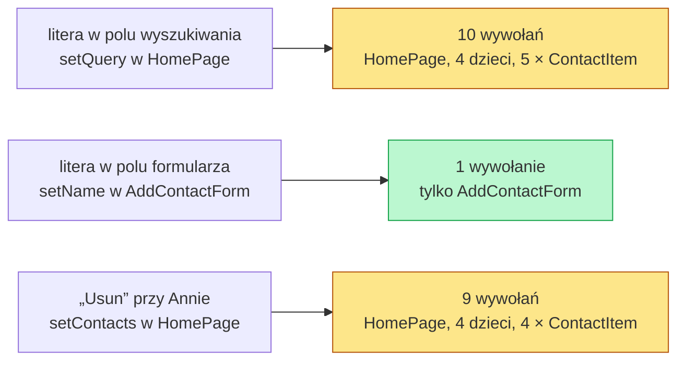

# Aplikacja kontaktów i render, który niczego nie zmienia

## Trzy pytania o jedną listę

Aplikacja `contacts-app` pokazuje pięć kontaktów, pole wyszukiwania, statystykę kategorii i formularz dodawania. Działa poprawnie, ale to jeszcze za mało, żeby oddać ją użytkownikom. Pierwsze pytanie dotyczy szybkości: ile pracy wykonuje przeglądarka po każdej literze wpisanej w wyszukiwarkę. Drugie dotyczy poprawności: skąd wiadomo, że po zmianie w kodzie lista nadal filtruje, usuwa i dodaje kontakty. Trzecie dotyczy użytkowników i serwera: czy z listy skorzysta osoba, która nie widzi ekranu, i czy wersja zbudowana na serwerze zachowa się tak samo jak ta na komputerze programisty.

Szybkość ocenia się w Reakcie inaczej niż w zwykłym skrypcie. O pracy po jednej literze decyduje przede wszystkim liczba komponentów, które React wywoła ponownie. Samo filtrowanie listy to tylko część tej pracy.

## Dziecko renderuje się razem z rodzicem

**Render** to jedno wywołanie funkcji komponentu. Po zmianie stanu React wywołuje komponent, w którym stan się zmienił, a potem funkcje wszystkich jego dzieci, także tych, którym nic się nie zmieniło. Morten Barklund w *React in Depth* zapisuje to jako regułę. Komponenty renderują się ponownie razem z rodzicem, bez względu na to, jakie propsy dostają (*„React components re-render when their parents do regardless of which properties they take”*). Nie ma też znaczenia, skąd propsy pochodzą i jak się zmieniają.

Najmniejszy przykład pokazuje regułę bez żadnej aplikacji:

```jsx
import { useState } from 'react';

function Child() {
  console.log('Child');          // wpis przy każdym wywołaniu funkcji
  return <p>stały tekst</p>;     // wynik nie zależy od niczego
}

function Parent() {
  const [n, setN] = useState(0);
  return (
    <div>
      <button onClick={() => setN(n + 1)}>n={n}</button>
      <Child />                  {/* element tworzony od nowa przy każdym renderze Parent */}
    </div>
  );
}
```

Pierwsze wyświetlenie wypisuje `Child`, a jedno kliknięcie wypisuje `Child` drugi raz. `Child` nie ma propsów, a jego wynik jest za każdym razem identyczny. Mimo to React wywołał jego funkcję, bo wywołał funkcję rodzica.

Liczby wpisów w tym i w kolejnych małych przykładach pochodzą ze środowiska testowego bez trybu ścisłego (*Strict Mode*). W `next dev` każda z nich wypada dwa razy większa.

Robin Wieruch w *The Road to React* podaje powód. Wstrzymanie renderu dzieci „mogłoby prowadzić do błędów” (*„preventing a re-render of child components could lead to bugs”*), bo dziecko mogłoby korzystać z czegoś, czego React nie widzi w propsach. Ten sam autor dodaje, że domyślny mechanizm jest szybki. React woła więc wszystkich potomków i dopiero po wywołaniu porównuje wynik.

Od reguły jest jeden wyjątek, który nie wymaga żadnego API. Dotyczy elementu przekazanego jako `children`:

```jsx
function Box({ children }) {
  const [n, setN] = useState(0);   // stan zmienia się tylko w Box
  return <div><button onClick={() => setN(n + 1)}>n={n}</button>{children}</div>;
}

// gdzieś wyżej w drzewie: <Box><Child /></Box>
// kliknięcie renderuje Box, ale nie wywołuje Child
```

Element `<Child />` powstał w JSX komponentu, który renderuje `Box`, a nie w samym `Box`. Kliknięcie zmienia stan `Box`, więc React wywołuje tylko jego funkcję. Prop `children` jest wtedy tym samym obiektem co przy poprzednim renderze, a obiekt, który się nie zmienił, React pomija. W środowisku testowym `Child` wypisuje się w tym układzie tylko raz, przy zamontowaniu.

## Propsy nie są przyczyną renderu

Barklund rozprawia się przy tej okazji z popularnym przekonaniem. W środowisku Reacta krąży pogląd, że komponent renderuje się ponownie, bo zmieniły się jego propsy. Według Barklunda tak nie jest (*„but that’s not the case”*). Przyczyną jest render rodzica. Nowe propsy są tylko jego skutkiem, bo propsy dziecka powstają w JSX rodzica, więc bez renderu rodzica nie mogą się zmienić. Dziecko bez propsów, takie jak `Child`, renderuje się więc dokładnie tak samo często jak dziecko z propsami.

## Render, który niczego nie zmienia

Wywołanie funkcji komponentu nie oznacza jeszcze zmiany na ekranie. W fazie renderu React tylko wylicza różnicę między starym a nowym drzewem elementów, a do strony trafia ona dopiero w fazie zatwierdzenia (*commit*). Stąd definicja. **Zbędny render** to wywołanie funkcji komponentu, które daje taki sam JSX jak poprzednio. Do strony nic wtedy nie trafia i przeglądarka niczego nie przerysowuje.

Koszt pojawia się wyłącznie w JavaScripcie: wywołanie funkcji, zbudowanie elementów i porównanie ich z poprzednimi. <u>React dowiaduje się, że wynik wyszedł identyczny, dopiero po wywołaniu funkcji.</u> Nie da się więc zobaczyć zbędnego renderu na ekranie. Trzeba go policzyć albo zmierzyć jego czas.

## Działająca aplikacja jako punkt wyjścia

Projekt `contacts-app` powstaje z szablonu Next.js 16.4.0 z React 19.3.0, w JavaScripcie, z App Routerem, bez Tailwinda, ESLinta i katalogu `src/`. Jedna flaga ma tu znaczenie merytoryczne. `--no-react-compiler` wyłącza React Compiler, czyli narzędzie, które w czasie budowania samo przerabia komponenty tak, żeby pomijały część zbędnych renderów. Z włączonym kompilatorem wersja startowa nie pokazałaby problemu, który ten wykład mierzy i naprawia ręcznie. Layout `app/layout.jsx` ustawia tylko `lang="pl"` i tytuł karty „Contacts App”, a arkusz `app/globals.css` zostaje pusty, bo aplikacja nie ma żadnego stylowania.

Kod aplikacji dzieli się na trzy warstwy: dane i logikę bez Reacta w `lib/contacts.js`, pięć komponentów w `components/` i stronę `app/page.jsx`, która trzyma cały stan.

## Dane i czysta funkcja filtrowania

Plik `lib/contacts.js` eksportuje tablicę `initialContacts` z pięcioma kontaktami i funkcję filtrującą. Każdy kontakt ma `id`, imię i nazwisko, telefon, adres e-mail i jedną z trzech kategorii: `work`, `family` albo `friends`.

```js
// lib/contacts.js: dane startowe
export const initialContacts = [
  { id: 1, name: 'Anna Kowalska',    phone: '600 100 200', email: 'anna@example.com',  category: 'work'   },
  { id: 2, name: 'Piotr Nowak',      phone: '601 200 300', email: 'piotr@example.com', category: 'family' },
  { id: 3, name: 'Maria Wisniewska', phone: '602 300 400', email: 'maria@example.com', category: 'work'   },
  { id: 4, name: 'Jan Dabrowski',    phone: '603 400 500', email: 'jan@example.com',   category: 'friends'},
  { id: 5, name: 'Katarzyna Wojcik', phone: '604 500 600', email: 'kata@example.com',  category: 'work'   },
];
```

Funkcja filtrująca w tym samym pliku wygląda tak:

```js
// lib/contacts.js: filtrowanie
export function filterContacts(contacts, query) {
  if (!query) return contacts;                 // puste zapytanie: ta sama tablica
  const q = query.toLowerCase();
  return contacts.filter(                      // niepuste: zawsze nowa tablica
    (c) => c.name.toLowerCase().includes(q) || c.email.toLowerCase().includes(q)
  );
}
```

`filterContacts` jest **czystą funkcją**: wynik zależy tylko od argumentów, a metoda `filter` nie zmienia tablicy wejściowej. Dzięki temu da się ją sprawdzić bez renderowania i bezpiecznie użyć ponownie jej wyniku.

Jeden szczegół ma znaczenie dla wydajności. Przy pustym zapytaniu funkcja zwraca **tę samą tablicę** `contacts`. Przy każdym niepustym zwraca **nową tablicę**, nawet gdy pasują do niego wszystkie kontakty:

```js
filterContacts(initialContacts, '')  === initialContacts;   // true
filterContacts(initialContacts, 'a') === initialContacts;   // false
filterContacts(initialContacts, 'a').length;                 // 5
```

Zapytanie „a” pasuje do wszystkich pięciu kontaktów, bo litera występuje w każdym adresie e-mail. Wynik ma tę samą zawartość, ale jest innym obiektem. Porównanie obiektów w Reakcie sprawdza tożsamość, czyli to, czy chodzi o ten sam obiekt w pamięci. Treść obiektu nie gra przy tym roli.

## Komponenty, które tylko wyświetlają

Trzy z pięciu komponentów tylko wyświetlają dane. Dostają je przez propsy i zwracają JSX. Wiersz listy w wersji startowej jest krótki:

```jsx
// components/ContactItem.jsx
export default function ContactItem({ contact, onDelete }) {
  return (
    <li>
      <strong>{contact.name}</strong>
      <span> — {contact.phone}</span>
      <span> — {contact.email}</span>
      <em> [{contact.category}]</em>
      {/* usuwanie należy do rodzica; wiersz przekazuje tylko id */}
      <button type="button" onClick={() => onDelete(contact.id)}>
        Usun
      </button>
    </li>
  );
}
```

`ContactList` zamienia tablicę na listę wierszy jedną linią `contacts.map`, z `key={contact.id}`, dzięki któremu React rozpoznaje wiersz po usunięciu sąsiada:

```jsx
// components/ContactList.jsx (fragment)
{contacts.map((contact) => (
  <ContactItem key={contact.id} contact={contact} onDelete={onDelete} />
))}
```

`ContactStats` liczy kategorie. Robi to metodą `reduce`, która przechodzi po tablicy i przekazuje dalej wynik dotychczasowy, tutaj obiekt z licznikami. Na danych startowych daje to:

```js
initialContacts.reduce((acc, c) => {
  acc[c.category] = (acc[c.category] || 0) + 1;   // licznik kategorii o jeden w górę
  return acc;                                     // obiekt przechodzi do kolejnego kontaktu
}, {});
// { work: 3, family: 1, friends: 1 }
```

Komponent pokazuje ten wynik razem z liczbą wszystkich kontaktów:

```jsx
// components/ContactStats.jsx (fragment, wersja startowa)
export default function ContactStats({ contacts }) {
  const total = contacts.length;                 // liczba wszystkich kontaktów
  const categories = contacts.reduce(/* jak wyżej */ (acc, c) => {
    acc[c.category] = (acc[c.category] || 0) + 1;
    return acc;
  }, {});
  return (
    <section aria-label="Statystyki kontaktow">
      <p>Lacznie: <strong>{total}</strong></p>
      <ul>
        {Object.entries(categories).map(([cat, count]) => (
          <li key={cat}>{cat}: {count}</li>      // jedna pozycja na kategorię
        ))}
      </ul>
    </section>
  );
}
```

Statystyka dostaje pełną listę, bo opisuje całą książkę adresową. Jej wynik zmienia się więc tylko po dodaniu albo usunięciu kontaktu.

## Wyszukiwarka i formularz

`SearchBar` to pole kontrolowane, czyli pole, którego wartość pochodzi ze stanu, a każda zmiana wraca do tego stanu przez `onChange`. Stan zapytania nie leży jednak w wyszukiwarce, tylko w stronie:

```jsx
// components/SearchBar.jsx
export default function SearchBar({ query, onChange }) {
  return (
    <div>
      <label htmlFor="search">Szukaj kontaktu:</label>  {/* etykieta wskazuje pole przez id */}
      <input
        id="search"
        type="search"
        value={query}                                   // wartość ze stanu rodzica
        onChange={(e) => onChange(e.target.value)}      // każda litera trafia do rodzica
        placeholder="wpisz imie lub email..."
      />
    </div>
  );
}
```

Każda litera zmienia więc stan `HomePage`. To jest źródło wszystkich renderów mierzonych w tym wykładzie.

`AddContactForm` trzyma u siebie stan trzech pól i komunikatu błędu. Sprawdza, czy imię nie jest puste i czy adres zawiera znak `@`. Poprawne dane przekazuje stronie przez `onAdd`:

```jsx
// components/AddContactForm.jsx (fragment)
const [name, setName]   = useState('');
const [phone, setPhone] = useState('');
const [email, setEmail] = useState('');
const [error, setError] = useState('');

function handleSubmit(e) {
  e.preventDefault();                      // formularz nie przeładowuje strony
  if (!name.trim()) {
    setError('Imie jest wymagane.');
    return;
  }
  if (!email.includes('@')) {
    setError('Podaj prawidlowy adres email.');
    return;
  }
  setError('');
  onAdd({ name: name.trim(), phone, email, category: 'friends' });
  setName('');                             // pola wracają do pustych wartości
  setPhone('');
  setEmail('');
}
```

JSX formularza ma trzy pola z etykietami i akapit z komunikatem błędu:

```jsx
// components/AddContactForm.jsx (fragment JSX)
<form onSubmit={handleSubmit} noValidate>   {/* noValidate: sprawdza komponent, nie przeglądarka */}
  <h2>Dodaj kontakt</h2>
  {error && <p role="alert">{error}</p>}    {/* akapit istnieje tylko przy błędzie */}
  <div>
    <label htmlFor="name">Imie i nazwisko</label>
    <input id="name" value={name} onChange={(e) => setName(e.target.value)} />
  </div>
  {/* ...pola „Telefon” (id="phone") i „Email” (id="email", type="email") w tym samym układzie */}
  <button type="submit">Dodaj</button>
</form>
```

Pisanie w formularzu zmienia tylko ten lokalny stan, więc nie dotyka strony ani listy.

## Strona, która trzyma stan

Cały stan wspólny leży w `app/page.jsx`. Plik zaczyna się od `'use client'`, bo używa `useState`, oraz od importów `initialContacts`, `filterContacts` i czterech komponentów. Reszta w wersji startowej wygląda tak:

```jsx
// app/page.jsx (wersja startowa, bez importów)
export default function HomePage() {
  const [contacts, setContacts] = useState(initialContacts);
  const [query, setQuery]       = useState('');

  const filtered = filterContacts(contacts, query);  // liczone przy każdym renderze

  function handleAdd(newContact) {
    setContacts((prev) => [...prev, { ...newContact, id: Date.now() }]);
  }

  function handleDelete(id) {
    setContacts((prev) => prev.filter((c) => c.id !== id));
  }

  return (
    <main>
      <h1>Kontakty</h1>
      <ContactStats contacts={contacts} />
      <SearchBar query={query} onChange={setQuery} />
      <ContactList contacts={filtered} onDelete={handleDelete} />
      <AddContactForm onAdd={handleAdd} />
    </main>
  );
}
```

Ten stan nazywa się dalej **wersją startową**. Nie ma w niej żadnej optymalizacji renderów i każda późniejsza zmiana jest porównywana z tym punktem. Nowy kontakt dostaje `id` z `Date.now()`, czyli liczbę milisekund od 1970 roku. Obie funkcje zmieniają listę aktualizatorem, czyli funkcją, która dostaje od Reacta poprzednią tablicę `prev` i zwraca nową.

Dwa miejsca w tym pliku mają znaczenie dla wydajności. Filtrowanie wykonuje się przy każdym renderze, nawet gdy ani lista, ani zapytanie się nie zmieniły. Funkcje `handleAdd` i `handleDelete` są deklaracjami w ciele komponentu, więc każdy render tworzy je od nowa jako nowe obiekty.

## Kiedy render jest drogi

Koszt jednego renderu składa się z dwóch części, które da się odczytać z kodu. Pierwsza to liczba wywołanych funkcji, czyli wielkość poddrzewa pod komponentem ze zmienionym stanem. Druga to praca w ciele każdej funkcji. W wersji startowej obie rosną razem z listą. `ContactList` tworzy jeden element `ContactItem` na kontakt, `ContactStats` przechodzi metodą `reduce` po całej tablicy, a `filterContacts` dla każdego kontaktu dwa razy zamienia tekst na małe litery.

Dokumentacja Reacta ocenia taki układ wprost. Domyślne renderowanie wszystkich zagnieżdżonych komponentów nie jest według niej optymalne dla wydajności, jeśli zaktualizowany komponent leży bardzo wysoko w drzewie (*„if the updated component is very high in the tree”*). `HomePage` jest korzeniem strony, więc spełnia ten warunek w całości. Kod wskazuje kandydatów na drogi render, a o tym, który z nich kosztuje najwięcej, rozstrzyga pomiar.

## Rysunek 6.1 — co renderuje się po trzech różnych czynnościach



Na Rysunku 6.1 trzy czynności użytkownika prowadzą do trzech różnych liczb wywołań w wersji startowej. Różnicę wyznacza miejsce, w którym leży zmieniany stan. Litera w polu „Imie i nazwisko” zmienia stan `name` w `AddContactForm`, więc React wywołuje tylko formularz. Litera w wyszukiwarce zmienia `query` w `HomePage` i budzi całe drzewo strony: jedno wywołanie strony, cztery jej dzieci i pięć wierszy. Usunięcie kontaktu też zaczyna się w `HomePage`, ale lista ma już o jeden wiersz mniej.

Dokumentacja elementu `<input>` opisuje ten mechanizm od strony pola tekstowego:

> **„Gdy używasz pola kontrolowanego, ustawiasz stan przy każdym naciśnięciu klawisza. Jeśli komponent, który zawiera ten stan, renderuje ponownie duże drzewo, może to działać wolno.”**
>
> *„When you use a controlled input, you set the state on every keystroke. If the component containing your state re-renders a large tree, this can get slow.”*
>
> — dokumentacja Reacta, *&lt;input&gt;*

Formularz w `contacts-app` stosuje już najprostszą odpowiedź na ten problem: stan pól leży w małym komponencie, który nie ma dzieci. Wyszukiwarka nie może tego zrobić w obecnym układzie, bo zapytanie jest potrzebne także liście, która leży obok niej. Dlatego to właśnie pisanie w wyszukiwarce jest kandydatem do pomiaru.

> 💡 **Zapamiętaj:** komponent renderuje się, gdy renderuje się jego rodzic, nawet jeśli jego propsy są takie same. Liczba wywołań po jednej czynności zależy od tego, jak wysoko w drzewie leży zmieniany stan.

