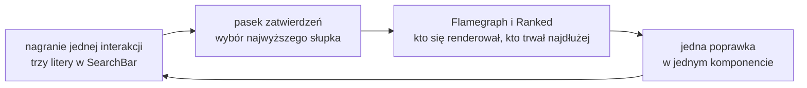

# Najpierw pomiar: podświetlanie, konsola i Profiler

## Podświetlanie renderów w React DevTools

Zanim cokolwiek zmieni się w kodzie, trzeba zobaczyć, które komponenty się renderują i ile to trwa. Pierwszym narzędziem jest rozszerzenie przeglądarki **React Developer Tools**, które dokłada do narzędzi deweloperskich zakładki *Components* i *Profiler*.

Opcja „Highlight updates when components render” w ustawieniach React DevTools rysuje kolorową ramkę wokół każdego komponentu, który właśnie się wyrenderował. Im więcej renderów komponent ma w krótkim czasie, tym bardziej kolor ramki przesuwa się od turkusowego w stronę pomarańczowego.

W wersji startowej `contacts-app` wpisywanie znaków w pole wyszukiwania obrysowuje prawie całą stronę. Ramki dostaje `ContactStats`, choć statystyka nie zależy od zapytania. Ramki dostaje też `ContactList` i każdy z pięciu wierszy `ContactItem`, bo zmiana stanu `query` w `HomePage` budzi całe drzewo pod nią.

Podświetlanie mówi, **kto** się renderował. Liczba renderów jest w nim zakodowana tylko kolorem, a czasu trwania nie pokazuje wcale.

## Liczenie renderów w konsoli

Dokładną liczbę renderów daje tymczasowy `console.log` w ciele komponentu. W `components/ContactItem.jsx` dochodzi jedna linia na początku funkcji:

```jsx
export default function ContactItem({ contact, onDelete }) {
  console.log('ContactItem render:', contact.name);   // kod pomiarowy, tylko na czas pomiaru
  // ...reszta komponentu bez zmian
```

Po wpisaniu litery „a” w trybie deweloperskim konsola dopisuje 10 linii, po dwie dla każdego kontaktu. Taka sama linia na początku `ContactStats` dokłada dwa wpisy `ContactStats render`, razem 12 linii. **Dwanaście linii** to sześć renderów: jeden statystyki i pięć wierszy. Każdy jest wypisany dwa razy, bo tryb ścisły (*Strict Mode*) w `next dev` celowo wywołuje funkcję komponentu podwójnie, żeby wychwycić nieczysty render. Build produkcyjny trybu ścisłego nie uruchamia i dla tej samej litery wypisuje 6 linii.

Przy pięciu kontaktach sześć zbędnych renderów nie ma znaczenia. Przy liście tysiąca kontaktów każda litera dawałaby 1001 zbędnych wywołań: jedno dla statystyki i tysiąc dla wierszy. Liczba rośnie liniowo z długością listy. Schwarzmüller w *React Key Concepts* zauważa granicę tej metody. W dużych aplikacjach z setkami komponentów dopisywanie `console.log` do każdego staje się żmudne (*„using `console.log()` can get tedious”*), a sam log nie mówi, ile render trwał.

## Sztuczne spowolnienie, żeby było co mierzyć

Render pięciu wierszy trwa ułamek milisekundy, więc pomiar czasu wyglądałby pusto. Żeby problem stał się widoczny, `ContactStats` dostaje tymczasowo pętlę, która przy każdym renderze liczy do pięciu milionów:

```jsx
export default function ContactStats({ contacts }) {
  let x = 0;
  for (let i = 0; i < 5_000_000; i++) x++;           // tylko na czas pomiaru
  console.log('ContactStats render, slow:', x * 0);  // x użyte, więc pętla nie jest martwym kodem
  // ...reszta komponentu bez zmian
```

Zapis `5_000_000` to zwykła liczba pięć milionów, a podkreślenia tylko grupują cyfry. Wyrażenie `x * 0` w logu zawsze daje zero. Jego rola polega na tym, żeby zmienna `x` była użyta, a pętla nie wyglądała na martwy kod. Statystyka nie ma nic wspólnego z wyszukiwaniem, a mimo to spowalnia każdą literę, bo renderuje się razem z rodzicem.

Pętla i logi są **kodem pomiarowym**. Zostają w aplikacji tylko na czas pomiarów opisanych w tym miejscu, a potem znikają, bo fałszowałyby każdy kolejny pomiar i każdy kolejny log. Czasy podawane przy kolejnych poprawkach dotyczą więc statystyki bez pętli, chyba że pomiar wprost mówi inaczej.

## Ile czasu ma jeden render

Barklund w *React in Depth* podaje punkt odniesienia. Przeglądarka stara się pokazywać 60 klatek na sekundę, co daje „tylko 16 milisekund na klatkę” (*„only 16 milliseconds (ms) per frame”*). W tym czasie musi się zmieścić obsługa zdarzenia, render Reacta, zapis zmian do strony i malowanie. Gdy praca trwa dłużej, przeglądarka gubi klatki, a wpisany tekst pojawia się z opóźnieniem. Barklund dodaje drugą miarę: według przytaczanych przez niego badań interfejs powinien zareagować w ciągu 0,1 sekundy, żeby reakcja wydawała się natychmiastowa.

Tejas Kumar w *Fluent React* formułuje to ostrożnie przy okazji renderów elementów HTML. Taki ponowny render jest według niego szybki i nie wymaga optymalizacji, chyba że „profilowanie pokaże, że stanowi problem” (*„unless profiling shows it to be a problem”*). Dokumentacja Reacta zamyka opis renderu tym samym zastrzeżeniem: „nie optymalizuj przedwcześnie” (*„Don’t optimize prematurely!”*).

Z obu zdań wynika kolejność pracy. <u>Optymalizację poprzedza pomiar, a jego wynik porównuje się z budżetem klatki.</u> Kod wskazuje tylko kandydatów. Wysoko położony stan, pętla po kolekcji i wiele tworzonych elementów to powody, żeby zmierzyć, a nie powody, żeby od razu zmieniać kod. Pomiar ma przy tym stałą postać: ta sama interakcja, te same dane i ten sam tryb uruchomienia przed poprawką i po niej.

## Pomiar z kodu: komponent `<Profiler>`

Czas renderu da się zbierać w kodzie. Dokumentacja Reacta opisuje komponent `<Profiler>` jako sposób, który pozwala zmierzyć wydajność renderowania drzewa Reacta programowo (*„lets you measure rendering performance of a React tree programmatically”*). Przyjmuje `id` i funkcję `onRender`, którą React woła po każdym zatwierdzeniu zmian w poddrzewie:

```jsx
import { Profiler, useState } from 'react';

function logRender(id, phase, actualDuration, baseDuration) {
  console.log(id, phase, actualDuration, baseDuration);   // czasy w milisekundach
}

function Counter() {
  const [n, setN] = useState(0);
  return <button onClick={() => setN(n + 1)}>n={n}</button>;
}

export default function App() {
  return (
    <Profiler id="Counter" onRender={logRender}>   {/* mierzy poddrzewo z Counter */}
      <Counter />
    </Profiler>
  );
}
```

Pierwsze wyświetlenie daje wpis z fazą `mount`, a każde kliknięcie wpis z fazą `update`. Ten przykład nie należy do `contacts-app`. Funkcja `onRender` dostaje według dokumentacji sześć argumentów:

- **`id`**: napis z propsa `id`, który odróżnia od siebie kilka profilerów.
- **`phase`**: `"mount"` przy pierwszym zamontowaniu, `"update"` po zmianie propsów, stanu albo hooków, a `"nested-update"`, gdy stan zmieniono w trakcie zatwierdzania, na przykład setterem w `useLayoutEffect`.
- **`actualDuration`**: milisekundy renderu poddrzewa przy bieżącej aktualizacji.
- **`baseDuration`**: szacunek czasu renderu całego poddrzewa bez żadnych optymalizacji, czyli przypadek najgorszy.
- **`startTime`** i **`commitTime`**: znaczniki czasu początku renderu i zatwierdzenia. `commitTime` jest wspólny dla wszystkich profilerów jednego zatwierdzenia.

Najwięcej mówi para dwóch czasów. Dokumentacja radzi porównać `actualDuration` z `baseDuration`, żeby sprawdzić, czy optymalizacja renderów działa (*„Compare actualDuration against it to see if memoization is working.”*). W wersji startowej oba czasy są równe z dokładnością do 0,1 ms, bo React niczego nie pomija. Profilery można zagnieżdżać, ale według dokumentacji każdy dokłada pracy procesora i pamięci, więc używa się ich tylko tam, gdzie są potrzebne.

## Tryb deweloperski i produkcyjny

Dokumentacja `memo` przypomina, że przy pomiarach wydajności React powinien działać w trybie produkcyjnym (*„make sure that React is running in the production mode”*). Profilowanie ma jednak swój koszt, więc według dokumentacji `<Profiler>` jest w buildzie produkcyjnym domyślnie wyłączony. Po zwykłym `next build` funkcja `onRender` nie jest wywoływana wcale. Next.js włącza profilowanie flagą `next build --profile`, którą dokumentacja CLI opisuje jako produkcyjne profilowanie dla Reacta (*„Enables production profiling for React”*).

## Budżet klatki w liczbach dla `contacts-app`

Na czas pomiaru `app/page.jsx` dostaje dwa profilery, jeden wokół całej strony i drugi wokół statystyki:

```jsx
// app/page.jsx na czas pomiaru (fragment JSX); logRender jak w przykładzie z licznikiem
<Profiler id="page" onRender={logRender}>
  <main>
    <h1>Kontakty</h1>
    <Profiler id="ContactStats" onRender={logRender}>
      <ContactStats contacts={contacts} />
    </Profiler>
    {/* ...SearchBar, ContactList i AddContactForm bez zmian */}
  </main>
</Profiler>
```

Dla spowolnionej wersji startowej, czyli z pętlą w statystyce, dają one takie czasy. Dotyczą jednej litery „a” w Chromium i Next.js 16.4.0:

| Tryb | `ContactStats` | cała strona |
|---|---|---|
| `next dev` | 12,1–12,7 ms | 16,2–19,7 ms |
| `next build --profile` | 5,7–6,5 ms | 6,3–7,5 ms |
| `next build --profile`, procesor spowolniony 4× | 23,8–26,1 ms | 26,5–31,2 ms |
| `next dev`, procesor spowolniony 4× | 49,4–52,3 ms | 67,4–82,3 ms |

Różnicę między trybem deweloperskim a produkcyjnym w statystyce tłumaczy prawie w całości tryb ścisły, przez który pętla wykonuje się dwa razy. Bez spowolnienia wersja produkcyjna mieści się w budżecie 16 ms. Dokumentacja Reacta zaleca jednak sztuczne spowolnienie wprost:

> **„Pamiętaj, że twój komputer jest prawdopodobnie szybszy niż komputery użytkowników, więc dobrze jest testować wydajność ze sztucznym spowolnieniem.”**
>
> *„Keep in mind that your machine is probably faster than your users’ so it’s a good idea to test the performance with an artificial slowdown.”*
>
> — dokumentacja Reacta, *useMemo*

Jako przykład dokumentacja podaje opcję *CPU Throttling* w Chrome. Przy spowolnieniu czterokrotnym jedna litera kosztuje w buildzie produkcyjnym prawie dwie klatki. <u>Decyzję o optymalizacji podejmuje się na liczbach z buildu produkcyjnego, zmierzonych ze spowolnieniem.</u> Liczby z `next dev` służą tylko do porównań „przed i po”. Same milisekundy zależą od komputera, a proporcje między wierszami tabeli zostają podobne.

## Nagranie w zakładce *Profiler*

Zakładka *Profiler* nagrywa zatwierdzenia i rysuje wykres płomieniowy (*Flamegraph*), w którym komponent pominięty ma szary pasek, a sekcja *Why did this render?* podaje przyczynę renderu po włączeniu opcji „Record why each component rendered while profiling”. Nagranie obejmuje wpisanie trzech znaków w pole wyszukiwania i nic więcej, bo każda dodatkowa czynność dokłada zatwierdzenia i zaciemnia obraz.

W wersji startowej żaden pasek nie jest szary: kolorowe są `ContactStats`, `ContactList` i pięć `ContactItem`. Widok *Ranked*, czyli te same komponenty posortowane od najwolniejszego, ma na szczycie `ContactStats`. Pytanie diagnostyczne brzmi więc: dlaczego statystyka się renderuje, skoro zmieniło się tylko `query`, a jej prop `contacts` jest tą samą tablicą. Sekcja *Why did this render?* podaje dla niej *„The parent component rendered.”*, czyli render rodzica.

## Rysunek 6.2 — pętla pomiaru



Na Rysunku 6.2 strzałka z ostatniego prostokąta wraca do pierwszego. Poprawka bez drugiego nagrania jest tylko hipotezą. Drugie nagranie dotyczy tej samej interakcji na tych samych danych: trzech liter i pięciu kontaktów z `lib/contacts.js`. Pętlę kończy się, gdy poprawiony komponent spada z góry widoku *Ranked* albo jego pasek staje się szary.

## Od wyniku pomiaru do poprawki

Nagranie dało trzy fakty o wersji startowej. Najwięcej czasu przy każdej literze zajmuje `ContactStats`. Jej jedyny prop jest przy tym tą samą tablicą co przed literą. Renderuje się wyłącznie dlatego, że wyrenderował się rodzic, a React nie może tego rozstrzygnąć sam, bo o identycznym wyniku dowiaduje się dopiero po wywołaniu funkcji.

Z tych faktów wynika kierunek poprawki. Komponent, który dla tych samych propsów zawsze daje ten sam JSX, można oznaczyć tak, żeby React porównał propsy przed wywołaniem i przy równych propsach użył poprzedniego wyniku. Taka poprawka pomoże tylko przy pisaniu w wyszukiwarce. Dodanie albo usunięcie kontaktu zmienia listę, więc statystyka i tak musi się przeliczyć. Skuteczność poprawki sprawdza drugie nagranie tej samej interakcji.

> 💡 **Zapamiętaj:** kolejność jest zawsze ta sama: nagranie, jedna poprawka, to samo nagranie jeszcze raz. Liczby, na których opiera się decyzję, pochodzą z buildu produkcyjnego i ze spowolnionego procesora.


Materiał rozszerzony do tego slajdu: [`rozszerzenia/r02_pomiar-profiler.md`](rozszerzenia/r02_pomiar-profiler.md)
