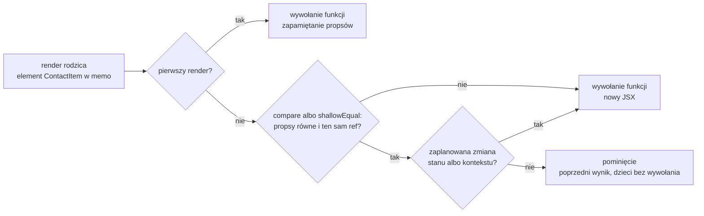

# `memo`: React pomija komponent, gdy propsy są te same

## Trzy powody renderu

Morten Barklund w *React in Depth* wymienia wszystkie sytuacje, w których komponent funkcyjny się renderuje. Lista jest krótka:

- **pierwsze zamontowanie**: komponentu nie było w drzewie, a teraz jest;
- **render rodzica**: rodzic właśnie się wyrenderował;
- **hook**: komponent używa hooka, który oznaczył go do ponownego renderu, na przykład po zmianie własnego stanu albo kontekstu, który czyta.

Barklund dodaje, że to cała lista (*„That’s it.”*). Gdy żadna z tych rzeczy nie zachodzi, komponent się nie renderuje. Gdy zachodzi którakolwiek, zwykły komponent renderuje się na pewno, a jedynym wyjątkiem jest komponent owinięty w `memo` przy renderze rodzica. Dwa powody naraz nie muszą dawać dwóch renderów. Gdy zmienia się stan komponentu i jednocześnie renderuje się jego rodzic, React może połączyć te zmiany w jeden render albo wykonać dwa, zależnie od chwili, w której nastąpiły. Zbędne rendery w `contacts-app` mają jedno źródło: drugi punkt. Wiersze listy i statystyka nie mają stanu ani kontekstu, więc każdy ich render przy pisaniu w wyszukiwarce pochodzi od rodzica. Narzędzie, które pozwala pominąć właśnie ten powód, to `memo`.

## Czym jest memoizacja

**Memoizacja** (*memoization*) to technika znana z informatyki dużo wcześniej niż React. Tejas Kumar w *Fluent React* opisuje ją tak:

> **„Mówiąc prościej, memoizacja zapisuje wynik funkcji na podstawie jej argumentów, tak że gdy funkcja zostanie wywołana ponownie z tymi samymi argumentami, zwraca zapamiętany wynik, zamiast liczyć go od nowa.”**
>
> *„In simple terms, memoization stores the output of a function based on its inputs so that if the function is called again with the same inputs, it returns the cached result rather than recomputing the output.”*
>
> — Tejas Kumar, *Fluent React*

Kumar dodaje warunek, bez którego technika nie działa: memoizacja opiera się na **czystości funkcji** (*„Memoization relies on function purity”*). Funkcja `add(1, 2)` zawsze zwraca 3, więc jej wynik można zapamiętać. Funkcja, która dolicza do argumentu liczbę pobraną z sieci, zwraca co dzień coś innego i zapamiętać jej się nie da.

Barklund odróżnia memoizację od zwykłej pamięci podręcznej. Pamięć podręczna przechowuje wiele wyników dla wielu argumentów. Memoizacja w Reakcie pamięta tylko **ostatnie wywołanie**, sprawdza, czy następne jest takie samo, i wtedy oddaje poprzednią odpowiedź (*„memoization normally remembers only the latest call to a given function”*). W samym Reakcie da się tak zapamiętać trzy rzeczy: cały komponent, fragment JSX i wartość przekazywaną w propsie. Pierwszą obsługuje `memo`. Trzecią obsługują dwa hooki: `useCallback`, który zapamiętuje funkcję, i `useMemo`, który zapamiętuje wynik obliczenia.

Komponent funkcyjny jest funkcją, która z propsów robi JSX. Jeśli jest czysty, te same propsy dają ten sam JSX. To otwiera drogę do memoizacji całych komponentów.

## Funkcja `memo` i co zwraca

Funkcja `memo` z pakietu `react` przyjmuje komponent i zwraca nowy typ komponentu: obiekt, który wskazuje oryginał i który React przy renderze traktuje jak komponent. Dokumentacja Reacta opisuje ją jednym zdaniem.

> **„`memo` pozwala pominąć ponowny render komponentu, gdy jego propsy się nie zmieniły.”**
>
> *„`memo` lets you skip re-rendering a component when its props are unchanged.”*
>
> — dokumentacja Reacta, *memo*

Najmniejszy przykład to etykieta ze stałym napisem w komponencie, który ma własny licznik.

```jsx
import { memo, useState } from 'react';

const Label = memo(function Label({ text }) {
  console.log('Label', text);        // wpis przy każdym wywołaniu funkcji
  return <p>{text}</p>;
});

function Parent() {
  const [n, setN] = useState(0);
  return (
    <div>
      <button onClick={() => setN(n + 1)}>n={n}</button>
      <Label text="stały" />         {/* prop ten sam przy każdym renderze */}
    </div>
  );
}
```

W środowisku testowym konsola pokazuje wpis `Label stały` tylko raz, przy zamontowaniu, a w `next dev` dwa razy, bo tryb ścisły podwaja wywołanie. Po kliknięciu `Parent` się renderuje, a etykieta nie: React porównał prop `text`, znalazł ten sam napis i użył poprzedniego wyniku.

Według dokumentacji `memo` zostawia przekazany komponent bez zmian, a zwrócony typ różni się od oryginału jednym: React nie zawsze wyrenderuje go ponownie razem z rodzicem. Dokumentacja opisuje owinięcie jako deklarację złożoną przez programistę:

> **„Używając `memo`, mówisz Reactowi, że komponent spełnia ten wymóg, więc React nie musi go ponownie renderować, dopóki jego propsy się nie zmieniły.”**
>
> *„By using memo, you are telling React that your component complies with this requirement, so React doesn’t need to re-render as long as its props haven’t changed.”*
>
> — dokumentacja Reacta, *memo*

Wymogiem jest czysty render: te same propsy, stan i kontekst mają dawać ten sam wynik. Komponent, który czyta na przykład bieżącą godzinę, tego wymogu nie spełnia. Z `memo` pokazywałby nieaktualny czas.

Samo owinięcie niczego jeszcze nie oblicza. Całą pracę wykonuje algorytm uzgadniania, czyli część Reacta, która porównuje stare drzewo elementów z nowym. Przy każdym renderze rodzica zadaje on komponentowi w `memo` te same pytania w tej samej kolejności.

## Rysunek 6.3 — decyzja algorytmu uzgadniania przy komponencie w `memo`



Na Rysunku 6.3 widać trzy pytania, które padają przy każdym renderze rodzica. Pierwsze odsiewa montowanie: komponent dopiero wchodzi do drzewa, więc nie ma z czym porównywać. Drugie zadaje funkcja porównująca. Gdy programista nie podał własnej, React używa porównania płytkiego `shallowEqual`. Kumar zwraca uwagę na warunek, którego nie widać w propsach: równy musi być także `ref`, czyli specjalny prop, przez który rodzic dostaje dostęp do węzła DOM albo wartości dziecka. Trzecie pytanie dotyczy zmian zaplanowanych w samym komponencie, czyli dwóch pozostałych powodów renderu z listy Barklunda.

Pominięcie obejmuje też dzieci komponentu. Skoro React nie wywołał funkcji, nowy JSX nie powstał i nie ma nowych elementów dzieci do wywołania. Barklund dopisuje, że odpada także porównanie z drzewem strony, bo wynik jest dokładnie tym samym obiektem co poprzednio (*„the JSX is not just similar but exactly the same”*).

## Porównanie płytkie i tożsamość funkcji

Domyślnie React porównuje każdy prop funkcją `Object.is`, czyli tą samą, którą porównuje stan. Liczby i napisy porównuje po wartości, a obiekty i funkcje po tożsamości. Kumar nazywa to porównaniem **płytkim** (*shallow comparison*): React sprawdza każdy prop osobno i nie zagląda do środka obiektów. Dwie funkcje o identycznym kodzie są dla niego dwiema wartościami:

```js
const f1 = () => {};
const f2 = () => {};
Object.is(f1, f2);           // false: dwa osobne obiekty funkcji
Object.is(f1, f1);           // true: ten sam obiekt
Object.is({ a: 1 }, { a: 1 }); // false: ta sama treść, różne obiekty
```

Ta reguła wystarcza, żeby zepsuć `memo`. Komponent w `memo`, który dostaje funkcję tworzoną w ciele rodzica, renderuje się przy każdym renderze rodzica:

```jsx
import { memo, useState } from 'react';

const Btn = memo(function Btn({ onPick }) {
  console.log('Btn');               // wpis przy każdym wywołaniu
  return <span onClick={onPick}>x</span>;
});

function Parent() {
  const [n, setN] = useState(0);
  function pick() {}                // nowy obiekt funkcji przy każdym renderze
  return <div><button onClick={() => setN(n + 1)}>n={n}</button><Btn onPick={pick} /></div>;
}
```

Po kliknięciu konsola dopisuje `Btn`. Prop `onPick` ma przy każdym renderze inną tożsamość, więc porównanie wypada „nierówne”. Ten sam komponent `Btn` z funkcją zdefiniowaną poza `Parent` po kliknięciu milczy, bo taka funkcja powstaje raz, przy wczytaniu modułu, i zawsze jest tym samym obiektem.

Schwarzmüller w *React Key Concepts* opisuje identyczną sytuację na komponencie komunikatu błędu. Stara i nowa funkcja to dla `memo` dwie różne wartości (*„the old and new `handleClearError` function objects are different from each other”*). Barklund ujmuje regułę krótko: przekazywanie nowych propsów przy każdym renderze przekreśla memoizację (*„Passing new properties on every render is a no-go when we’re using memoization.”*).

## Pierwsza próba: `memo` na wierszu listy

Najwięcej zbędnych renderów w wersji startowej dają wiersze listy. Plik `components/ContactItem.jsx` dostaje więc opakowanie. Zmieniają się trzy miejsca, a treść wiersza zostaje bez zmian:

```jsx
import { memo } from 'react';

// Nazwana funkcja w memo: DevTools pokazują ContactItem, a nie Anonymous.
const ContactItem = memo(function ContactItem({ contact, onDelete }) {
  return (
    <li>
      {/* ...treść wiersza bez zmian, przycisk woła onDelete(contact.id) */}
    </li>
  );
});

export default ContactItem;   // osobna linia, bo export default nie może poprzedzać const
```

Funkcja komponentu ma nadal nazwę `ContactItem`, dzięki czemu React DevTools i komunikaty błędów pokazują czytelną nazwę. `memo` zmienia tylko to, **kiedy** React wywołuje funkcję. Plik `ContactList.jsx` nie wymaga żadnej poprawki, bo importuje `ContactItem` pod tą samą nazwą.

## Dlaczego wiersze nadal się renderują

Po tej zmianie litera „a” w trybie deweloperskim dalej daje w konsoli dziesięć linii `ContactItem render: …`, tyle samo co bez `memo`. Porównanie propsów się odbyło, tylko wypadło „nierówne”.

`ContactItem` dostaje przy każdym renderze rodzica dwa propsy. Prop `contact` to obiekt z tablicy w stanie `HomePage`, którego litera w wyszukiwarce nie zmienia, więc przechodzi porównanie. Prop `onDelete` to funkcja `handleDelete`, która w wersji startowej jest zwykłą deklaracją w ciele `HomePage`. Każdy render strony tworzy ją od nowa jako nowy obiekt. Robi to samo co poprzednia, ale ma inną tożsamość, więc porównanie daje `false`. <u>Wystarczy jedna różna para propsów, żeby `memo` dopuściło render.</u>

## Gdzie szukać poprawki

Poprawka nie dotyczy wiersza. Musi trafić do `app/page.jsx`, gdzie rodzic ma przekazywać przy każdym renderze ten sam obiekt funkcji. Plik `ContactItem.jsx` zostaje taki, jak jest.

Barklund opisuje ten krok jako regułę. Gdy zaczyna się memoizować komponenty, trzeba też memoizować ich propsy (*„it is necessary to memoize properties when you start memoizing components”*). Dotyczy to obiektów i tablic tworzonych w ciele rodzica, a jeszcze bardziej funkcji. Według Barklunda właśnie funkcje są głównym powodem, dla którego hook `useCallback` istnieje i jest tak często używany. `memo` w dziecku i stabilne propsy w rodzicu działają tylko razem. Każda z tych zmian osobno daje w `contacts-app` ten sam wynik co jej brak: pięć wierszy renderowanych przy każdej literze.

## Rozszerzenie: komponent czysty, klasy i wnętrze `memo`

Alex Banks i Eve Porcello w *Learning React* nazywają wynik `memo` komponentem czystym:

> **„W Reakcie komponent czysty to komponent, który przy tych samych propsach zawsze renderuje ten sam wynik.”**
>
> *„In React, a pure component is a component that always renders the same output, given the same properties.”*
>
> — Alex Banks, Eve Porcello, *Learning React*

Autorzy przypominają też, skąd ten mechanizm się wziął. W komponentach klasowych tę samą decyzję podejmowała metoda `shouldComponentUpdate`, a później klasa bazowa `React.PureComponent`. Według autorów `PureComponent` działa tak samo jak `memo`, ale tylko dla klas, a `memo` jest jego odpowiednikiem dla komponentów funkcyjnych. Ich przykład z kotami ma budowę listy kontaktów: bez `memo` dodanie czwartego kota wypisuje w konsoli cztery linie, a z `memo` tylko jedną, dla nowego kota.

Tejas Kumar zagląda przy tym do kodu źródłowego Reacta. `memo` zwraca zwykły obiekt z trzema polami i nie tworzy żadnej nowej funkcji. Pole `$$typeof` ma wartość oznaczającą komponent memoizowany, `type` wskazuje oryginalny komponent, a `compare` przechowuje opcjonalną funkcję porównującą. Decyzję z Rysunku 6.3 Kumar rozpisuje, czytając w kodzie Reacta funkcję `updateMemoComponent`.

> 💡 **Zapamiętaj:** owinięcie w `memo` to deklaracja, że komponent renderuje się czysto. React pomija go tylko wtedy, gdy każdy prop ma tę samą tożsamość co poprzednio, więc jedna funkcja tworzona w ciele rodzica wystarczy, żeby nie pominął ani jednego renderu.

