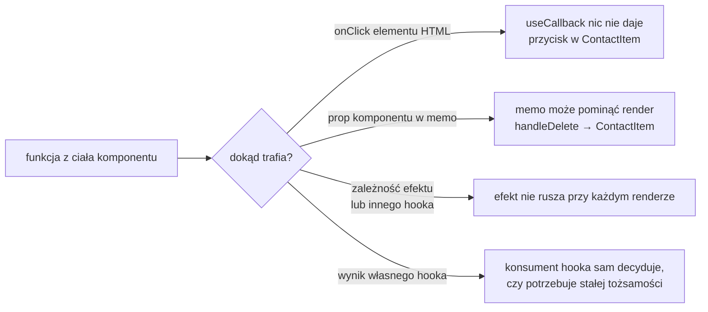

# `useCallback`: ta sama funkcja między renderami

## Hook, który zapamiętuje definicję funkcji

Wiersze listy z `memo` dostają od `HomePage` dwa propsy, a jeden z nich jest przy każdym renderze nowy. Rozwiązanie leży w rodzicu. **`useCallback`** to hook, który według dokumentacji Reacta „pozwala zapamiętać definicję funkcji między renderami” (*„lets you cache a function definition between re-renders”*). Sygnatura ma postać `useCallback(fn, dependencies)`, gdzie drugi argument to tablica zależności, tak samo jak w `useEffect`.

Dokumentacja opisuje też, co hook zwraca:

> **„Przy pierwszym renderze `useCallback` zwraca przekazaną funkcję `fn`. Przy kolejnych renderach zwraca albo funkcję zapamiętaną przy ostatnim renderze (jeśli zależności się nie zmieniły), albo funkcję `fn` przekazaną w bieżącym renderze.”**
>
> *„On the initial render, useCallback returns the fn function you have passed. During subsequent renders, it will either return an already stored fn function from the last render (if the dependencies haven't changed), or return the fn function you have passed during this render.”*
>
> — dokumentacja Reacta, *useCallback*

Najmniejszy przykład to ten sam przycisk w `memo` co przy porównaniu płytkim, tym razem z funkcją z hooka:

```jsx
import { memo, useCallback, useState } from 'react';

const Btn = memo(function Btn({ onPick }) {
  console.log('Btn');                         // wpis przy każdym wywołaniu
  return <span onClick={onPick}>x</span>;
});

function Parent() {
  const [n, setN] = useState(0);
  const pick = useCallback(() => {}, []);     // ten sam obiekt funkcji przez całe życie Parent
  return <div><button onClick={() => setN(n + 1)}>n={n}</button><Btn onPick={pick} /></div>;
}
```

Po kliknięciu konsola milczy. `Parent` się wyrenderował, ale `pick` ma tę samą tożsamość co poprzednio, więc `memo` pominęło `Btn`.

Hook niczego nie przyspiesza w samej funkcji. Wyrażenie strzałkowe nadal powstaje przy każdym renderze, bo jest argumentem wywołania. Różnica polega na tym, co trafia do zmiennej. Gdy zależności się nie zmieniły, React oddaje obiekt funkcji z poprzedniego renderu, a świeżo utworzony wyrzuca. Dla `memo` w dziecku liczy się tylko ta zwrócona tożsamość.

Barklund w *React in Depth* i Kumar w *Fluent React* opisują `useCallback` jako szczególny przypadek ogólniejszego mechanizmu Reacta. Ten mechanizm zapamiętuje wynik dowolnego obliczenia, dopóki zależności są te same. W `useCallback` tym zapamiętanym wynikiem jest sama funkcja, dlatego Kumar nazywa go wersją „dla funkcji” (*„essentially `useMemo` for functions”*). Hook nie wywołuje przekazanej funkcji. Oddaje ją do zmiennej w całości, a wywołuje ją dopiero ten, kto ją dostanie, na przykład przycisk w wierszu.

## `HomePage` z zapamiętanymi funkcjami

W `app/page.jsx` zmieniają się import i dwie definicje funkcji. Reszta pliku zostaje bez zmian:

```jsx
import { useState, useCallback } from 'react';
```

```jsx
  // Ta sama funkcja przy każdym renderze; pusta tablica: brak zależności.
  const handleAdd = useCallback((newContact) => {
    setContacts((prev) => [...prev, { ...newContact, id: Date.now() }]);
  }, []);

  // Aktualizator dostaje bieżącą listę, więc contacts nie trafia do zależności.
  const handleDelete = useCallback((id) => {
    setContacts((prev) => prev.filter((c) => c.id !== id));
  }, []);
```

`handleAdd` i `handleDelete` przestały być deklaracjami `function`. Są teraz stałymi, które dostają wynik `useCallback`. Pusta tablica zależności `[]` sprawia, że React oddaje przez cały czas życia strony funkcje z pierwszego renderu.

Po tej zmianie wpisanie litery w wyszukiwarkę daje wierszom dwa propsy równe poprzednim: ten sam obiekt `contact` i tę samą funkcję `onDelete`. `memo` na `ContactItem` zaczyna pomijać render i log w wierszu przy literze „a” przestaje cokolwiek wypisywać. Profiler owinięty wokół strony, ten sam co przy pierwszym pomiarze, pokazuje to w liczbach. W trybie deweloperskim, bez spowolnienia procesora i bez pętli w statystyce, `actualDuration` strony wynosi 2,0–2,9 ms przy `baseDuration` 8,1–9,1 ms, czyli React pominął większą część drzewa. Z pętlą w statystyce strona daje 13,2–14,8 ms przy `baseDuration` 19,7–21,3 ms, bo `ContactStats` nie ma jeszcze `memo` i przy każdej literze liczy do pięciu milionów. `handleAdd` przekazywany do `AddContactForm` też jest stabilny, ale sam formularz nie jest owinięty w `memo`, więc i tak się renderuje.

## Pusta tablica dzięki aktualizatorowi

Obie funkcje mogą mieć pustą tablicę zależności, bo nie czytają niczego, co zmienia się między renderami. Setter `setContacts` ma stałą tożsamość, a aktualną listę funkcja dostaje od Reacta jako argument `prev` w chwili aktualizacji. Taka funkcja przekazana do settera to aktualizator.

Dokumentacja `useCallback` opisuje ten zabieg osobno, na przykładzie listy zadań. Funkcja `handleAddTodo` w wersji `setTodos([...todos, newTodo])` musi mieć zależność `[todos]` i zmienia się po każdym dodaniu. Po przejściu na aktualizator `todos => [...todos, newTodo]` zależność znika:

> **„Zapamiętane funkcje powinny zwykle mieć jak najmniej zależności. Gdy odczytujesz stan tylko po to, żeby obliczyć następny stan, możesz usunąć tę zależność, przekazując zamiast tego aktualizator.”**
>
> *„You’ll usually want memoized functions to have as few dependencies as possible. When you read some state only to calculate the next state, you can remove that dependency by passing an updater function instead.”*
>
> — dokumentacja Reacta, *useCallback*

Dokumentacja opisuje to jako przekazanie Reactowi instrukcji, *jak* zmienić stan, zamiast odczytu stanu wewnątrz funkcji. Barklund wyciąga z tego dalszy wniosek. Wartość z hooka memoizującego z pustą tablicą jest tak samo stabilna jak setter (*„A memoizing hook with an empty dependency array always returns the same value; thus, it can be considered to be stable.”*).

## Przestarzałe domknięcie

Pusta tablica ma swoją cenę, gdy funkcja czyta wartość z renderu. Funkcja w JavaScripcie jest **domknięciem**: pamięta zmienne z miejsca, w którym powstała. `useCallback` z pustą tablicą oddaje przez cały czas funkcję z pierwszego renderu, więc ta funkcja widzi zmienne z pierwszego renderu. Taką funkcję nazywa się **przestarzałym domknięciem** (*stale closure*). Najmniejszy przykład to licznik z dwiema wersjami tego samego przycisku:

```jsx
import { useCallback, useState } from 'react';

function Counter() {
  const [count, setCount] = useState(0);
  // count w tej funkcji zawsze pochodzi z pierwszego renderu, czyli wynosi 0
  const addStale = useCallback(() => setCount(count + 1), []);
  // aktualizator dostaje bieżącą wartość od Reacta
  const addFresh = useCallback(() => setCount((c) => c + 1), []);
  return <div><p>count={count}</p><button onClick={addStale}>stale</button><button onClick={addFresh}>fresh</button></div>;
}
```

Dwa kliknięcia „stale” zostawiają `count=1`, bo za każdym razem funkcja liczy `0 + 1`. Dwa kolejne kliknięcia „fresh” dają `count=3`, bo aktualizator za każdym razem dostaje od Reacta bieżącą wartość.

W `HomePage` ta sama pułapka wyglądałaby tak:

```jsx
// Wariant błędny: contacts pochodzi z domknięcia pierwszego renderu.
const handleDelete = useCallback((id) => {
  setContacts(contacts.filter((c) => c.id !== id));
}, []);
```

Ta funkcja widzi `contacts` z pierwszego renderu, czyli pięć kontaktów z `initialContacts`. Pierwsze usunięcie Anny działa, bo ta lista zgadza się jeszcze z ekranem, i licznik pokazuje „Lacznie: 4”. Dodanie kontaktu przez `handleAdd`, który korzysta z `prev`, daje „Lacznie: 5”. Drugie usunięcie, na przykład Piotra, filtruje jednak pierwotne pięć kontaktów i nadpisuje nimi stan. Na liście są wtedy Anna, Maria, Jan i Katarzyna: Anna wraca, a nowy kontakt znika.

Naprawy są dwie. Pierwsza to aktualizator `setContacts((prev) => prev.filter(...))` z pustą tablicą. Druga to dopisanie `contacts` do zależności. Wtedy `handleDelete` zmienia się po każdym dodaniu i usunięciu, a `memo` w wierszach przestaje pomijać render po takich zmianach. <u>Aktualizator jest lepszy, bo usuwa zależność zamiast ją dopisywać.</u>

## Rysunek 6.4 — dokąd trafia funkcja i co wtedy daje `useCallback`



Na Rysunku 6.4 romb zadaje jedno pytanie o każdą funkcję. Tylko gałąź „onClick elementu HTML” kończy się bez zysku, bo element HTML nie porównuje propsów. Pozostałe trzy prowadzą do miejsc, w których ktoś porównuje tożsamość funkcji: `memo`, tablica zależności albo kod, który dopiero użyje hooka.

## Funkcja na przycisku nie przeszkadza

W `ContactItem` jest jeszcze jedna funkcja tworzona przy każdym renderze: `onClick={() => onDelete(contact.id)}`. Ona niczego nie psuje. Przycisk `<button>` jest elementem HTML, więc nikt nie porównuje jego propsów w celu pominięcia renderu. Kumar w *Fluent React* omawia licznik, w którym ktoś owinął funkcję przycisku w `useCallback`, i ocenia to surowo. Według niego taki hook jest gorszy niż bezużyteczny (*„is in fact worse than useless”*), bo trzeba go zaimportować, wywołać i porównać zależności, a nic to nie daje.

## Funkcja jako zależność efektu

Druga sytuacja, w której tożsamość funkcji ma znaczenie, to tablica zależności efektu. Efekt uruchamia się ponownie, gdy któraś zależność ma inną tożsamość niż przy poprzednim renderze. Funkcja tworzona w ciele komponentu ma inną tożsamość przy każdym renderze:

```jsx
import { useCallback, useEffect, useState } from 'react';

function Demo() {
  const [n, setN] = useState(0);
  const [q] = useState('react');
  function loadPlain() { return q; }            // nowa funkcja przy każdym renderze
  const loadStable = useCallback(() => q, [q]); // nowa tylko po zmianie q
  useEffect(() => { loadPlain(); }, [loadPlain]);   // rusza po każdym renderze
  useEffect(() => { loadStable(); }, [loadStable]); // rusza raz
  return <button onClick={() => setN(n + 1)}>n={n}</button>;
}
```

W środowisku testowym, po zamontowaniu i dwóch kliknięciach, pierwszy efekt wykonał się trzy razy, a drugi jeden raz. Ten sam wynik daje owinięcie w tryb ścisły. Robin Wieruch w *The Road to React* pokazuje skutek tego mechanizmu na pobieraniu danych. Gdy efekt pobiera dane i zapisuje je do stanu, a w zależnościach ma funkcję bez `useCallback`, każdy zapis daje render, nową funkcję i kolejne pobranie. Aplikacja utknęłaby w nieskończonej pętli (*„and we’d be stuck in an endless loop”*). Dokumentacja Reacta dodaje, że jeszcze lepiej jest w ogóle pozbyć się funkcji z zależności (*„However, it’s even better to remove the need for a function dependency.”*), na przykład przenosząc ją do wnętrza efektu.

## Gdzie `useCallback` ma sens

Kumar podaje kryterium: `useCallback` pomaga, gdy komponent renderuje się często i przekazuje funkcję dziecku, zwłaszcza dziecku owiniętemu w `memo`. W `contacts-app` kryterium spełnia `handleDelete`, bo trafia do `ContactList` i dalej do pięciu wierszy w `memo`. `handleAdd` trafia do formularza bez `memo`. Hook zwraca mu przy każdym renderze tę samą funkcję, ale nikt tej tożsamości nie porównuje, więc formularz renderuje się tak samo jak przed zmianą.

Stała tożsamość nie jest celem sama w sobie. Funkcja, która czyta wartość z renderu, ma ją w zależnościach i zmienia się razem z nią. Gdyby `handleDelete` zapisywała usunięcie razem z nazwą zalogowanego użytkownika, jej tablica zależności zawierałaby tego użytkownika, a wiersze w `memo` renderowałyby się po jego zmianie. Taki render jest potrzebny, bo funkcja w wierszu ma od tej chwili robić coś innego.

## Funkcja, której nie trzeba zapamiętywać

Strona przekazuje w dół jeszcze trzecią funkcję: `setQuery` jako `onChange` dla `SearchBar`. Ta funkcja nie potrzebuje `useCallback`, bo jest setterem z `useState`. Dokumentacja `useState` gwarantuje mu stałą tożsamość (*„The set function has a stable identity”*). Przez całe życie `HomePage` prop `onChange` jest więc tym samym obiektem, bez żadnego hooka. Tę samą gwarancję ma `dispatch` z `useReducer`, a stałą tożsamość ma też każda wartość zdefiniowana poza komponentem, na przykład zaimportowana funkcja `filterContacts`.

Gwarancja znika przy pozornie niewinnej zmianie zapisu. Wersja `onChange={(q) => setQuery(q)}` działa identycznie, ale tworzy nową funkcję strzałkową przy każdym renderze strony. Dla `SearchBar` bez `memo` nie ma to znaczenia. Dla komponentu w `memo` byłby to ten sam błąd, który psuł wiersze listy.

> 💡 **Zapamiętaj:** `useCallback` zwraca tę samą funkcję, dopóki nie zmieni się żadna zależność. Gdy funkcja czyta stan tylko po to, żeby policzyć następny, używa się aktualizatora `prev =>` i zależność znika.


Materiał rozszerzony do tego slajdu: [`rozszerzenia/r04_usecallback.md`](rozszerzenia/r04_usecallback.md)
