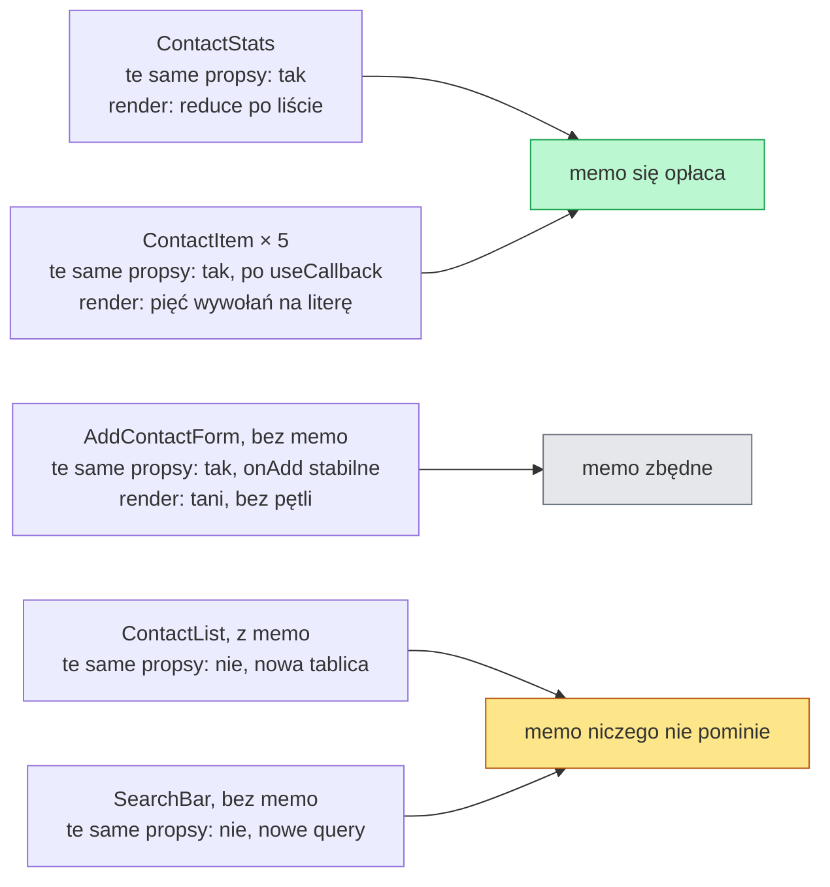

# Gdzie `memo` się opłaca, a gdzie tylko porównuje

## `memo` na liście i na statystyce

Wiersze listy już pomijają render przy wpisywaniu liter. Bez opakowania zostały `ContactList` i `ContactStats`. Zmiana w obu plikach ma ten sam schemat co w wierszu: import `memo`, funkcja komponentu jako argument i `export default` w osobnej linii. Ciało funkcji się nie zmienia. Nowe linie w `components/ContactList.jsx`:

```jsx
import { memo } from 'react';
import ContactItem from './ContactItem';

// Lista w memo, ale w tej aplikacji memo nigdy nie pomija renderu:
// HomePage renderuje się tylko po zmianie contacts albo query,
// a każda taka zmiana daje nową tablicę filtered. Zostaje do pokazania porównania.
const ContactList = memo(function ContactList({ contacts, onDelete }) {
  // return: lista <ul> z wierszami ContactItem, bez zmian
});

export default ContactList;
```

I w `components/ContactStats.jsx`:

```jsx
import { memo } from 'react';

// Statystyka w memo: pomija render, gdy zmienia się tylko query
const ContactStats = memo(function ContactStats({ contacts }) {
  // total, categories i return: bez zmian
});

export default ContactStats;
```

Różni się to, co każdy z trzech komponentów dostaje w propsach. `ContactItem` dostaje obiekt i funkcję, `ContactList` tablicę i funkcję, a `ContactStats` tylko tablicę. Od stabilności tych wartości zależy, czy opakowanie cokolwiek pominie. Po usunięciu kontaktu statystyka nadal pokazuje nową liczbę, bo dostała nową tablicę.

## Które paski Profilera będą szare

Nagranie tej samej interakcji co przed zmianą, czyli trzech liter w polu wyszukiwania, da się przewidzieć z samego kodu. Szary pasek w Profilerze oznacza komponent, który React pominął:

- **`ContactStats`** dostaje pełną tablicę `contacts`, a pisanie zmienia tylko `query`. Jedyny prop jest ten sam, więc funkcja statystyki nie zostaje wywołana.
- **`ContactItem`** dla kontaktów, które zostały na liście, dostaje ten sam obiekt `contact` i tę samą funkcję `onDelete`.
- **`HomePage`**, **`SearchBar`**, **`ContactList`** i **`AddContactForm`** renderują się przy każdej literze.

Każdy z tych renderów ma uzasadnienie. `HomePage` trzyma zmieniony stan `query`. `SearchBar` musi pokazać nową wartość pola. `ContactList` dostał nową tablicę z wynikiem filtrowania. `AddContactForm` nie ma `memo`, bo jego render jest tani.

Szary pasek `ContactStats` przy pisaniu nie znaczy, że statystyka nigdy się nie przelicza. Usunięcie kontaktu przyciskiem „Usun” tworzy nową tablicę w stanie, więc przy tej interakcji statystyka się renderuje. Tak ma być, bo zmieniła się liczba kontaktów. Nagrywa się więc także usuwanie. **`memo` ma przepuszczać rendery potrzebne i zatrzymywać tylko zbędne.**

## Usunięcie kontaktu a klucz wiersza

Przy usuwaniu o szarych paskach wierszy decyduje także `key`. Po kliknięciu „Usun” przy Annie `filter` zwraca nową tablicę, ale z tymi samymi obiektami pozostałych kontaktów. Klucz `contact.id` łączy każdy obiekt z tym samym wierszem co przed usunięciem. Cztery pozostałe wiersze dostają więc te same propsy i React je pomija.

Klucz równy indeksowi tablicy psuje to połączenie. Przykład spoza `contacts-app` usuwa pierwszy element listy. Tablica `seen` zbiera przy tym imiona z wyrenderowanych wierszy.

```jsx
import { memo, useState } from 'react';
import { initialContacts } from '../lib/contacts';

const seen = [];                     // imiona z każdego renderu wiersza
const Row = memo(function Row({ c }) {
  seen.push(c.name.split(' ')[0]);
  return <li>{c.name}</li>;
});

function List({ byIndex }) {         // byIndex: true daje klucz z indeksu, false z id
  const [contacts, setContacts] = useState(initialContacts);
  return (
    <>
      <button onClick={() => setContacts(contacts.slice(1))}>usun pierwszy</button>
      <ul>{contacts.map((c, i) => <Row key={byIndex ? i : c.id} c={c} />)}</ul>
    </>
  );
}
// po kliknięciu, key={c.id}: seen nie dostaje żadnego imienia
// po kliknięciu, key={i}:    seen dostaje 'Piotr', 'Maria', 'Jan', 'Katarzyna'
```

Przy kluczu z indeksu wiersz o kluczu 0 dostaje po usunięciu obiekt Piotra, wiersz o kluczu 1 obiekt Marii i tak dalej. Każdy porównuje więc propsy z cudzym poprzednim renderem. <u>Klucz wskazuje `memo`, z którym poprzednim renderem ma porównać nowe propsy.</u>

## `ContactList`: `memo`, które nigdy nie pomija

`memo` na `ContactList` wygląda na tak samo uzasadnione jak pozostałe. W tej aplikacji nie pomija jednak ani jednego renderu. Komentarz nad `memo` w pliku mówi to wprost.

Rachunek jest krótki. `HomePage` renderuje się tylko po zmianie `contacts` albo `query`, bo innego stanu nie ma. Zmiana `query` na niepusty tekst daje nową tablicę z `filterContacts`. Zmiana `contacts` daje nową tablicę w stanie, a przy pustym zapytaniu `filterContacts` zwraca właśnie ją. Każdy render rodzica przynosi więc liście nowy prop `contacts`. Porównanie odbywa się przy każdym renderze i za każdym razem wykrywa różnicę.

Lista mimo to nie jest kosztowna, bo jej wiersze mają własne `memo`. Gdy `ContactList` się renderuje, tworzy pięć elementów `ContactItem`, a React pomija te, których propsy się nie zmieniły. Ochrona działa o poziom niżej, tam gdzie propsy są stabilne.

## Kiedy `memo` się opłaca

Dokumentacja Reacta podaje kryterium z dwóch warunków spełnionych jednocześnie:

> **„Optymalizacja przez `memo` ma wartość tylko wtedy, gdy komponent często renderuje się z dokładnie tymi samymi propsami, a jego logika renderowania jest kosztowna.”**
>
> *„Optimizing with memo is only valuable when your component re-renders often with the same exact props, and its re-rendering logic is expensive.”*
>
> — dokumentacja Reacta, *memo*

Ta sama strona dodaje, że gdy przy renderze nie widać opóźnienia, `memo` jest niepotrzebne. Liczy się też charakter aplikacji. Gdy interakcje podmieniają całe strony albo sekcje, memoizacja według dokumentacji przeważnie nic nie daje. W edytorze graficznym, gdzie użytkownik przesuwa pojedyncze kształty, może bardzo pomóc.

## Rysunek 6.5 — dwa warunki dokumentacji dla pięciu komponentów



Na Rysunku 6.5 każdy komponent strony przechodzi przez oba warunki z cytatu. Tylko dwa spełniają oba naraz. Pojedynczy wiersz `ContactItem` jest tani, ale koszt liczy się dla całej listy: litera w wyszukiwarce wywołuje go raz na każdy kontakt, więc przy tysiącu kontaktów daje tysiąc wywołań. Najciekawszy jest środkowy przypadek. `AddContactForm` po dodaniu `useCallback` dostaje przy każdej literze ten sam prop `onAdd`, więc pierwszy warunek spełnia. Jego render tworzy jednak kilka elementów formularza bez żadnej pętli, a jego liczba nie rośnie razem z listą, więc drugi warunek odpada. Brak `memo` na formularzu to decyzja wynikająca z rachunku. Dolna grupa nie spełnia już pierwszego warunku. `ContactList` ma `memo`, które tylko porównuje. `SearchBar` go nie ma i mieć nie powinien, bo przy każdej literze musi pokazać nową wartość.

Schwarzmüller w *React Key Concepts* dokłada kryterium położenia w drzewie. Najwięcej daje `memo` na komponencie blisko korzenia albo na początku głębokiej gałęzi, bo pominięcie takiego komponentu pomija razem z nim wszystkich potomków. Na bardzo prostym komponencie, takim jak komunikat błędu z jednym napisem, `memo` według niego prawdopodobnie nie da mierzalnej korzyści.

## Ile kosztuje memoizacja

Każda memoizacja to dodatkowy kod wykonywany przy renderze. Opakowanie z `memo` przed wywołaniem komponentu zestawia stare i nowe propsy, jeden po drugim. Schwarzmüller przypomina, że i ta czynność zajmuje procesor (*„It’s not “free.””*). Banks i Porcello w *Learning React* ostrzegają, że używanie `useCallback` i `useMemo` wszędzie „może w rzeczywistości obniżyć wydajność aplikacji” (*„might actually make your app less performant”*). Na jednym komponencie to niewiele. Gdy jednak wynik zestawienia prawie zawsze brzmi „inne”, praca idzie na marne, jak przy `ContactList`.

Barklund w *React in Depth* opisuje skrajny przypadek. Gdy wynik trzeba policzyć przy każdym renderze, memoizacja jest droższa niż jej brak. Dochodzi wtedy narzut wywołania dodatkowych funkcji (*„using memoization is more expensive because of the overhead of calling extra functions”*). Ogólniej: samo wywołanie funkcji optymalizującej kosztuje, więc optymalizacja, która nie przyspiesza aplikacji, spowalnia ją (*„if they don’t make the application faster, they make it slower”*).

Autorzy różnią się w tym, kiedy sięgać po memoizację. Wieruch w *The Road to React* stosuje ją dopiero po natrafieniu na wąskie gardło (*„Apply these performance optimizations only if you run into performance bottlenecks”*). Dodaje, że sprawdzenie w `memo` bywa droższe niż render, przed którym miało chronić. Barklund odradza przedwczesną optymalizację początkującym. Osobom doświadczonym pozwala jednak memoizować od razu tam, gdzie przewidują, że będzie to miało znaczenie.

Oba stanowiska da się pogodzić jedną regułą utrzymania kodu. <u>Memoizacja zostaje w kodzie, gdy nagranie po zmianie pokazuje dzięki niej pominięty render.</u> Taką, która w nagraniu niczego nie zmienia, usuwa się albo opisuje komentarzem z powodem, tak jak w `ContactList.jsx`. Przewidywanie, o którym pisze Barklund, jest skrótem dla kogoś, kto takie porównania wykonał już wiele razy.

Liczby z pomiaru Barklunda pokazują, ile można zyskać we właściwym miejscu. Jego przykładowa aplikacja z książki to lista zadań z polem tekstowym do wpisywania nowego zadania. Obsługa jednego naciśnięcia klawisza zajmowała w niej przeglądarce do 5 ms. Po owinięciu listy w `memo` spadła do 2 ms. Lista była tam najdroższą częścią strony, a jej propsy przy pisaniu się nie zmieniały.

Dokumentacja dodaje koszt, którego nie widać w milisekundach. Memoizowanie wszystkiego „na zapas” nie wyrządza według niej większej szkody, ale kod staje się mniej czytelny. Do tego jedna wartość „zawsze nowa” wystarczy, żeby zepsuć memoizację całego komponentu (*„a single value that’s “always new” is enough to break memoization for an entire component”*). Kto czyta `ContactList.jsx` bez komentarza, zakłada ochronę, której nie ma.

## Propsy, które psują `memo`

Wszystkie przypadki, w których `memo` przestaje działać, mają tę samą przyczynę: prop powstaje od nowa w ciele rodzica. Dokumentacja pisze, że `memo` jest wtedy zupełnie bezużyteczne (*„`memo` is completely useless if the props passed to your component are always different”*). Barklund pokazuje to na liście zadań. Dopisanie stałej pozycji zapisem `["Complete todo list", ...items]` prosto w JSX przywraca czas obsługi klawisza do 5 ms, bo każdy render tworzy nową tablicę. Funkcja zdefiniowana w ciele rodzica działa tak samo. Tak samo działa element JSX zapisany w ciele komponentu, który sam się renderuje. Gdy trafia jako `children` do dziecka w `memo`, każdy render tego komponentu tworzy nowy obiekt elementu. Element, który powstał wyżej w drzewie i tylko przechodzi przez komponent ze zmienionym stanem, zostaje tym samym obiektem.

Dokumentacja wskazuje lepszą drogę niż memoizacja każdego propsa: **przekazywać najmniej, ile trzeba**. Komponent może przyjąć pojedyncze wartości zamiast całego obiektu. Wartość można też zamienić na taką, która zmienia się rzadziej. Przykład z dokumentacji to komponent `CallToAction`, który dostaje `hasGroups`, wartość logiczną mówiącą, czy grupy istnieją, a nie samą listę grup.

W `contacts-app` ta zasada ma prosty odpowiednik. Komponent pokazujący wyłącznie liczbę kontaktów mógłby dostawać `total={contacts.length}`, czyli liczbę. Liczba przechodzi porównanie po wartości. Po usunięciu jednego kontaktu i dodaniu innego licznik dalej wynosi 5, więc taki komponent w `memo` zostałby pominięty. `ContactStats` tak zrobić nie może, bo liczy kategorie z całej listy.

## Taniej niż `memo`: stan bliżej miejsca użycia

Dokumentacja `memo` wymienia zasady, dzięki którym dużej części memoizacji nie trzeba pisać. Jedna z nich mówi, żeby trzymać stan lokalnie i nie podnosić go wyżej, niż to konieczne. W `contacts-app` statystyka renderuje się przy literach tylko dlatego, że stan `query` leży w tym samym komponencie co lista kontaktów. Przykład spoza projektu, bez żadnego `memo`, porównuje oba układy:

```jsx
import { useState } from 'react';
import { initialContacts as contacts } from '../lib/contacts';

function Stats({ contacts }) {               // uproszczona statystyka, bez memo
  return <p>Lacznie: {contacts.length}</p>;
}

// query na górze: Stats renderuje się przy każdej literze
function PageHigh() {
  const [query, setQuery] = useState('');
  return <><Stats contacts={contacts} /><input value={query} onChange={(e) => setQuery(e.target.value)} /></>;
}

// query w SearchArea: litera renderuje tylko SearchArea
function SearchArea({ contacts }) {
  const [query, setQuery] = useState('');     // stan zapytania mieszka tutaj
  return <input value={query} onChange={(e) => setQuery(e.target.value)} />;  // tu także lista z filterContacts(contacts, query)
}

function PageLow() {
  return <><Stats contacts={contacts} /><SearchArea contacts={contacts} /></>;
}
```

Po wpisaniu „ann” w środowisku testowym `Stats` w pierwszym układzie renderuje się cztery razy: raz na start i raz na każdą literę. W drugim renderuje się tylko raz, na start, bo stan zmienia się w `SearchArea`, którego `Stats` nie jest dzieckiem. Metoda ma granicę: komponent, który sam potrzebuje zmieniającego się stanu, i tak musi się wyrenderować. Pozostałe zasady z tej listy to czysty render i rezygnacja z efektów, które tylko przepisują jeden stan na drugi.

## Rozszerzenie: własna funkcja porównująca

`memo` przyjmuje drugi argument: funkcję `arePropsEqual(prevProps, nextProps)`. Dokumentacja określa jej znaczenie jednoznacznie. Ma zwrócić `true`, gdy stare i nowe propsy są równe, czyli render można pominąć. Kuszące jest porównanie samego identyfikatora. Przykład spoza `contacts-app` pokazuje skutek:

```jsx
// arePropsEqual: true znaczy „propsy równe, pomiń render”
const Badge = memo(
  function Badge({ user }) { return <b>{user.name}</b>; },
  (prev, next) => prev.user.id === next.user.id // porównuje tylko id
);

// rodzic zmienia { id: 1, name: 'Ala' } na { id: 1, name: 'Ola' }:
// id się nie zmieniło, więc Badge nadal pokazuje „Ala”
```

Funkcja porównująca pominęła pole, które się zmieniło, więc ekran pokazuje stare imię. To samo spotkałoby wiersz kontaktu porównujący tylko `contact.id`: zatrzymałby starą funkcję `onDelete` na zawsze.

> **„Jeśli podaje się własną implementację `arePropsEqual`, trzeba porównać każdy prop, łącznie z funkcjami.”**
>
> *„If you provide a custom arePropsEqual implementation, you must compare every prop, including functions.”*
>
> — dokumentacja Reacta, *memo*

Przy tym argumencie źródła potrafią się rozjechać. Schwarzmüller pisze, że funkcja ma zwrócić `true`, gdy komponent trzeba wyrenderować ponownie, i pokazuje porównanie `!==` imion użytkownika. To odwrotność opisu w dokumentacji. Funkcja napisana według książki pomijałaby render dokładnie wtedy, gdy imię się zmieniło. <u>Znaczenie `true` sprawdza się w dokumentacji `memo`, nie w przykładzie z książki.</u> Dokumentacja ostrzega też przed porównaniem głębokim. Gdy ktoś później rozbuduje strukturę danych, takie porównanie może zamrozić aplikację na wiele sekund (*„can freeze your app for many seconds”*).

> 💡 **Zapamiętaj:** <u>`memo` opłaca się na komponencie, który często dostaje dokładnie te same propsy i ma kosztowny render</u>. Na komponencie, którego propsy zmieniają się przy każdym renderze rodzica, `memo` tylko dokłada porównanie.

