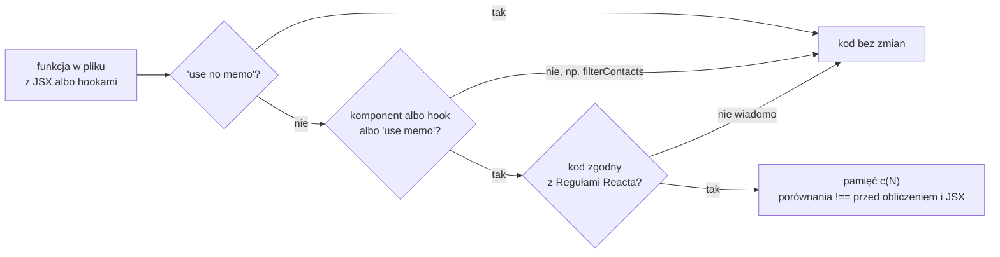

# React Compiler: memoizacja dopisywana w czasie budowania

## Ręczna memoizacja i jej koszt

Ręczna optymalizacja `contacts-app` zajęła trzy `memo`, dwa `useCallback` i jeden `useMemo`. <u>Trzy z tych sześciu memoizacji nic nie dają.</u> `memo` na `ContactList` i `useMemo` na `filtered` nigdy nie zwracają zapamiętanego wyniku, bo każdy render `HomePage` zmienia ich wejście. Stabilny `handleAdd` trafia do formularza, który niczego nie porównuje. Dokumentacja Reacta opisuje ten problem jednym zdaniem:

> **„Taka ręczna memoizacja jest żmudna, łatwo w niej o błąd i dokłada kodu do utrzymania.”**
>
> *„This manual memoization is tedious, easy to get wrong, and adds extra code to maintain.”*
>
> — dokumentacja Reacta, *React Compiler: Introduction*

Ta sama strona pokazuje błąd, który łatwo przeoczyć. Komponent ma `handleClick` w `useCallback`, ale przekazuje dziecku zapis `onClick={() => handleClick(item)}`. Funkcja strzałkowa powstaje przy każdym renderze, więc dziecko w `memo` i tak dostaje nowy prop. Według dokumentacji kompilator optymalizuje ten kod poprawnie zarówno z taką funkcją, jak i bez niej.

## Czym jest React Compiler

**React Compiler** to narzędzie uruchamiane w czasie budowania aplikacji. Wpis na blogu Reacta z okazji wydania wersji 1.0 opisuje go tak:

> **„React Compiler to narzędzie działające w czasie budowania, które optymalizuje aplikację Reacta przez automatyczną memoizację.”**
>
> *„React Compiler is a build-time tool that optimizes your React app through automatic memoization.”*
>
> — blog Reacta, *React Compiler v1.0*

Kompilator czyta kod komponentów i hooków, zanim trafi on do przeglądarki. Ustala, które wartości zależą od których propsów i stanu, a potem sam wstawia memoizację wyników: wartości wyliczanych w komponencie, funkcji i fragmentów JSX. Kod źródłowy w repozytorium się nie zmienia, zmienia się tylko wynik budowania. Dokumentacja `memo` dodaje, że po włączeniu kompilatora ręczne `memo` na ogół przestaje być potrzebne.

Ten sam wpis wymienia rzecz, której ręczna memoizacja nie potrafi. Kompilator zapamiętuje wartości także **warunkowo**, na przykład po wcześniejszym `return null`. Hooka `useMemo` nie wolno wywołać po takim powrocie, bo hooki muszą stać przed nim.

## Które funkcje kompilator bierze pod uwagę

Kompilator nie przetwarza każdej funkcji w projekcie. Domyślny tryb wyboru, `compilationMode: 'infer'`, bierze dwie grupy:

- **funkcje oznaczone dyrektywą `'use memo'`**,
- **funkcje nazwane jak komponent albo hook**, czyli wielką literą albo z przedrostkiem `use`, które tworzą JSX albo wywołują inne hooki.

Nie spełnia tego warunku `filterContacts` z `lib/contacts.js`. To zwykła funkcja, która nie tworzy JSX ani nie woła hooków. Dokumentacja podaje dwa skutki tej granicy. Kompilator zapamiętuje wyniki tylko wewnątrz komponentów i hooków. Każdy komponent ma przy tym własną pamięć, więc gdy dwa komponenty wywołują tę samą kosztowną funkcję z tymi samymi danymi, funkcja wykona się dwa razy.

Next.js dokłada własny filtr na poziomie plików. Babel i SWC to narzędzia, które przekształcają kod JavaScriptu podczas budowania: SWC jest szybszy, a Babel ma bogatszy zestaw wtyczek. Dokumentacja opcji `reactCompiler` pisze, że kompilator działa jako wtyczka Babel, a Next.js przepuszcza przez nią tylko pliki, które jej potrzebują (*„only applies the React Compiler to relevant files—like those with JSX or React Hooks”*). Decyzję podejmuje szybka analiza napisana w SWC, więc pozostałe pliki nie płacą kosztu Babela.

## Reguły, na których kompilator polega

Kompilator nie zgaduje, które wartości się nie zmienią. Opiera się na założeniu, że kod przestrzega **Reguł Reacta** (*Rules of React*), wśród których pierwsza to czysty render. Dokumentacja pisze o nich tak:

> **„To reguły, a nie tylko wskazówki, w tym sensie, że gdy zostaną złamane, aplikacja prawdopodobnie ma błędy.”**
>
> *„They are rules – and not just guidelines – in the sense that if they are broken, your app likely has bugs.”*
>
> — dokumentacja Reacta, *Rules of React*

Gdy kompilator wykryje kod, który może łamać reguły, **pomija go**. Przewodnik debugowania opisuje to jako bezpieczne ominięcie optymalizacji zamiast ryzyka zmiany działania aplikacji. Build przy tym nie przerywa się, bo domyślnie kompilator tylko zostawia taki komponent bez zmian.

Tejas Kumar w *Fluent React* opisywał ten projekt jeszcze pod roboczą nazwą Forget:

> **„Forget to zestaw narzędzi dla Reacta podobny do lintera z włączoną flagą `--fix`: pilnuje reguł Reacta, a potem automatycznie przekształca kod Reacta do postaci optymalnej, inteligentnie zapamiętując wartości, które nie zmienią się w czasie życia aplikacji.”**
>
> *„Forget is a toolchain for React similar to a linter that has its `--fix` flag enabled: it enforces the rules of React and then automatically transforms React code to be optimal through intelligently memoizing values that will not change throughout the lifecycle of an application […]”*
>
> — Tejas Kumar, *Fluent React*

## Status: od eksperymentu do wersji stabilnej

Barklund w *React in Depth* (2024) i Schwarzmüller w *React Key Concepts* opisują kompilator jako eksperymentalny, bo pisali przed wersją 1.0. Ta ukazała się 7 października 2025 roku, a dokumentacja nazywa kompilator stabilnym i gruntownie przetestowanym w produkcji (*„React Compiler is now stable and has been tested extensively in production”*). Działa z Reactem 17 i nowszym, a dla wersji starszych niż 19 wymaga pakietu `react-compiler-runtime`.

## Włączenie w Next.js 16

Kompilator wymaga dwóch rzeczy. Pierwsza to pakiet `babel-plugin-react-compiler` w zależnościach deweloperskich projektu. Druga to jeden klucz w pliku `next.config.mjs`:

```js
/** @type {import('next').NextConfig} */
const nextConfig = {
  reactCompiler: true, // Next.js 16: klucz na najwyższym poziomie, już poza experimental
};

export default nextConfig;
```

Plik ma trzy części:

1. **Komentarz `@type`** podpowiada edytorowi typy konfiguracji. Na działanie nie wpływa.
2. **`reactCompiler: true`** włącza kompilator dla całego projektu.
3. **`export default`** eksportuje konfigurację jako moduł ES. Rozszerzenie `.mjs` mówi Node.js, że plik ma ten format.

Klucz stoi na najwyższym poziomie obiektu. W Next.js 15 był w obiekcie `experimental`, więc konfiguracja skopiowana ze starszego artykułu może mieć go w niewłaściwym miejscu. Sam pakiet niczego nie włącza, a sam klucz bez pakietu kończy build komunikatem „Failed to resolve package babel-plugin-react-compiler while attempting to resolve React Compiler”. Docelowa konfiguracja `contacts-app` zostaje pusta (`const nextConfig = {};`), a ręczna memoizacja w `page.jsx` zostaje w kodzie, żeby jej mechanizm był widoczny.

## Co kompilator wstawia do kodu

Wynik kompilacji da się obejrzeć w plikach `.next/static/chunks`. W buildzie `contacts-app` z `reactCompiler: true` skompilowany `ContactStats` zaczyna się tak:

```js
let m=(0,l.memo)(function(e){let t,l,o,i,r=(0,n.c)(9),{contacts:c}=e,s=c.length;r[0]!==c?(t=c.reduce(h,{}),r[0]=c,r[1]=t):t=r[1];let m=t;return r[2]!==s?(l=(0,a.jsxs)("p",{children:["Lacznie: ",(0,a.jsx)("strong",{children:s})]}),r[2]=s,r[3]=l):l=r[3], …
```

Ten sam początek, rozpisany ręcznie z czytelnymi nazwami, wygląda tak:

```js
const cache = c(9);                     // pamięć komponentu: 9 miejsc, trwa między renderami
const total = contacts.length;
let categories;
if (cache[0] !== contacts) {            // przyszła inna tablica: liczymy od nowa
  categories = contacts.reduce(countCategory, {});
  cache[0] = contacts;                  // zapamiętane wejście
  cache[1] = categories;                // zapamiętany wynik
} else {
  categories = cache[1];                // ta sama tablica: wynik z pamięci
}
let totalLine;
if (cache[2] !== total) {               // ta sama zasada dla akapitu „Lacznie”
  totalLine = <p>Lacznie: <strong>{total}</strong></p>;
  cache[2] = total;
  cache[3] = totalLine;
} else {
  totalLine = cache[3];
}
```

Wywołanie `c(9)` tworzy pamięć komponentu z dziewięcioma miejscami. To funkcja `c` z modułu `react/compiler-runtime`, którą dokumentacja pokazuje w przykładzie skompilowanego kodu. Pierwsze miejsce przechowuje ostatnią tablicę `contacts`, drugie wynik `reduce`. **`reduce` wykonuje się tylko wtedy, gdy przyszła inna tablica**, a akapit „Lacznie” powstaje od nowa tylko po zmianie liczby kontaktów. Funkcja przekazywana do `reduce` trafiła poza komponent jako `function h`, bo nie korzysta z niczego wewnątrz niego.

Kod przeglądarki zawiera sześć takich wywołań `c(N)`, po jednym na każdy komponent kliencki: `HomePage`, `ContactList`, `ContactItem`, `ContactStats`, `SearchBar` i `AddContactForm`. `RootLayout` z `app/layout.jsx` jest komponentem serwerowym, renderuje się raz na żądanie i w wyniku budowania zostaje bez pamięci `c(N)`. W `HomePage` ręczne `useMemo` zamieniło się na to samo porównanie `!==` dla `contacts` i `query`.

## Wybrane komponenty: tryb `annotation` i `'use no memo'`

Dla dużej aplikacji jest łagodniejsza droga niż włączenie kompilatora wszędzie naraz. Ustawienie `reactCompiler: { compilationMode: 'annotation' }` kompiluje wyłącznie funkcje z dyrektywą `'use memo'`. Dyrektywa **`'use no memo'`** działa odwrotnie i wyłącza kompilator dla jednej funkcji albo, na początku pliku, dla całego modułu. Obie stoją w pierwszej linii ciała funkcji:

```jsx
// tryb 'annotation': kompilowana jest tylko funkcja z 'use memo'
const ContactStats = memo(function ContactStats({ contacts }) {
  'use memo';
  // reszta komponentu bez zmian
});

// tryb 'infer': ta jedna funkcja zostaje bez kompilacji
const ContactStats = memo(function ContactStats({ contacts }) {
  'use no memo'; // powód wyłączenia zapisuje się w komentarzu obok
  // reszta komponentu bez zmian
});
```

W `contacts-app` w trybie `annotation` bez żadnej dyrektywy kod przeglądarki nie ma ani jednego wywołania `c(N)`. Z `'use memo'` w `ContactStats` ma jedno. W trybie `infer` z `'use no memo'` w `ContactStats` ma pięć zamiast sześciu, a statystyka wraca do postaci sprzed kompilacji. Dyrektywa ma pierwszeństwo przed każdym trybem kompilacji. Dokumentacja traktuje `'use no memo'` jako narzędzie tymczasowe i zaleca dopisać obok komentarz z powodem wyłączenia.

## Rysunek 6.7 — droga funkcji przez kompilator w trybie `infer`



Na Rysunku 6.7 są trzy pytania i tylko jedna droga do skompilowanego kodu. Pierwsze rozstrzyga dyrektywa, która ma pierwszeństwo przed resztą. Drugie wynika z nazwy i treści funkcji, dlatego `filterContacts` zostaje bez zmian. Trzecie zadaje analiza kodu. Wątpliwość kończy się pominięciem, a nie błędem buildu.

## Ręczne `useMemo` przy włączonym kompilatorze

Dokumentacja nie każe usuwać istniejącej memoizacji. W nowym kodzie zaleca polegać na kompilatorze, a `useMemo` i `useCallback` traktować jako furtkę do precyzyjnej kontroli. Typowy przypadek to wartość będąca zależnością efektu, który nie powinien uruchamiać się ponownie bez istotnej zmiany danych. W kodzie, który już istnieje, ręczną memoizację lepiej zostawić, bo jej usunięcie może zmienić wynik kompilacji. Zdanie o tym, że ręczne `memo` przestaje być potrzebne, dotyczy więc kodu pisanego od początku z kompilatorem.

## Memoizacja nie może decydować o poprawności

Każda memoizacja, ręczna i automatyczna, podlega tej samej regule. Dokumentacja `memo` formułuje ją tak:

> **„React może go jednak wyrenderować: memoizacja jest optymalizacją wydajności, a nie gwarancją.”**
>
> *„But React may still re-render it: memoization is a performance optimization, not a guarantee.”*
>
> — dokumentacja Reacta, *memo*

Dokumentacja `useMemo` dodaje praktyczny test. Jeśli kod bez hooka nie działa, najpierw trzeba znaleźć i naprawić właściwy problem (*„If your code doesn’t work without it, find the underlying problem and fix it first.”*). Reguła ma techniczne uzasadnienie, bo React może wyrzucić zapamiętaną wartość. Dokumentacja podaje trzy sytuacje: edycję pliku komponentu w trybie deweloperskim, zawieszenie komponentu podczas pierwszego montowania i, w przyszłości, wiersze, które przewinęły się poza widoczny obszar wirtualizowanej listy. Wartość, którą trzeba pamiętać na pewno, trzyma się w stanie albo w refie. <u>Usunięcie memoizacji z poprawnego kodu może go spowolnić, ale nie może zmienić tego, co widzi użytkownik.</u>

Kompilator dokłada do tej listy własny powód. Kolejne wersje mogą memoizować inaczej, a kod, który po cichu polega na memoizacji, może wtedy zmienić działanie efektów. Projekt bez testów, które wychwyciłyby taką zmianę, ma według wpisu o wydaniu przypiąć dokładną wersję flagą `--save-exact`, czyli `1.0.0` zamiast `^1.0.0`.

## Gdy po włączeniu coś działa inaczej

Przewodnik debugowania odróżnia błędy kompilacji od problemów w działaniu. Te pierwsze są rzadkie, bo kompilator raczej pomija kod, niż przerywa build. Te drugie pojawiają się, gdy kod łamie reguły w sposób, którego analiza nie wykryła, najczęściej właśnie polegając na memoizacji dla poprawności. Kolejność postępowania jest prosta. Najpierw `'use no memo'` w podejrzanym komponencie: jeśli błąd znika, przyczyną jest naruszenie reguł. Potem usunięcie ręcznej memoizacji: błąd, który zostaje bez niej, leży w samym komponencie. Skompilowany komponent ma w React DevTools znaczek „Memo ✨”.

## Czego kompilator nie zrobi

Kompilator zmniejsza **liczbę** renderów i obliczeń. Nie przyspiesza pojedynczego obliczenia, które samo w sobie jest wolne. Gdyby pętla pomiarowa do pięciu milionów wróciła do `ContactStats`, każde jej wykonanie trwałoby tyle samo co bez kompilatora, a kompilator ograniczyłby tylko liczbę wykonań. Poza jego zasięgiem zostają też efekty i pobieranie danych.

## Skąd wiadomo, że nic się nie zepsuło

`memo`, `useCallback`, `useMemo` i kompilator zmieniają to, **kiedy** React wywołuje funkcje. Tego, co funkcje zwracają, zmieniać nie mają. Profiler pokazuje, że rendery zniknęły, ale nie to, że lista nadal filtruje, a „Usun” usuwa właściwy kontakt.

Ręczne sprawdzanie tych czynności po każdej zmianie łatwo skrócić albo coś w nim pominąć. Ten sam zestaw czynności może wykonać program, który renderuje komponent, klika w niego i porównuje wynik z oczekiwanym. Z takim zestawem włączenie kompilatora, aktualizacja jego wersji i usunięcie zbędnej memoizacji stają się zmianami, które da się sprawdzić jednym poleceniem.

> 💡 **Zapamiętaj:** React Compiler w Next.js 16 wymaga wtyczki `babel-plugin-react-compiler` i opcji `reactCompiler: true` na najwyższym poziomie konfiguracji. Kompiluje tylko komponenty i hooki zgodne z Regułami Reacta, a resztę pomija bez przerywania buildu.


Materiał rozszerzony do tego slajdu: [`rozszerzenia/r07_react-compiler.md`](rozszerzenia/r07_react-compiler.md)
