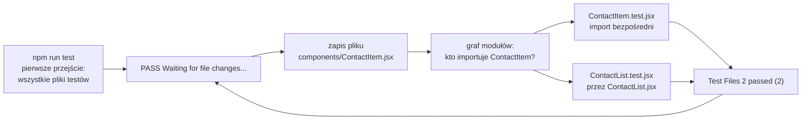

# Środowisko testowe: Vitest, jsdom i Testing Library

## Kto właściwie uruchamia test

Czy zmiana w `contacts-app` nie zepsuła ekranu, sprawdza **test komponentu**, czyli program, który renderuje komponent, wykonuje czynność użytkownika i porównuje wynik z oczekiwanym. Taki test wymaga dwóch różnych narzędzi. Pierwsze znajduje pliki z testami, uruchamia je, liczy wyniki i wypisuje raport. Nazywa się je **test runnerem** (*test runner*). Drugie umie wyrenderować komponent i znaleźć w nim przycisk albo pole formularza. Morten Barklund w *React in Depth* dzieli te role tak samo. Vitest pełni u niego funkcję test runnera, a React Testing Library służy do testowania komponentów metodą „czarnej skrzynki” (*„the component black-box testing framework”*). Test czarnej skrzynki patrzy na to, co komponent pokazuje i jak reaguje, bez zaglądania do jego środka.

## Najmniejszy test: `test`, `describe`, `expect` i `vi.fn`

Zanim pojawi się komponent, test runner da się pokazać na zwykłej funkcji. Przykład spoza `contacts-app` składa się z dwóch plików. Pierwszy to funkcja z jednym rozgałęzieniem:

```js
// sign.js
export function sign(n) {
  if (n < 0) return 'minus'; // gałąź dla liczb ujemnych
  return 'plus';             // gałąź dla zera i liczb dodatnich
}
```

Drugi, `sign.test.js`, leży obok i sprawdza ją dwoma testami. Nazwy testów są po angielsku, tak jak w testach `contacts-app`:

```js
import { sign } from './sign';

describe('sign', () => {                 // grupa testów z jedną nazwą w raporcie
  test('positive number', () => {        // pojedynczy test: nazwa i funkcja
    expect(sign(5)).toBe('plus');        // asercja: wynik ma być równy 'plus'
  });
  test('mock remembers calls', () => {
    const onPick = vi.fn();              // atrapa: funkcja, która zapisuje swoje wywołania
    onPick(1);
    expect(onPick).toHaveBeenCalledWith(1);
  });
});
```

**`describe`** grupuje testy, **`test`** opisuje jeden przypadek, a **`expect`** zaczyna asercję. Metody wywoływane po `expect(...)`, takie jak `toBe` i `toHaveBeenCalledWith`, nazywa się **matcherami**: każda porównuje wartość z oczekiwaną i przy różnicy przerywa test. Uruchomienie kończy się podsumowaniem `Test Files  1 passed (1)` i `Tests  2 passed (2)`. Liczba w nawiasie to wszystkie znalezione pliki albo testy, a liczba przed słowem `passed` to te, które przeszły.

## Przeglądarka, której nie ma

Testy uruchamia się w terminalu, w Node.js. Banks i Porcello w *Learning React* wskazują wynikający z tego problem:

> **„Nie uruchamiamy testów w przeglądarce, tylko w terminalu, w Node.js. Node.js nie ma DOM API, które standardowo ma każda przeglądarka.”**
>
> *„We're not running our tests in a browser; we're running them in the terminal with Node.js. Node.js does not have the DOM API that comes standard with each browser.”*
>
> — Alex Banks, Eve Porcello, *Learning React*

Rozwiązaniem jest **jsdom**, czyli implementacja drzewa DOM i zdarzeń przeglądarki napisana w JavaScripcie i działająca w Node.js. Banks i Porcello opisują ją jako pakiet, który symuluje środowisko przeglądarki w Node.js. Jsdom ma `document`, `window`, elementy, atrybuty i zdarzenia. Nie ma układu strony, pikseli ani prawdziwego serwera Next.js. Wystarcza to, żeby sprawdzić, czy `ContactList` z pustą tablicą nie rysuje wiersza, ale nie, czy przycisk mieści się na ekranie telefonu.

## Vitest a Jest

Starsze materiały o Reakcie prawie zawsze pokazują Jesta. Barklund wybiera Vitesta i tak to uzasadnia:

> **„Jest to inna biblioteka testowa, prawdopodobnie częściej używana przy testowaniu Reacta, ale Vitest ma niemal identyczne API.”**
>
> *„Jest is another testing library that's probably more commonly used in React testing, but Vitest is almost identical in its API.”*
>
> — Morten Barklund, *React in Depth*

Funkcje `test`, `describe`, `expect` i matchery z przykładu wyżej działają w Jeście tak samo. Różni się przedrostek atrapy: `vi.fn()` w Vitest, `jest.fn()` w Jeście.

## Zależności z przypiętymi wersjami

`contacts-app` ma w `devDependencies` siedem pakietów testowych, zapisanych dokładnymi numerami, bez znaku `^`. Takie wpisy daje polecenie `npm install -D --save-exact` z wersjami podanymi wprost:

```bash
npm install -D --save-exact vitest@2.1.9 @vitejs/plugin-react@4.7.0 jsdom@25.0.1 \
  @testing-library/react@16.3.3 @testing-library/dom@10.4.2 \
  @testing-library/user-event@14.6.8 @testing-library/jest-dom@6.9.1
```

Każdy pakiet ma jedno zadanie:

- **`vitest`** to test runner.
- **`@vitejs/plugin-react`** pozwala Vitestowi czytać JSX w plikach komponentów i testów.
- **`jsdom`** dostarcza drzewo DOM w Node.js.
- **`@testing-library/react`** daje funkcję `render` i obiekt `screen` z zapytaniami.
- **`@testing-library/dom`** to biblioteka bazowa, na której stoi wersja dla Reacta.
- **`@testing-library/user-event`** symuluje działania użytkownika, takie jak kliknięcie i pisanie.
- **`@testing-library/jest-dom`** dodaje matchery DOM, na przykład `toBeInTheDocument` i `toHaveValue`.

Bez numerów npm instaluje najnowsze wersje główne, a te zmieniają konfigurację i komunikaty. Wersja 2.1.9 Vitesta i jsdom 25.0.1 pasują do Next.js 16.4.0 i Reacta 19.3.0, na których stoi reszta projektu.

## Plik konfiguracji Vitesta

W katalogu głównym projektu leży plik `vitest.config.js`:

```js
import { defineConfig } from 'vitest/config';
import react from '@vitejs/plugin-react';

export default defineConfig({
  plugins: [react()],
  test: {
    environment: 'jsdom',      // imitacja DOM zamiast czystego Node.js
    setupFiles: ['./vitest.setup.js'],
    globals: true,             // test, expect i vi dostępne bez importu
  },
});
```

Next.js tego pliku nie czyta, więc build działa bez zmian. Każde pole odpowiada za jedną rzecz, bez której test nie ruszy:

1. **`plugins: [react()]`** uczy Vitesta JSX. Bez niej pierwszy znacznik `<` w pliku testu byłby błędem składni.
2. **`environment: 'jsdom'`** podstawia imitację przeglądarki. Dokumentacja Vitesta podaje, że domyślnym środowiskiem jest Node.js. Bez tego pola pierwszy `render` kończy się błędem `ReferenceError: document is not defined`.
3. **`setupFiles`** wskazuje plik, który według dokumentacji uruchamia się przed każdym plikiem testów (*„They will run before each test file in the same process”*).
4. **`globals: true`** udostępnia `test`, `expect` i `vi` bez importu, tak jak w przykładzie z `sign`.

Domyślnie Vitest nie udostępnia globalnych funkcji, żeby kod był jawny (*„By default, vitest does not provide global APIs for explicitness”*). Włączenie `globals: true` ma jeszcze jeden skutek. Funkcja `cleanup` usuwa wyrenderowane drzewo po teście. Dokumentacja React Testing Library podaje, że wywołuje się sama tylko wtedy, gdy framework wstrzykuje globalną funkcję `afterEach()` (*„injects a global afterEach() function”*). Bez `globals: true` drugi test w pliku trafiałby na elementy z pierwszego.

Środowisko z pola `environment` obowiązuje wszystkie pliki. Dokumentacja Vitesta pozwala zmienić je dla jednego pliku komentarzem w pierwszej linii, na przykład `// @vitest-environment node` dla testu funkcji z `lib/`, która nie potrzebuje DOM.

## Plik przygotowania i skrypty

Drugi plik w katalogu głównym, `vitest.setup.js`, ma jedną linię:

```js
import '@testing-library/jest-dom'; // dopisuje matchery DOM do globalnego expect
```

Import rozszerza globalne `expect` o matchery DOM. Dzięki temu w teście pisze się `expect(element).toBeInTheDocument()` zamiast `expect(element).not.toBeNull()`, a nieudana asercja wypisuje opis elementu. Słowo `.not` przed matcherem odwraca jego sens: asercja przechodzi, gdy warunek nie jest spełniony.

<u>Plik przygotowania działa tylko razem z `globals: true`</u>, bo `jest-dom` dopisuje matchery do globalnego `expect`. Bez tego pola test nie dochodzi nawet do pierwszej linii. Pada sam `vitest.setup.js` z komunikatem `ReferenceError: expect is not defined`. Odwrotnie, bez pola `setupFiles` testy ruszają, ale każda asercja `toBeInTheDocument` kończy się błędem `Invalid Chai property: toBeInTheDocument`. Chai to biblioteka asercji, na której Vitest buduje `expect`, więc nieznany matcher zgłasza ona.

Sekcja `scripts` w `package.json` ma dwa wpisy dla testów:

```json
{
  "scripts": {
    "test": "vitest",
    "test:run": "vitest run"
  }
}
```

Projekt bez żadnego pliku testów kończy `vitest run` komunikatem `No test files found, exiting with code 1`. Konfiguracja się wtedy wczytała, a kod wyjścia 1 oznacza, że nie było czego sprawdzić.

## Dwa tryby uruchomienia

**`npm run test`** (albo krócej `npm test`) uruchamia Vitesta w **trybie obserwowania** (*watch mode*). Po pierwszym przejściu nie kończy pracy, tylko czeka na zapis pliku. **`npm run test:run`** wykonuje wszystkie testy raz i kończy działanie kodem wyjścia 0 albo 1. Barklund stosuje ten sam podział, tylko drugi skrypt nazywa `test:once`. Jego treść to także `vitest run`, a słowo `run` Barklund nazywa flagą: to ono wyłącza obserwowanie. Barklund radzi, który tryb do czego służy:

> **„Przy pracy nad kodem lepiej chyba uruchamiać test bez tej flagi, żeby działał przez cały czas pisania aplikacji i pokazywał, że wszystkie testy wciąż przechodzą.”**
>
> *„For development purposes, it's probably better to run the test without the flag to keep it running as you write your application and observe that all tests always pass.”*
>
> — Morten Barklund, *React in Depth*

Tryb obserwowania nie powtarza po każdym zapisie całego zestawu. Według dokumentacji Vitest przeszukuje wtedy graf modułów i uruchamia tylko powiązane testy (*„Vitest smartly searches the module graph and only reruns the related tests”*). **Graf modułów** to zapis tego, który plik importuje który.

## Rysunek 6.8 — co Vitest uruchamia po zapisie pliku



Rysunek 6.8 zakłada, że w `__tests__/` leży po jednym pliku testów dla wiersza, listy, wyszukiwarki i formularza. Zapis `ContactItem.jsx` uruchamia wtedy dwa z nich: jeden importuje wiersz wprost, drugi przez `ContactList.jsx`. Testy `SearchBar` i `AddContactForm` nie startują, bo żaden z ich importów nie prowadzi do zmienionego pliku. Pętlę obserwowania zamyka klawisz `q`.

## Gdzie Vitest szuka testów

Vitest domyślnie uruchamia pliki pasujące do wzorca `**/*.{test,spec}.?(c|m)[jt]s?(x)`. W praktyce oznacza to nazwy kończące się na `.test.js`, `.test.jsx`, `.spec.js` albo `.spec.jsx`, w dowolnym katalogu poza `node_modules`. Plik z literówką w końcówce, na przykład `ContactStats.tests.jsx`, zostanie pominięty bez ostrzeżenia. Gdy liczba plików w podsumowaniu się nie zgadza, Vitest nie znalazł któregoś testu.

W `contacts-app` testy leżą we wspólnym katalogu `__tests__/`. Barklund kładzie plik testu obok komponentu, na przykład `MenuItem.test.jsx` obok `MenuItem.jsx`. Vitest obsługuje oba układy bez zmian w konfiguracji, a Barklund wymaga tylko konsekwencji (*„Make sure that you're consistent, at least.”*).

Przed podsumowaniem Vitest wypisuje żółte ostrzeżenie „The CJS build of Vite's Node API is deprecated”. Jest nieszkodliwe i bierze się z braku pola `"type": "module"` w `package.json`. Opis nieudanej asercji kończy się ścieżką do pliku testu z numerem linii. Od niej zaczyna się czytanie, a przyczyny w komponencie szuka się na końcu.

## Vitest w projekcie Next.js

Dokumentacja Next.js ma osobny przewodnik tego zestawu. Zaczyna go zdaniem, że Vitest i React Testing Library są często używane razem do testów jednostkowych (*„Vitest and React Testing Library are frequently used together for Unit Testing”*). Gotowy szkielet daje `npx create-next-app@latest --example with-vitest`. Konfiguracja z przewodnika ma tylko wtyczkę Reacta i `environment: 'jsdom'`, bez `jest-dom` i `globals`.

Ten sam przewodnik zaczyna od ostrzeżenia o granicy całego zestawu:

> **„Ponieważ asynchroniczne komponenty serwerowe są w ekosystemie Reacta nowe, Vitest ich obecnie nie obsługuje. Testy jednostkowe synchronicznych komponentów serwerowych i klienckich nadal są możliwe, ale dla komponentów `async` zaleca się testy E2E.”**
>
> *„Since async Server Components are new to the React ecosystem, Vitest currently does not support them. While you can still run unit tests for synchronous Server and Client Components, we recommend using E2E tests for async components.”*
>
> — dokumentacja Next.js, *How to set up Vitest with Next.js*

Testy E2E (*end-to-end*) uruchamiają prawdziwą przeglądarkę na działającym serwerze. Z granicy wynika reguła podziału kodu. Komponent `async` tylko pobiera dane i przekazuje je dalej. Wszystko, co da się kliknąć, wpisać albo pomylić, trafia do komponentu synchronicznego z danymi w propsach. W `contacts-app` strona `HomePage` jest komponentem klienckim, a dane leżą w `lib/contacts.js`, więc każdy komponent aplikacji mieści się w Vitest.

> 💡 **Zapamiętaj:** test komponentu w Next.js potrzebuje runnera (Vitest), imitacji przeglądarki (jsdom) i biblioteki do renderowania i wyszukiwania elementów (React Testing Library z `jest-dom`). `npm run test` obserwuje pliki i powtarza tylko testy powiązane ze zmianą, a `npm run test:run` przechodzi wszystko raz i zwraca kod wyjścia.


Materiał rozszerzony do tego slajdu: [`rozszerzenia/r08_vitest-konfiguracja.md`](rozszerzenia/r08_vitest-konfiguracja.md)
