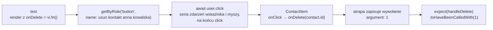

# Pierwsze testy: wiersz kontaktu oczami użytkownika

## Co obiecuje wiersz kontaktu

Barklund w *React in Depth* zaczyna każdy test od pytania, co komponent właściwie robi. Najpierw opisuje jego zadanie zwykłym zdaniem, a dopiero potem pisze kod testu. Dla `ContactItem` takie zdanie brzmi: wiersz pokazuje imię i nazwisko, telefon, adres e-mail i kategorię kontaktu, a przycisk „Usun” przekazuje rodzicowi identyfikator kontaktu. Wszystko, co wykracza poza to zdanie, leży poza **kontraktem komponentu**. Nie ma w nim klas CSS, kolejności znaczników `<span>` ani tego, czy komponent jest owinięty w `memo`.

Kontrakt wyznacza też granicę testu. Wiersz zgłasza rodzicowi, który kontakt usunąć, a samo usuwanie wykonuje rodzic. Test wiersza sprawdza więc zgłoszenie. Zniknięcie wiersza należy do testu komponentu, który trzyma listę w stanie.

## Pierwszy test

Plik `__tests__/ContactItem.test.jsx` zaczyna się od importów i danych jednego kontaktu. Pod nimi stoi pierwszy test:

```jsx
// __tests__/ContactItem.test.jsx
import { render, screen } from '@testing-library/react';
import ContactItem from '../components/ContactItem';

// dane jednego kontaktu, wspólne dla wszystkich testów w pliku
const contact = {
  id: 1,
  name: 'Anna Kowalska',
  phone: '600 100 200',
  email: 'anna@example.com',
  category: 'work',
};

test('renders contact name and email', () => {
  // render montuje komponent w dokumencie jsdom
  render(<ContactItem contact={contact} onDelete={() => {}} />);
  // getByText szuka elementu z dokładnie tym tekstem
  expect(screen.getByText('Anna Kowalska')).toBeInTheDocument();
  // wyrażenie regularne dopasowuje fragment tekstu elementu
  expect(screen.getByText(/anna@example\.com/)).toBeInTheDocument();
});
```

Funkcja `test` rejestruje jeden test: pierwszy argument to nazwa widoczna w raporcie, drugi to treść testu. **`render`** montuje komponent w drzewie jsdom, czyli w imitacji DOM działającej w Node.js. Prop `onDelete` dostaje pustą funkcję, bo komponent go wymaga, choć test niczego nie klika. **`screen.getByText`** szuka w dokumencie elementu z podanym tekstem, a **`toBeInTheDocument`** z `jest-dom` sprawdza, że element jest w dokumencie.

Adres stoi w `<span>` razem z myślnikiem, więc napis `'anna@example.com'` nie pasuje do całego tekstu elementu. Wyrażenie regularne `/anna@example\.com/` dopasowuje fragment. Kropka ma przed sobą ukośnik, bo sama oznacza dowolny znak.

## Przygotuj, wykonaj, sprawdź

Barklund opisuje układ testu, który ma własną nazwę: **Arrange-Act-Assert** (przygotuj, wykonaj, sprawdź). W pierwszym teście część „przygotuj” to obiekt `contact` i `render`. Część „wykonaj” jest pusta, bo test nie symuluje żadnej czynności. Barklund pozwala ją wtedy pominąć. Część „sprawdź” to linie z `expect`. Test kliknięcia ma wszystkie trzy części, a ich kolejność się nie zmienia: po asercji nie wykonuje się już żadnej czynności.

## Testuje się zachowanie, a nie implementację

Dokumentacja Testing Library otwiera opis swoich zasad jednym zdaniem:

> **„Im bardziej testy przypominają sposób, w jaki oprogramowanie jest używane, tym większą pewność mogą dać.”**
>
> *„The more your tests resemble the way your software is used, the more confidence they can give you.”*
>
> — dokumentacja Testing Library, *Guiding Principles*

Z tej zasady wynikają decyzje projektowe biblioteki. Operuje ona na węzłach DOM i nie daje dostępu do instancji komponentów. Wprowadzenie do React Testing Library nazywa problem wprost: testy mają unikać **szczegółów implementacji** komponentów. Refaktoryzacja, czyli zmiana budowy bez zmiany działania, zostawia wtedy testy zielone.

Barklund nazywa pożądaną cechę testu **odpornością** (*test resiliency*):

> **„Chcemy, żeby testy przechodziły przy zmianach, które niczego nie psują, i padały tylko przy istotnych zmianach funkcjonalności.”**
>
> *„We want our tests to pass when we make nonbreaking changes and fail only when we make significant changes to functionality.”*
>
> — Morten Barklund, *React in Depth*

Owinięcie `ContactItem` w `memo` zmienia budowę pliku: inny sposób deklaracji, osobny eksport. Test przechodzi przed tą zmianą i po niej, bo wiersz wygląda tak samo. Zamiana imienia na inicjały go psuje, i słusznie, bo użytkownik zobaczy co innego. Do testów komponentów trafia więc treść po wyrenderowaniu, reakcja na kliknięcie i pisanie oraz komunikaty walidacji. Poza nimi zostają **nazwy klas CSS**, **wewnętrzny stan** i **liczba renderów**, która zmienia się po dodaniu `memo` przy niezmienionym ekranie.

Strona zasad przyznaje też, że pełne odtworzenie użytkownika jest niemożliwe, bo test wykonuje komputer, najczęściej w symulowanej przeglądarce (*„we're using a computer and often a simulated browser environment”*). Test w jsdom nie zobaczy przycisku zasłoniętego innym elementem ani tekstu w kolorze tła.

## Jeden test, jedno zachowanie

Pierwszy test sprawdza dwie rzeczy jednego rodzaju: dwa teksty, które wiersz pokazuje. Kliknięcie i nazwa przycisku dostają osobne testy, bo to osobne zachowania. Powód jest praktyczny. Asercja, która nie przechodzi, rzuca wyjątek i kończy test, więc kolejne linie z `expect` w tym samym teście się nie wykonują. Gdy jeden duży test sprawdza imię, adres i kliknięcie, a imię zmieni się na inicjały, raport podaje tylko pierwszą porażkę. O stanie adresu i kliknięcia nie mówi nic.

Nazwa testu jest przy tym zdaniem z kontraktu komponentu. Raport `× calls onDelete with contact id when delete button is clicked` mówi, co przestało działać, zanim ktokolwiek otworzy plik testu. Nazwy w `contacts-app` są po angielsku, tak jak cały kod, i zaczynają się od czasownika: *renders*, *calls*, *shows*. Lista nazw w raporcie czyta się wtedy jak opis tego, co komponent robi.

## Atrapa funkcji: `vi.fn()`

Druga część kontraktu dotyczy rodzica: kliknięcie ma mu przekazać identyfikator. Żeby to sprawdzić, test podstawia w miejsce `onDelete` **atrapę** (*mock*). Barklund definiuje ją tak:

> **„Atrapa zastępuje prawdziwy element kawałkiem pseudokodu, który nie robi tego, co oryginał; to podmiana, nad którą ma się pełną kontrolę.”**
>
> *„When you mock something, you replace it with a tiny bit of pseudocode that doesn't do what the thing normally does; it's a drop-in replacement that you fully control.”*
>
> — Morten Barklund, *React in Depth*

`vi.fn()` tworzy funkcję, która niczego nie robi, ale zapamiętuje każde wywołanie razem z argumentami:

```jsx
test('vi.fn remembers calls', () => {
  const greet = vi.fn();      // atrapa: zwraca undefined
  greet('Ala');
  greet('Ola', 2);
  expect(greet).toHaveBeenCalledTimes(2);          // liczba wywołań
  expect(greet).toHaveBeenCalledWith('Ola', 2);    // jedno z wywołań miało te argumenty
  expect(greet.mock.calls).toEqual([['Ala'], ['Ola', 2]]); // pełna lista
});
```

Atrapa pasuje do granic komponentu. Vitest umie też podmienić cały moduł funkcją `vi.mock`. Barklund wymienia jako typowe cele API przeglądarki, zewnętrzne biblioteki do pobierania danych i złożone elementy aplikacji, takie jak kontekst. Atrapa własnego komponentu dziecka jest sygnałem ostrzegawczym, bo jego zachowanie wymyśla wtedy autor testu. W `contacts-app` jedyną atrapą jest `onDelete`, czyli miejsce, w którym wiersz oddaje sprawę rodzicowi.

## Kliknięcie przez user-event

Przeglądarka nie wysyła pojedynczego „kliknięcia”. Najechanie kursorem, wciśnięcie przycisku myszy, przeniesienie fokusu, puszczenie przycisku i dopiero na końcu `click` to seria zdarzeń. Biblioteka `@testing-library/user-event` odtwarza całą serię. Jej instancję tworzy się na początku testu przez `userEvent.setup()`:

```jsx
import { useState } from 'react';
import userEvent from '@testing-library/user-event';

function Counter() {
  const [n, setN] = useState(0);
  return <button onClick={() => setN(n + 1)}>Kliknięto {n}</button>;
}

test('user.click minimal', async () => {
  const user = userEvent.setup();      // instancja pamięta stan sesji: fokus, klawisze
  render(<Counter />);
  await user.click(screen.getByRole('button')); // jedyny przycisk na stronie; seria zdarzeń zakończona click
  expect(screen.getByRole('button')).toHaveTextContent('Kliknięto 1'); // tekst wewnątrz elementu
});
```

Zapytanie `getByRole('button')` znajduje element po roli przycisku, a matcher `toHaveTextContent` z `jest-dom` porównuje tekst wewnątrz znalezionego elementu.

Dokumentacja zaleca właśnie metody instancji zwróconej przez `setup()` (*„Using the methods on the instances returned by userEvent.setup() is recommended”*). React Testing Library ma też prostsze narzędzie, `fireEvent`, które wysyła jedno wskazane zdarzenie:

> **„`fireEvent` wysyła zdarzenia DOM, podczas gdy `user-event` symuluje pełne interakcje, które mogą wywołać wiele zdarzeń i po drodze wykonać dodatkowe sprawdzenia.”**
>
> *„fireEvent dispatches DOM events, whereas user-event simulates full interactions, which may fire multiple events and do additional checks along the way.”*
>
> — dokumentacja Testing Library, *user-event: Introduction*

Dodatkowe sprawdzenia dotyczą tego, czy użytkownik w ogóle mógłby wykonać czynność. Kliknięcie w element z regułą `pointer-events: none` kończy się w `user-event` błędem „Unable to perform pointer interaction as the element has `pointer-events: none`”, a tekst wpisywany do wyłączonego pola do niego nie trafia. `fireEvent` w obu przypadkach wysyła zdarzenie i obsługa się wykonuje, choć prawdziwy użytkownik by utknął. Metody `user.click` i `user.type` zwracają obiekty Promise, bo symulowana seria zdarzeń trwa. <u>Funkcja testu jest więc `async`, a każde wywołanie na obiekcie `user` poprzedza `await`</u>. Ten sam licznik bez `await` przed `user.click` pokazuje w asercji „Kliknięto 0”, bo asercja wykonuje się, zanim kliknięcie dotrze do komponentu.

Instancję `user` tworzy się w każdym teście od nowa. Instancja pamięta, który element ma fokus i które klawisze są wciśnięte, więc instancja dzielona między testami przenosiłaby ten stan z jednego testu do drugiego. Ta sama zasada dotyczy `render`: każdy test montuje komponent od zera, a biblioteka sama odmontowuje go po teście.

## Rola i nazwa przycisku

Zapytanie `getByRole('button', { name: ... })` szuka przycisku tak, jak szuka go czytnik ekranu: w drzewie dostępności, czyli w opisie strony, który przeglądarka przygotowuje dla technologii wspomagających. Dopasowuje **rolę** (tu `button`) i **nazwę dostępną**, czyli tekst, pod którym element występuje w tym opisie. Domyślnie nazwą przycisku jest jego treść, a atrybut `aria-label` może ją zastąpić. Sam napis „Usun” nie mówi, którego kontaktu dotyczy przycisk. Wiersz obiecuje usunięcie konkretnej osoby, więc nazwa dostępna ma ją wymieniać: „Usun kontakt Anna Kowalska”.

Dwa kolejne testy w tym samym pliku sprawdzają nazwę przycisku i kliknięcie. Import `userEvent` stoi na górze pliku:

```jsx
import userEvent from '@testing-library/user-event';

test('renders delete button with accessible label', () => {
  render(<ContactItem contact={contact} onDelete={() => {}} />);
  expect(
    // rola i nazwa dostępna; flaga i wyłącza rozróżnianie wielkości liter
    screen.getByRole('button', { name: /usun kontakt anna kowalska/i })
  ).toBeInTheDocument();
});

test('calls onDelete with contact id when delete button is clicked', async () => {
  const user = userEvent.setup();
  const handleDelete = vi.fn();             // atrapa w miejscu prawdziwego onDelete
  render(<ContactItem contact={contact} onDelete={handleDelete} />);
  await user.click(
    screen.getByRole('button', { name: /usun kontakt anna kowalska/i })
  );
  expect(handleDelete).toHaveBeenCalledWith(1); // kontrakt wobec rodzica: id Anny
});
```

Napisy w demo są bez polskich znaków, więc zapytanie o `/usuń/` nie trafiłoby w „Usun”. Gdyby `ContactItem` przekazywał `contact.name` zamiast `contact.id`, ostatni test padłby z komunikatem `expected "spy" to be called with arguments: [ 1 ]` i różnicą `- 1`, `+ "Anna Kowalska"`. Asercja na atrapie jest tu konieczna, bo wyjątek rzucony w obsłudze kliknięcia sam testu nie przerywa.

## Najpierw czerwono

Dwa nowe testy nie przechodzą, dopóki przycisk ma sam napis „Usun”, bo test szuka nazwy „Usun kontakt Anna Kowalska”. Komunikat brzmi „Unable to find an accessible element with the role "button" and name `/usun kontakt anna kowalska/i`”, a podsumowanie: `Tests  2 failed | 1 passed (3)`. Banks i Porcello w *Learning React* nazywają tę kolejność **programowaniem sterowanym testami** (*test-driven development*, TDD) i podkreślają, że to praktyka (*„TDD, is a practice—not a technology”*). Najpierw pisze się test, patrzy, jak pada, i dopiero wtedy dopisuje minimalny kod. Autorzy nazywają etapy kolorami (*„The steps you'll use to test are red, green, and gold”*), a złoty to porządkowanie kodu po zielonym wyniku.

Minimalny kod to jeden atrybut na przycisku w `components/ContactItem.jsx`:

```jsx
      <button
        type="button"
        onClick={() => onDelete(contact.id)}
        // nazwa w drzewie dostępności; na ekranie zostaje napis „Usun”
        aria-label={`Usun kontakt ${contact.name}`}
      >
        Usun
      </button>
```

Po zmianie raport pokazuje `Tests  3 passed (3)`. <u>Nazwa dostępna mówi, którego kontaktu dotyczy przycisk</u>: na liście z pięcioma wierszami osoba z czytnikiem ekranu nie słyszy pięć razy tego samego słowa, a zapytanie w teście listy wskazuje jeden przycisk. Barklund uzasadnia wybór ról tym, że przypominają sposób korzystania z aplikacji (*„as roles are similar to how users interact with an application”*).

## Rysunek 6.9 — przebieg testu kliknięcia



Rysunek 6.9 pokazuje, że komponent nie wie, że jest testowany: woła `onDelete` tak samo jak w przeglądarce, a jedynym świadkiem wywołania jest atrapa na końcu łańcucha.

> 💡 **Zapamiętaj:** test sprawdza to, co widzi i robi użytkownik: `render` montuje komponent, zapytanie szuka przycisku po roli i nazwie dostępnej, `await user.click(...)` klika jak człowiek, a atrapa `vi.fn()` z `toHaveBeenCalledWith` sprawdza kontrakt wobec rodzica.

