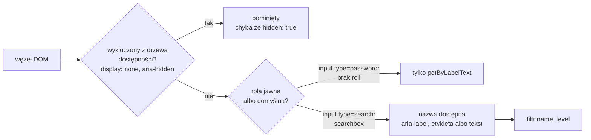

# Jak test znajduje element: zapytania i ich odmiany

## Test listy kontaktów

`ContactList` obiecuje dwie rzeczy: pokazuje wszystkie kontakty, które dostała, a przy pustej tablicy nie pokazuje żadnego wiersza. Sprawdzają to dwa testy w pliku `__tests__/ContactList.test.jsx`:

```jsx
// __tests__/ContactList.test.jsx
import { render, screen } from '@testing-library/react';
import ContactList from '../components/ContactList';

// dwa kontakty wystarczą, żeby lista nie skończyła się na pierwszym
const contacts = [
  { id: 1, name: 'Anna Kowalska', phone: '600 100 200', email: 'anna@example.com',  category: 'work'   },
  { id: 2, name: 'Piotr Nowak',   phone: '601 200 300', email: 'piotr@example.com', category: 'family' },
];

test('renders all contacts', () => {
  render(<ContactList contacts={contacts} onDelete={() => {}} />);
  expect(screen.getByText('Anna Kowalska')).toBeInTheDocument();
  expect(screen.getByText('Piotr Nowak')).toBeInTheDocument();
});

test('renders nothing when contacts list is empty', () => {
  render(<ContactList contacts={[]} onDelete={() => {}} />);
  // queryBy zwraca null, gdy elementu nie ma, zamiast rzucać błąd
  expect(screen.queryByRole('listitem')).toBeNull();
});
```

Test renderuje `ContactList` razem z prawdziwymi wierszami `ContactItem`. Nie podmienia dzieci atrapami, bo lista bez wierszy nie ma czego pokazać. Drugi test używa innego zapytania niż pierwszy. Rola `listitem` należy do elementu `<li>`, a `toBeNull()` sprawdza, że takiego elementu nie ma. `queryBy` przy braku zwraca właśnie `null`, więc zwykły matcher wystarcza; `expect(...).not.toBeInTheDocument()` z `jest-dom` daje ten sam wynik i jest zapisem równoważnym. Pusta lista zostawia w dokumencie samo `<ul>`: `queryByRole('list')` nadal je znajduje, a `queryAllByRole('listitem')` zwraca pustą tablicę. Test pyta więc o wiersze, bo to one znikają. Pusta tablica jest przypadkiem brzegowym, czyli wartością na skraju możliwych danych, przy której kod najłatwiej zachowuje się inaczej niż przy typowych danych. Razem z plikiem wiersza raport ma teraz `Test Files  2 passed (2)` i `Tests  5 passed (5)`.

## Trzy odpowiedzi na brak elementu

Każde zapytanie w React Testing Library występuje w trzech odmianach. Różnią się tym, co robią, gdy elementu nie ma albo gdy pasuje więcej niż jeden. Dokumentacja zapytań opisuje je tak:

| Odmiana | Brak dopasowania | Jedno dopasowanie | Więcej niż jedno | Czeka |
|---|---|---|---|---|
| `getBy…` | rzuca wyjątek | zwraca element | rzuca wyjątek | nie |
| `queryBy…` | zwraca `null` | zwraca element | rzuca wyjątek | nie |
| `findBy…` | rzuca wyjątek | zwraca element | rzuca wyjątek | tak |

**`getBy…`** służy do elementów, które muszą być na ekranie. **`queryBy…`** według dokumentacji przydaje się do sprawdzania, że elementu nie ma (*„This is useful for asserting an element that is not present”*). **`findBy…`** zwraca Promise, który spełnia się, gdy element się pojawi. Dokumentacja metod asynchronicznych opisuje `findBy` jako połączenie `getBy` z funkcją `waitFor`. Ta ponawia sprawdzenie co 50 ms, domyślnie przez 1000 ms:

```jsx
import { useEffect, useState } from 'react';

// komponent, który 300 ms po zamontowaniu zmienia napis
function Later() {
  const [ok, setOk] = useState(false);
  useEffect(() => {
    const id = setTimeout(() => setOk(true), 300); // timer startuje po renderze, nie w nim
    return () => clearTimeout(id);                 // sprzątanie przy odmontowaniu
  }, []);
  return ok ? <p>Gotowe</p> : <p>Czekam</p>;
}

test('findBy waits', async () => {
  render(<Later />);
  expect(screen.queryByText('Gotowe')).toBeNull();          // jeszcze nie ma
  expect(await screen.findByText('Gotowe')).toBeInTheDocument(); // pojawia się po ok. 300 ms
});
```

Test trwa około 325 ms, bo `findBy` kończy czekanie przy pierwszym udanym sprawdzeniu. Timer stoi w efekcie, bo render ma być czysty: `setTimeout` w ciele funkcji uruchamiałby się przy każdym renderze. Na element czeka `findBy`, a na warunek, który nie jest elementem, sama funkcja `waitFor`: `await waitFor(() => expect(save).toHaveBeenCalled())` ponawia asercję o atrapie, aż przejdzie albo minie limit czasu. Ten sam `findByText('Gotowe')` przy komponencie, który napisu nigdy nie pokaże, odrzuca Promise po 1004 ms z komunikatem „Unable to find an element with the text: Gotowe”.

Każda odmiana ma też wersję w liczbie mnogiej: `getAllBy…`, `queryAllBy…` i `findAllBy…`. Zwracają tablicę i przydają się, gdy test liczy pozycje listy. Na liście dwóch kontaktów zapytanie `getByRole('button', { name: /usun/i })` kończy się błędem „Found multiple elements with the role "button" and name `/usun/i`”. Komunikat sam podpowiada wyjście: wariant `*AllBy*`, czyli `getAllByRole`, który zwraca oba przyciski.

## Dlaczego `getBy` nie sprawdzi nieobecności

Test pustej listy z `getBy` zamiast `queryBy` wyglądałby tak:

```jsx
// BŁĄD: getBy rzuca wyjątek, gdy nic nie znajdzie
expect(screen.getByRole('listitem')).toBeNull(); // wyjątek, zanim toBeNull się wykona
```

Taki test pada z niewłaściwego powodu. `getByRole` rzuca `TestingLibraryElementError: Unable to find an accessible element with the role "listitem"`, zanim `toBeNull` w ogóle się wykona. Komunikat mówi o braku elementu, czyli o dokładnie tym, co test miał potwierdzić. Czerwony wynik oznacza tu, że test pyta niewłaściwym słowem, a komponent działa dobrze. <u>`getBy`, gdy coś ma być; `queryBy`, gdy czegoś ma nie być; `findBy`, gdy coś ma się dopiero pojawić</u>.

Ten sam mechanizm działa w drugą stronę. Przewodnik Next.js pisze w przykładowym teście `expect(screen.getByRole('heading', { level: 1, name: 'Home' })).toBeDefined()`. Matcher `toBeDefined()` jest tu zbędny i nigdy nie da czerwieni, bo przy braku nagłówka zapytanie rzuca wyjątek wcześniej. O wyniku testu decyduje wtedy samo zapytanie.

## Jak zapytanie porównuje tekst

Pierwszy argument zapytań tekstowych dokumentacja nazywa `TextMatch`. Może to być napis, wyrażenie regularne albo funkcja zwracająca `true` lub `false` dla danego tekstu i elementu. **Napis** porównuje cały tekst elementu, z rozróżnianiem wielkości liter: `getByText('Anna Kowalska')` trafia w `<strong>Anna Kowalska</strong>`, ale nie w dłuższy tekst, który ten napis zawiera. **Wyrażenie regularne** dopasowuje fragment. Opcja `{ exact: false }` też dopasowuje fragment, ale dokumentacja w większości przypadków zaleca wyrażenie regularne, bo daje więcej kontroli.

Przed porównaniem biblioteka **normalizuje** tekst: usuwa białe znaki z początku i końca oraz zamienia ciągi spacji na jedną. Wcięcia w JSX nie psują więc dopasowania. Normalizacja nie usuwa jednak myślnika z `<span> — anna@example.com</span>`. Zapytanie `getByText('anna@example.com')` kończy się więc komunikatem „Unable to find an element with the text: anna@example.com. This could be because the text is broken up by multiple elements.” Podpowiedź o tekście rozbitym na kilka elementów jest tu myląca. Adres leży w jednym `<span>`, tylko poprzedzony myślnikiem.

## Zapytania przypięte do dokumentu

Zapytania z biblioteki bazowej przyjmują jako pierwszy argument kontener, w którym mają szukać. Dokumentacja wyjaśnia, że przeszukiwanie całego `document.body` jest tak częste, że biblioteka eksportuje obiekt **`screen`** z zapytaniami przypiętymi właśnie do niego, i zaleca jego użycie. Funkcja `render` też zwraca zestaw zapytań, przypiętych do kontenera komponentu. Banks i Porcello w *Learning React* pokazują tę starszą formę. `screen` zawsze pyta o aktualny stan dokumentu, więc po kliknięciu, które zmieniło drzewo, wystarczy zadać kolejne pytanie.

## Pole wyszukiwania

Drugi komponent pod testem to `SearchBar`. Etykietę z polem wiążą atrybuty `htmlFor` i `id`:

```jsx
// components/SearchBar.jsx (fragment)
      <label htmlFor="search">Szukaj kontaktu:</label>
      <input
        id="search"
        type="search"
        value={query}
        onChange={(e) => onChange(e.target.value)}
```

Pole ma `type="search"`, więc dostaje rolę `searchbox`, a nie `textbox`. Jest kontrolowane, czyli pokazuje wartość z propsa `query`, a każdą zmianę oddaje rodzicowi przez `onChange`. Testy leżą w pliku `__tests__/SearchBar.test.jsx`:

```jsx
// __tests__/SearchBar.test.jsx
import { render, screen } from '@testing-library/react';
import userEvent from '@testing-library/user-event';
import SearchBar from '../components/SearchBar';

test('search input has accessible label', () => {
  render(<SearchBar query="" onChange={() => {}} />);
  // znajduje pole przez tekst etykiety i przy okazji sprawdza powiązanie
  expect(screen.getByLabelText(/szukaj kontaktu/i)).toBeInTheDocument();
});

test('renders current query value', () => {
  render(<SearchBar query="Anna" onChange={() => {}} />);
  expect(screen.getByRole('searchbox')).toHaveValue('Anna'); // bieżąca wartość pola
});

test('calls onChange when user types a character', async () => {
  const user = userEvent.setup();
  const handleChange = vi.fn();
  render(<SearchBar query="" onChange={handleChange} />);
  // user.type klika w pole i wpisuje tekst znak po znaku
  await user.type(screen.getByRole('searchbox'), 'a');
  expect(handleChange).toHaveBeenCalledWith('a');
});
```

Po usunięciu `htmlFor` albo `id` pierwszy test pada, choć na ekranie napis nadal stałby obok pola. Trzeci test celowo wpisuje jedną literę. Atrapa `handleChange` nie zmienia `query`, więc pole wraca po każdej literze do pustej wartości. Przy „ab” atrapa dostałaby najpierw `'a'`, potem `'b'`, a nie `'ab'`. Pisanie całych słów sprawdza się piętro wyżej, w komponencie, który naprawdę trzyma stan, czyli w `HomePage`.

Opcja `name` pozwala sprawdzić etykietę i rolę jednym zapytaniem, bo nazwa dostępna pola pochodzi z powiązanej etykiety. Zapytanie `getByRole('searchbox', { name: /szukaj kontaktu/i })` znajduje pole. Napis `'Szukaj kontaktu'` w tym samym zapytaniu nie trafia, bo porównuje całą nazwę, a etykieta kończy się dwukropkiem. Komunikat brzmi wtedy „Unable to find an accessible element with the role "searchbox" and name "Szukaj kontaktu"”.

## Matchery, które czytają element

Zapytanie zwraca węzeł DOM, a asercję o nim wypowiada matcher. Pakiet `@testing-library/jest-dom` dopisuje do `expect` matchery, które czytają stan elementu tak, jak widzi go użytkownik: `toHaveValue`, `toHaveTextContent`, `toBeDisabled`, `toBeEnabled`, `toBeVisible`. Ten sam warunek da się zapisać zwykłym matcherem na właściwości węzła. Komunikat przy porażce jest wtedy uboższy, co widać na dwóch asercjach o tym samym polu.

```jsx
test('jest-dom matcher vs plain value', () => {
  render(<input aria-label="q" defaultValue="Ann" />);
  const input = screen.getByLabelText('q');
  expect(input).toHaveValue('Anna');   // porażka: „Expected the element to have value: Anna” + HTML pola
  expect(input.value).toBe('Anna');    // porażka: „expected 'Ann' to be 'Anna'”, bez elementu
});
```

Pierwszy komunikat zaczyna się od `expect(element).toHaveValue(Anna)` i pokazuje element razem z jego HTML-em, więc od razu widać, które pole test znalazł. Drugi porównuje dwa napisy i nic nie mówi o elemencie. Matcher z `jest-dom` dba też o różnice między rodzajami pól. Dla pola liczbowego `toHaveValue` porównuje liczbę, a dla listy wyboru z wieloma wartościami tablicę. Testy `contacts-app` używają matcherów z `jest-dom` wszędzie tam, gdzie asercja dotyczy elementu.

## Kolejność zapytań

Dokumentacja Testing Library układa zapytania w kolejności, która wynika z zasady przewodniej biblioteki. Na samej górze stoi `getByRole`:

> **„Tego zapytania można użyć do każdego elementu wystawionego w drzewie dostępności. Opcja `name` pozwala filtrować zwrócone elementy po ich nazwie dostępnej. To powinien być pierwszy wybór praktycznie we wszystkim.”**
>
> *„This can be used to query every element that is exposed in the accessibility tree. With the name option you can filter the returned elements by their accessible name. This should be your top preference for just about everything.”*
>
> — dokumentacja Testing Library, *About Queries*

Za nim idą `getByLabelText` do pól formularza i `getByText` do elementów nieinteraktywnych. Na samym końcu jest `getByTestId`, który szuka po atrybucie `data-testid`, niewidocznym dla użytkownika. W `contacts-app` nie ma ani jednego `data-testid`.

## Rysunek 6.10 — droga elementu do wyniku `getByRole`



Rysunek 6.10 pokazuje dwa sita, przez które przechodzi element, zanim `getByRole` go zwróci: wykluczenie z drzewa dostępności i rolę.

Z tym samym rozróżnieniem wiążą się dwa matchery z `jest-dom`. **`toBeInTheDocument`** sprawdza tylko obecność w dokumencie. **`toBeVisible`** wymaga dodatkowo, żeby element i wszyscy jego przodkowie nie byli ukryci przez `display: none`, `visibility: hidden`, `opacity: 0` ani atrybut `hidden`.

## Gdy zapytanie nie trafia

Każde nieudane `getBy` i `findBy` wypisuje w konsoli stan drzewa DOM, według dokumentacji debugowania domyślnie do 7000 znaków (zmienna `DEBUG_PRINT_LIMIT`). Gdy to nie wystarcza, dwa narzędzia drukują drzewo w dowolnym miejscu testu:

```jsx
import { logRoles } from '@testing-library/dom';

test('debugging queries', () => {
  const { container } = render(<SearchBar query="" onChange={() => {}} />);
  screen.debug();      // cały dokument jako HTML z kolorami
  logRoles(container); // role i nazwy dostępne wszystkich elementów
});
```

Dla `SearchBar` funkcja `logRoles` wypisuje `searchbox:` i `Name "Szukaj kontaktu:":`, czyli dokładnie argumenty dla `getByRole`. Wywołanie `screen.debug(element)` drukuje tylko wskazany element. Po naprawie testu takie linie się usuwa, bo zaśmiecają wynik każdego uruchomienia.

Zapytanie `getByRole('searchbox')` pilnuje przy tym semantyki elementu. Zmiana typu pola na `text` zmienia rolę na `textbox` i dwa testy `SearchBar` padają, choć na ekranie różnicy prawie nie widać.

## Rozszerzenie: zawężanie przez `within`

Gdy na stronie pasuje kilka elementów, obszar wyszukiwania zawęża funkcja `within`:

```jsx
import { render, screen, within } from '@testing-library/react';

test('within narrows the search', () => {
  render(
    <>
      <ul aria-label="A"><li>1</li><li>2</li></ul>
      <ul aria-label="B"><li>3</li></ul>
    </>
  );
  // screen.getByRole('list') rzuciłby błąd: dwie listy
  const list = screen.getByRole('list', { name: 'A' });
  expect(within(list).getAllByRole('listitem')).toHaveLength(2); // długość zwróconej tablicy
});
```

`within(list)` zwraca te same zapytania co `screen`, ale przypięte do jednego elementu. Samo `screen.getByRole('list')` kończy się tu błędem „Found multiple elements with the role "list"”. Zawężenie przydaje się na stronie z dwiema listami albo dwoma formularzami o tych samych etykietach.

## Rozszerzenie: pełna kolejność zapytań i sita `getByRole`

W pełnej kolejności dokumentacji, w grupie dostępnej dla wszystkich użytkowników, stoją po `getByRole` **`getByLabelText`** do pól formularza, **`getByPlaceholderText`**, **`getByText`** do elementów nieinteraktywnych i **`getByDisplayValue`**. Przy placeholderze dokumentacja zaznacza, że nie zastępuje on etykiety (*„A placeholder is not a substitute for a label”*). Niżej stoją zapytania semantyczne `getByAltText` i `getByTitle`. Na samym końcu jest `getByTestId`, który szuka po atrybucie `data-testid`. Dokumentacja zaleca go tylko wtedy, gdy elementu nie da się dopasować po roli ani tekście, bo użytkownik tego atrybutu nie widzi ani nie słyszy. Wprowadzenie do React Testing Library nazywa go „furtką awaryjną” (*„escape hatch”*).

Na Rysunku 6.10 przycisk wewnątrz `<div style="display: none">` odpada na pierwszym sicie: `queryByRole('button')` zwraca `null`, a `getByRole('button', { hidden: true })` go znajduje. Na drugim odpada `<input type="password">`, który według specyfikacji nie ma roli domyślnej, więc pole hasła znajduje się przez `getByLabelText`. Role porównuje się dosłownie, więc zapytanie o `checkbox` nie zwróci przełącznika z rolą `switch`, a opcja `level` zawęża nagłówki do jednego poziomu.

> 💡 **Zapamiętaj:** element szuka się najpierw po roli i nazwie dostępnej, pole formularza po etykiecie, a `getByTestId` zostaje na ostateczność, bo użytkownik tego atrybutu nie widzi ani nie słyszy.

