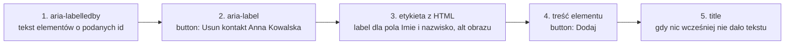

# Dostępność: co czytnik ekranu wie o stronie

## Drzewo, z którego korzysta czytnik ekranu

**Czytnik ekranu** (*screen reader*) to program zamieniający zawartość strony na mowę albo pismo Braille'a. Nie ogląda układu strony ani kolorów. Dostaje od przeglądarki osobną strukturę, którą MDN opisuje tak:

> **„Przeglądarki zamieniają znaczniki na wewnętrzną reprezentację zwaną drzewem DOM. […] Następnie na podstawie drzewa DOM tworzą drzewo dostępności, z którego korzystają interfejsy dostępności danej platformy, żeby dostarczyć reprezentację zrozumiałą dla technologii wspomagających, takich jak czytniki ekranu.”**
>
> *„Browsers convert markup into an internal representation called the DOM tree. […] Browsers then create an accessibility tree based on the DOM tree, which is used by platform-specific Accessibility APIs to provide a representation that can be understood by assistive technologies, such as screen readers.”*
>
> — MDN, *Accessibility tree*

Element, którego nie ma w **drzewie dostępności** (*accessibility tree*), dla osoby z czytnikiem nie istnieje. Według MDN każdy obiekt w tym drzewie ma cztery właściwości. **Nazwa** mówi, jak się do elementu odwołać, a **rola** mówi, czym element jest: przyciskiem, polem tekstowym, listą. Te dwie wystarczają, żeby element znaleźć, i dlatego zapytanie `getByRole` przyjmuje właśnie rolę i nazwę. **Opis** daje dodatkową informację, na przykład wskazówkę albo komunikat błędu powiązany z polem. **Stan** opisuje bieżący stan elementu, na przykład zaznaczenie pola wyboru albo rozwinięcie menu.

W `contacts-app` żaden element nie ustawia opisu ani stanu, a testy projektu pytają wyłącznie o nazwę i rolę. Skrót **`a11y`** oznacza *accessibility*: między „a” i „y” stoi 11 liter.

## Semantyka HTML robi większość pracy

Większość elementów HTML dostaje rolę domyślną od samej przeglądarki: `<button>` ma rolę `button`, `<ul>` rolę `list`, `<li>` rolę `listitem`, `<h1>` rolę `heading`. Element `<button>` przychodzi też z możliwością otrzymania fokusu i obsługą klawiszy Enter i Spacja. Zapis `<div onClick>` nie ma żadnej z tych rzeczy. Czytnik ogłosi go jako zwykły tekst, a klawisz Tab go ominie.

**ARIA** (*Accessible Rich Internet Applications*) to zestaw atrybutów, które dopisują do drzewa dostępności role, nazwy i stany. Barklund w *React in Depth* opisuje specyfikację WAI-ARIA jako opis tego, jak elementy strony mogą być rozumiane i obsługiwane w sposób niewizualny. MDN przytacza zasadę, którą nazywa pierwszą regułą stosowania ARIA.

> **„Jeśli można użyć natywnego elementu lub atrybutu HTML, który ma już wbudowaną potrzebną semantykę i zachowanie, zamiast zmieniać przeznaczenie innego elementu i dodawać mu rolę, stan lub właściwość ARIA, żeby był dostępny, to należy tak zrobić.”**
>
> *„If you can use a native HTML element or attribute with the semantics and behavior you require already built in, instead of re-purposing an element and adding an ARIA role, state or property to make it accessible, then do so.”*
>
> — MDN, *ARIA*

Ta sama strona przytacza powiedzenie „No ARIA is better than bad ARIA”. Podaje też wynik badania WebAIM ponad miliona stron głównych: strony z ARIA miały średnio o 41% więcej wykrytych błędów niż strony bez niej. Atrybut `role="button"` na `<div>` każe czytnikowi ogłosić przycisk, ale nie dodaje obsługi klawiatury. Użytkownik słyszy „przycisk”, naciska Enter i nic się nie dzieje.

## Nazwy dla elementów, które ich nie mają

`contacts-app` używa natywnych elementów: `<main>`, `<section>`, `<ul>`, `<button>`, `<label>` i `<input>`. Przycisk usuwania ma nazwę z `aria-label`. Trzem innym elementom nazwy brakuje, więc dostają ją tym samym atrybutem. W `components/ContactList.jsx` zmienia się otwierający znacznik listy:

```jsx
const ContactList = memo(function ContactList({ contacts, onDelete }) {
  return (
    // nazwa odróżnia listę kontaktów od listy kategorii w statystyce
    <ul aria-label="Lista kontaktow">
      {contacts.map((contact) => (
        <ContactItem key={contact.id} contact={contact} onDelete={onDelete} />
      ))}
    </ul>
  );
});
```

W `components/ContactStats.jsx` zmienia się znacznik `<section>`, a w `app/page.jsx` znacznik `<main>`. Obliczenia i zawartość obu elementów zostają bez zmian:

```jsx
// components/ContactStats.jsx: sekcja z nazwą staje się w drzewie regionem
<section aria-label="Statystyki kontaktow">
  {/* licznik i lista kategorii bez zmian */}
</section>

// app/page.jsx: główny obszar strony
<main aria-label="Contacts application">
  {/* statystyka, wyszukiwarka, lista i formularz bez zmian */}
</main>
```

Każda nazwa ma inne zadanie. **`<main>`** to **punkt orientacyjny** (*landmark*), czyli obszar, do którego użytkownik czytnika przeskakuje jednym skrótem klawiszowym. **`<section>` z nazwą** staje się w drzewie regionem, więc czytnik może ogłosić „Statystyki kontaktow” przy wejściu do niego. Sama nazwa decyduje tu o roli: `<section>` bez nazwy roli `region` nie ma, więc `queryByRole('region')` zwraca dla niej `null`. **Lista z nazwą** pozwala odróżnić listę kontaktów od listy kategorii w statystyce, bo obie są elementami `<ul>`.

Etykietę listy sprawdza trzeci test w `__tests__/ContactList.test.jsx`:

```jsx
test('list has accessible label', () => {
  render(<ContactList contacts={contacts} onDelete={() => {}} />);
  // rola list i nazwa z aria-label
  expect(screen.getByRole('list', { name: /lista kontaktow/i })).toBeInTheDocument();
});
```

Raport pokazuje teraz `Test Files  4 passed (4)` i `Tests  13 passed (13)`. Usunięcie `aria-label` z `<ul>` zmienia wynik tego testu na czerwony.

## Rysunek 6.12 — skąd przeglądarka bierze nazwę dostępną



Rysunek 6.12 pokazuje kolejność, w jakiej specyfikacja W3C *Accessible Name and Description Computation 1.2* szuka **nazwy dostępnej** (*accessible name*) elementu. Pierwsze źródło, które da niepusty tekst, wygrywa, a dalszych przeglądarka już nie sprawdza. Dlatego przycisk „Usun” ma w drzewie nazwę z `aria-label`, a widoczny napis do nazwy nie wchodzi. Atrybut `title` stoi na końcu, bo specyfikacja używa go tylko wtedy, gdy nic innego, łącznie z treścią elementu, nie dało wyniku. Ta sama specyfikacja wymienia role, którym nazw nadawać nie wolno.

MDN dodaje dwie wskazówki. Najlepszą nazwą jest tekst widoczny na ekranie (*„It is best to use visible text as the accessible name”*), a nazwy elementów powinny być na stronie unikalne. Sekcja statystyk nie ma nagłówka, więc jej nazwa istnieje tylko w atrybucie. Wersja z widocznym nagłówkiem daje tę samą rolę i nazwę widoczną dla wszystkich:

```jsx
// nazwa sekcji z widocznego nagłówka: aria-labelledby wskazuje jego id
<section aria-labelledby="stats-title">
  <h2 id="stats-title">Statystyki</h2>
</section>
// getByRole('region', { name: 'Statystyki' }) znajduje tę sekcję
```

Projekt demo zostaje przy `aria-label`. Przycisk usuwania spełnia kryterium 2.5.3 *Label in Name* z **WCAG** (*Web Content Accessibility Guidelines*), wytycznych W3C, które opisują dostępność stron jako listę numerowanych, sprawdzalnych kryteriów. Według W3C nazwa kontrolki z widocznym napisem ma zawierać ten napis, najlepiej na początku. Nazwa „Usun kontakt Anna Kowalska” zaczyna się od „Usun”, więc osoba sterująca komputerem głosem mówi „Usun” i program rozpoznawania mowy znajduje przycisk.

## Komunikat, który czytnik ma ogłosić sam

Treść, która zmienia się bez przeładowania strony, czytnik ogłasza tylko wtedy, gdy leży w **regionie na żywo** (*live region*), czyli fragmencie strony obserwowanym pod kątem zmian. Dwie role tworzą taki region. Rola `alert` odpowiada według MDN atrybutom `aria-live="assertive"` i `aria-atomic="true"`: czytnik przerywa bieżące czytanie i odczytuje cały region. Rola `status` odpowiada `aria-live="polite"`: czytnik czeka, aż skończy bieżące zdanie. Komunikat błędu walidacji dostaje więc rolę `alert`, a potwierdzenie zapisu rolę `status`.

`AddContactForm` wyświetla błąd zapisem `{error && <p role="alert">{error}</p>}`. Taki zapis tworzy element od razu z treścią, a MDN ostrzega przed tym wprost:

> **„Nie należy dynamicznie dodawać ani generować elementu z `role="alert"`, który już zawiera komunikat do ogłoszenia; zwykle nie prowadzi to do ogłoszenia, bo nie jest zmianą treści.”**
>
> *„Do not try to dynamically add/generate an element with role="alert" that is already populated with the alert message you want announced - this generally does not lead to an announcement, as it is not a content change.”*
>
> — MDN, *ARIA: alert role*

Ogłoszenie następuje tylko po zmianie treści elementu, który już był w dokumencie. Poprawką jest region obecny zawsze, z pustym tekstem, gdy błędu nie ma:

```jsx
// region istnieje od pierwszego renderu; zmienia się tylko jego treść
<p role="alert">{error}</p>
```

Test `getByRole('alert')` przechodzi w obu wersjach, bo sprawdza rolę i treść, a nie ogłoszenie. W kodzie demo zostają świadomie dwa błędy dostępności. Pierwszy to alert tworzony od razu z treścią. Drugi dotyczy języka. Plik `app/layout.jsx` deklaruje `<html lang="pl">`, a MDN wyjaśnia, że atrybut `lang` służy przede wszystkim temu, żeby technologie wspomagające użyły właściwej wymowy. Nazwa `"Contacts application"` na `<main>` jest jednak po angielsku, więc polski syntezator przeczyta ją z polską wymową. <u>Nazwy w atrybutach `aria-*` pisze się w języku strony</u>, a fragmenty w innym języku oznacza się własnym atrybutem `lang`.

## Nagłówki strony

Strona `contacts-app` ma dwa nagłówki: `<h1>` z nazwą aplikacji i `<h2>` „Dodaj kontakt” w formularzu. MDN zaleca jeden `<h1>` na stronie i kolejne poziomy bez przeskoków. Uzasadnia to sposobem pracy z czytnikiem: użytkownik przeskakuje od nagłówka do nagłówka, żeby poznać zawartość strony, a przeskok z `<h1>` od razu do `<h3>` każe mu szukać brakującego poziomu.

## Klawiatura i kolejność fokusu

Fokus przechodzi klawiszem Tab przez elementy w kolejności kodu HTML: pole wyszukiwania, pięć przycisków „Usun”, trzy pola formularza i przycisk „Dodaj”. Do pola „Imie i nazwisko” trzeba nacisnąć Tab siedem razy, a do przycisku „Dodaj” dziesięć. Atrybut `tabIndex` zmienia tę kolejność:

```jsx
<button>A</button>
<div tabIndex={0}>B</div>   {/* dołącza do kolejki Tab */}
<div tabIndex={-1}>C</div>  {/* fokus tylko z kodu, metodą focus() */}
<button>D</button>
// trzy naciśnięcia Tab: A, B, D
```

`user.tab()` z `user-event` przechodzi w tym przykładzie kolejno przez A, B i D, a element C pomija. MDN zaleca używać tylko `0` i `-1`, bo wartości większe od zera utrudniają nawigację osobom korzystającym z klawiatury. Fokus musi też być widoczny. Reguła `outline: none` usunęłaby obrys ze wszystkich przycisków i pól. Pseudoklasa `:focus-visible` pokazuje go tylko wtedy, gdy przeglądarka uzna to za potrzebne, na przykład przy nawigacji klawiaturą.

Przy obsłudze klawiaturą widać w `contacts-app` jeden problem z fokusem. Po Tab do przycisku „Usun kontakt Anna Kowalska” i naciśnięciu Enter React usuwa wiersz razem z przyciskiem, który miał fokus. Fokus trafia na `<body>`, więc obrys znika. Następny Tab przenosi w Chromium fokus na przycisk Piotra, ale do tego czasu fokus nie wskazuje żadnego elementu. Poprawką byłoby przeniesienie fokusu z kodu, przez ref i `focus()`, na następny przycisk albo na nagłówek listy.

> 💡 **Zapamiętaj:** najpierw właściwy element HTML, potem nazwa dla tego, co jej nie ma, najlepiej z widocznego tekstu i w języku strony. Komunikat, który czytnik ma ogłosić, stoi w regionie na żywo obecnym od pierwszego renderu.


Materiał rozszerzony do tego slajdu: [`rozszerzenia/r12_dostepnosc.md`](rozszerzenia/r12_dostepnosc.md)
