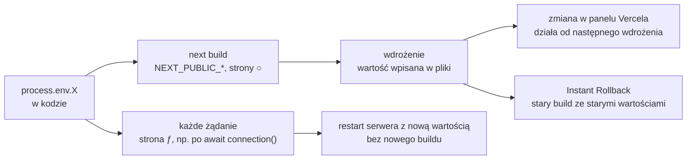

# Build, zmienne środowiskowe i wdrożenie na Vercel

## Wersja, którą dostaje użytkownik

Serwer deweloperski kompiluje każdą trasę dopiero przy pierwszym otwarciu, dokłada odświeżanie modułów po zapisie pliku i komunikaty dla programisty. Użytkownik dostaje inną wersję: zbudowaną raz, bez narzędzi deweloperskich, uruchomioną na serwerze. **Build** (*build*) to krok, który z kodu źródłowego robi tę wersję. W `contacts-app` uruchamia go skrypt `build` z `package.json`, czyli polecenie `next build`. Dla Next.js 16.4.0 raport wygląda tak:

```
▲ Next.js 16.4.0 (Turbopack)
✓ Running next.config.mjs took 16ms
  Creating an optimized production build ...
✓ Compiled successfully in 188ms
  Running TypeScript ...
  Finished TypeScript in 1ms ...
  Collecting page data using 4 workers ...
✓ Generating static pages using 4 workers (3/3) in 557ms
  Finalizing page optimization ...

Route (app)
┌ ○ /
└ ○ /_not-found

○  (Static)  prerendered as static content
```

Czasy i liczba procesów roboczych (*workers*) zależą od komputera. Kolejne linie raportu mówią o trzech krokach:

1. **`▲ Next.js 16.4.0 (Turbopack)`** podaje wersję i narzędzie budujące. Turbopack to bundler Next.js, czyli narzędzie składające pliki źródłowe w paczki dla przeglądarki i serwera; od Next.js 16 build domyślnie korzysta z niego.
2. **`Running TypeScript ...`** to krok sprawdzania typów. Projekt jest w JavaScripcie, więc nie ma tu czego sprawdzać. W projekcie w TypeScripcie błąd typów zatrzymałby build w tym miejscu.
3. **`Generating static pages`** to prerendering, czyli wyrenderowanie stron do gotowego HTML-a już w czasie buildu. Obie trasy mają symbol `○`, oznaczający stronę statyczną. Stan początkowy z `initialContacts` trafia do HTML-a strony `/`, a przeglądarka po załadowaniu skryptów przejmuje wyszukiwanie i formularz. Trasa `/_not-found` to strona błędu 404 dodawana przez Next.js. Licznik `(3/3)` obejmuje jeszcze stronę `/_global-error`, której tabela tras nie wymienia.

Zbudowaną aplikację uruchamia lokalnie skrypt `start`, czyli `next start`. Zmianę, która ma trafić do użytkowników, sprawdza się na tej parze poleceń. Tryb deweloperski kompiluje trasę dopiero przy pierwszym otwarciu, więc błąd w trasie, której nikt nie otworzył, przepuści, a build sprawdza wszystkie trasy naraz.

## Zmienne środowiskowe

Wartości zależne od miejsca uruchomienia, takie jak adres API albo klucz usługi, trafiają do **zmiennych środowiskowych** (*environment variables*), czyli par nazwa–wartość, które system przekazuje procesowi przy starcie. Kod czyta je przez obiekt `process.env`. Next.js dokłada do tego pliki `.env*` w katalogu głównym projektu. W `contacts-app` nazwa aplikacji przychodzi z pliku `.env.local`:

```bash
# .env.local: plik poza repozytorium, z wartościami dla tego komputera
NEXT_PUBLIC_APP_NAME=Contacts
```

Wartość odczytuje nagłówek w `app/page.jsx`:

```jsx
      {/* || daje wartość zapasową, gdy zmienna nie jest ustawiona */}
      <h1>{process.env.NEXT_PUBLIC_APP_NAME || 'Kontakty'}</h1>
```

Z plikiem `.env.local` nagłówek pokazuje „Contacts”, a raport buildu ma pod pierwszą linią wpis `- Environments: .env.local`. Bez pliku nagłówek zostaje przy „Kontakty”. Plik `.env.local` nie trafia do repozytorium, bo obejmuje go wpis w `.gitignore`. Kolejność szukania zmiennej jest stała: najpierw `process.env`, potem `.env.$(NODE_ENV).local`, `.env.local`, `.env.$(NODE_ENV)` i na końcu `.env`. Gdy `NODE_ENV` nie jest ustawione, `next dev` przyjmuje `development`, a pozostałe polecenia `production`. Przy `NODE_ENV=test` plik `.env.local` jest pomijany, bo testy mają dawać ten sam wynik każdemu (*„you expect tests to produce the same results for everyone”*).

## `NEXT_PUBLIC_`: wartość wklejona w czasie buildu

Zmienne bez prefiksu istnieją tylko na serwerze. Zmienne z prefiksem `NEXT_PUBLIC_` trafiają do przeglądarki w sposób, który ma skutki dla wdrożenia:

> **„Żeby udostępnić wartość zmiennej środowiskowej w przeglądarce, Next.js może „wkleić” wartość, w czasie buildu, do paczki JavaScript wysyłanej do klienta, zastępując wszystkie odwołania do `process.env.[variable]` wpisaną na sztywno wartością.”**
>
> *„In order to make the value of an environment variable accessible in the browser, Next.js can "inline" a value, at build time, into the js bundle that is delivered to the client, replacing all references to process.env.[variable] with a hard-coded value.”*
>
> — dokumentacja Next.js, *Environment Variables*

Przy buildzie Next.js podmienia każde wystąpienie `process.env.NEXT_PUBLIC_APP_NAME` na napis `"Contacts"`, który ląduje w pliku z `.next/static/chunks/`. Przeglądarka nigdy nie widzi zmiennej, dostaje gotowy tekst. Wynikają z tego trzy skutki. Klucz zapisany jako `NEXT_PUBLIC_API_KEY` jest publiczny, bo każdy może pobrać ten plik. Zmiana wartości wymaga nowego buildu, bo według dokumentacji zbudowana aplikacja przestaje reagować na zmiany tych zmiennych (*„will no longer respond to changes to these environment variables”*). Odczyt dynamiczny nie działa: dokumentacja podaje dwa przykłady, których Next.js nie podmienia, `process.env[varName]` i odczyt przez zmienną pomocniczą `const env = process.env`.

## Rysunek 6.13 — kiedy zmienna dostaje wartość



Rysunek 6.13 łączy obie drogi z wdrożeniem. Górą idą kod klienta i strona statyczna `○`, dołem strona dynamiczna `ƒ`, renderowana przy każdym żądaniu, na przykład po wywołaniu `await connection()` z `next/server`. <u>Wartość ustalona w `next build` należy od tej chwili do plików wdrożenia</u>, a Instant Rollback, czyli powrót do wcześniejszego wdrożenia bez nowego buildu, przywraca ją razem ze starym buildem. Wartość czytaną przy żądaniu na własnym serwerze z `next start` zmienia restart procesu z nową wartością, bez nowego buildu. Na Vercelu zmianę zmiennej obejmuje dopiero nowe wdrożenie.

## Wdrożenie na Vercel

**Wdrożenie** (*deployment*) to umieszczenie zbudowanej aplikacji na serwerze, z którego korzystają użytkownicy. Dokumentacja Next.js wymienia serwer Node.js, kontener Dockera, eksport statyczny i adaptery platform. Pierwsze dwa obsługują wszystkie funkcje frameworka. Daniel Bugl w *Modern Full-Stack React Projects* wskazuje drogę najprostszą:

> **„Najłatwiej wdrożyć aplikację Next.js na platformie Vercel, udostępnianej przez firmę, która rozwija framework Next.js.”**
>
> *„The easiest way to deploy Next.js apps is by using the Vercel platform, provided by the company that develops the Next.js framework.”*
>
> — Daniel Bugl, *Modern Full-Stack React Projects*

Vercel sam rozpoznaje projekt Next.js i uruchamia to samo `next build`, które działa lokalnie. Platforma rozróżnia dwa rodzaje wdrożeń. **Production** to wersja, którą widzą użytkownicy. Według dokumentacji Vercela powstaje po zmianach na gałęzi produkcyjnej albo po poleceniu `vercel --prod`. **Preview** służy do sprawdzania zmian bez wpływu na produkcję i ma własny adres. Powstaje po commicie na innej gałęzi, dla pull requestu, czyli prośby o włączenie zmian do gałęzi głównej, i po samym `vercel`. Dokumentacja zaznacza wyjątek: pierwsze wdrożenie nowego projektu jest zawsze produkcyjne.

Plik `.env.local` nie trafia do repozytorium, więc Vercel go nie widzi. Zmienne ustawia się w ustawieniach projektu na platformie, osobno dla Production, Preview i Development, a polecenie `vercel env pull` pobiera je do lokalnego `.env.local`. Dokumentacja Vercela stawia regułę, która wynika wprost z Rysunku 6.13:

> **„Żadna zmiana zmiennych środowiskowych nie jest stosowana do wcześniejszych wdrożeń; dotyczy tylko nowych wdrożeń.”**
>
> *„Any change you make to environment variables are not applied to previous deployments, they only apply to new deployments.”*
>
> — dokumentacja Vercela, *Environment Variables*

Zmienna skopiowana z `.env.local` może na platformie wskazywać złe miejsce. Bugl opisuje build, który na Vercelu padł, bo `DATABASE_URL` wskazywał `localhost`, czyli maszynę budującą, na której bazy nie było.

## Lista kontaktów po drugiej stronie

Na serwer trafia wersja z `next build`, sprawdzona wcześniej lokalnie przez `next start`, z nazwą aplikacji wpisaną w pliki i statyczną stroną `/`. Dane kontaktów nadal żyją tylko w pamięci przeglądarki i giną po przeładowaniu strony.

## Rozszerzenie: czego w raporcie już nie ma

Starsze raporty miały przy każdej trasie kolumny `Size` i `First Load JS`. Przewodnik aktualizacji podaje powód ich usunięcia:

> **„Next.js 16 usuwa z wyniku `next build` metryki `size` i `First Load JS`. Uznaliśmy je za niedokładne w architekturach sterowanych przez serwer, opartych na React Server Components.”**
>
> *„Next.js 16 removes the size and First Load JS metrics from the next build output. We found these to be inaccurate in server-driven architectures using React Server Components.”*
>
> — dokumentacja Next.js, *Upgrading: Version 16*

Ten sam przewodnik wskazuje następców. Rzeczywistą wydajność trasy najskuteczniej mierzą według niego narzędzia oparte na Core Web Vitals i rozmiarze pobranych zasobów, takie jak Chrome Lighthouse albo Vercel Analytics. Do analizy samych paczek służy od wersji 16.1 polecenie `next experimental-analyze`. Lintera build nie uruchamia.

## Rozszerzenie: zmienne czytane przy każdym żądaniu

Zmienna serwerowa też nie zawsze jest czytana na żywo. Strona statyczna wykonuje swój kod w `next build`, więc odczytana tam wartość zostaje w gotowym HTML-u. Dokumentacja wskazuje drogę do wartości z chwili żądania: zmienne środowiskowe można bezpiecznie czytać na serwerze podczas renderowania dynamicznego (*„You can safely read environment variables on the server during dynamic rendering”*). Trasę dynamiczną, oznaczaną w raporcie symbolem `ƒ` i renderowaną przy każdym żądaniu, wymusza wywołanie `await connection()` z `next/server`. Poniższe dwie strony nie należą do `contacts-app` i różnią się tylko tym wywołaniem:

```jsx
// app/frozen/page.jsx: strona statyczna, kod wykonuje się w next build
export default function FrozenPage() {
  return <p>Region: {process.env.APP_REGION || 'brak'}</p>;
}
```

```jsx
// app/runtime/page.jsx: connection() czeka na żądanie, więc strona jest dynamiczna
import { connection } from 'next/server';

export default async function RuntimePage() {
  await connection();
  return <p>Region: {process.env.APP_REGION || 'brak'}</p>;
}
```

Build z `APP_REGION=build-eu` oznacza w Next.js 16.4.0 trasy jako `○ /frozen` i `ƒ /runtime`. Serwer uruchomiony potem z `APP_REGION=start-us` pokazuje pod `/frozen` napis „Region: build-eu”, a pod `/runtime` napis „Region: start-us”. Według dokumentacji odczyt przy żądaniu pozwala przenosić jeden obraz Dockera, czyli spakowaną aplikację razem ze środowiskiem uruchomieniowym, między środowiskami z różnymi wartościami.

## Rozszerzenie: Instant Rollback i jego granice

Gdy po wdrożeniu produkcja przestaje działać, cofnięcie jest szybsze od poprawki. Dokumentacja Vercela opisuje **Instant Rollback** jako powrót do wcześniejszego wdrożenia produkcyjnego bez nowego buildu, uruchamiany z panelu albo poleceniem `vercel rollback`. Vercel kieruje domeny z powrotem na wybrane wdrożenie. Dokumentacja wymienia granice:

- **Konfiguracja może być nieaktualna.** Przywrócony build ma wartości zmiennych z chwili, gdy powstał.
- **Plan Hobby cofa tylko o jeden krok**, do bezpośrednio poprzedniego wdrożenia. Plany to poziomy konta na Vercelu; Pro i Enterprise pozwalają wybrać dowolne wcześniejsze wdrożenie produkcyjne.
- **Automatyczne przypisywanie domen zostaje wyłączone.** Nowe zmiany na gałęzi produkcyjnej nie zastępują przywróconej wersji, dopóki rollback nie zostanie cofnięty.

Rollback cofa kod, ale nie cofa danych. Jeśli nowa wersja zmieniła format zapisanych rekordów, stary kod może ich nie odczytać, więc wersję Preview sprawdza się także pod kątem tego, co aplikacja zapisuje.

## Rozszerzenie: poza Vercelem, tryb `standalone`

Na własnym serwerze z Node.js wystarczą `next build` i `next start`, ale `next start` wymaga całego katalogu `node_modules`. Ustawienie `output: 'standalone'` tworzy folder `.next/standalone` tylko z plikami potrzebnymi do uruchomienia:

```js
// next.config.mjs: build przygotowuje samodzielny folder do wdrożenia
/** @type {import('next').NextConfig} */
const nextConfig = { output: 'standalone' };

export default nextConfig;
```

Dla `contacts-app` folder ma 39 MB, wobec 406 MB całego `node_modules`. W środku leży minimalny `server.js`, uruchamiany poleceniem `node server.js` zamiast `next start`. Build nie kopiuje do tego folderu `public` ani `.next/static`, bo według dokumentacji powinien je obsługiwać CDN, czyli sieć serwerów dostarczających pliki statyczne. Serwer uruchomiony bez nich odpowiada na `/` kodem 200, ale plik skryptu z `/_next/static/chunks/` dostaje 404, więc strona nie ożywa. Oba foldery kopiuje się ręcznie obok `server.js`. Bugl buduje w tym trybie obraz Dockera i odsyła do przykładu `with-docker` w repozytorium Next.js. Projekt `contacts-app` z tego trybu nie korzysta.

> 💡 **Zapamiętaj:** zmienna z prefiksem `NEXT_PUBLIC_` i zmienna czytana na stronie statycznej dostają wartość w `next build` i trafiają do plików wdrożenia, więc klucz z tym prefiksem jest publiczny, a nowa wartość wymaga nowego buildu.

